# 🚀 AI Engineering en 10 Planetas: del Chatbot al Sistema Multiagente

## 🗺️ MAPA DE LA GUÍA

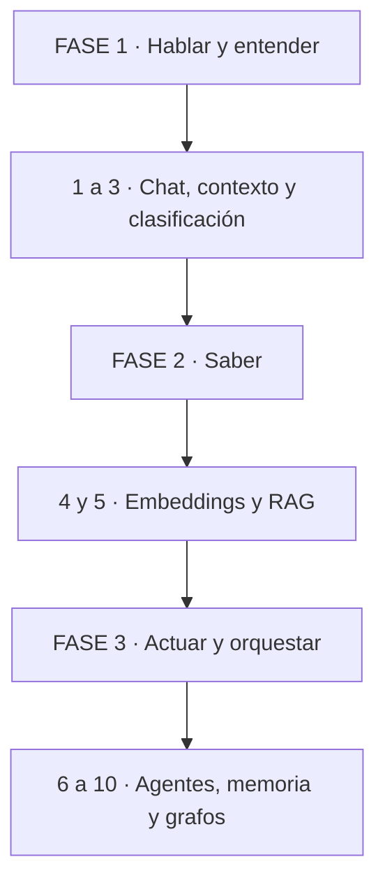

*Se lee de arriba hacia abajo. Primero el modelo conversa, después consulta tus documentos, y al final decide y coordina.*

| 🧩 Fase | ❓ Pregunta que responde | 📤 Resultado |
|---------|--------------------------|--------------|
| **FASE 1 · Hablar y entender** | ¿Cómo conversa y clasifica un LLM? | Chat con streaming y etiquetas |
| **FASE 2 · Saber** | ¿Cómo le doy mis documentos? | RAG sobre tus PDFs |
| **FASE 3 · Actuar y orquestar** | ¿Cómo decide y coordina? | Agente con memoria y multiagente |

> **🎯 Objetivo** — Terminás con el mapa completo de un stack de AI Engineering y con la capacidad de estimar tokens, costo y latencia de cada pieza antes de construirla.
> **⚠️ Advertencia** — Esta guía enseña criterio, no copiar y pegar. Cero código: acá se aprende a decidir qué construir y por qué.

---

## 🧠 PRE-ENTRENAMIENTO: 8 TÉRMINOS ANTES DE DESPEGAR

*Glosario declarado: se parte en dos tablas de 4 para no saturar.*

| 🏷️ Término | 📖 Qué es |
|-------------|-----------|
| **Token** | Ficha mínima de texto que el modelo cobra y procesa |
| **Tokenizer** | Máquina que corta el texto en tokens y los numera |
| **Ventana de contexto** | Mesa de trabajo: todo lo que el modelo puede mirar a la vez |
| **Embedding** | Coordenadas numéricas del significado de un texto |

| 🏷️ Término | 📖 Qué es |
|-------------|-----------|
| **Chunk** | Porción de documento que se indexa y se recupera |
| **Herramienta (tool)** | Función externa que el modelo puede pedir ejecutar |
| **Checkpoint** | Foto del estado de una conversación, guardada para retomar |
| **Grafo de estado** | Pasos conectados por vías, con una bandeja de datos que viaja |

*Se lee de arriba hacia abajo. Con estos 8 nombres ya podés seguir cualquier PARTE sin perderte.*

---

## 💬 PARTE 1: PLANETA 1 — EL CHATBOT QUE RESPONDE EN STREAMING (Nivel 1/5)

*🕒 Bloque del curso: 0:13:35*

### 1.1 ❓ PRETEST

Dos chats tardan 8 segundos en completar la misma respuesta. Uno muestra la primera palabra a los 0,3 s; el otro, a los 8 s. ¿Cuál se percibe más rápido?

> Respuesta esperada: el primero. La latencia percibida se mide por el tiempo hasta el primer token, no por el total.
> Si acertás: camino rápido → andá al punto 7.

### 1.2 🎯 POR QUÉ + LOGRO

Importa porque todo producto con LLM empieza siendo un chat: el streaming decide si se siente vivo o colgado. Vas a lograr **estimar tokens, costo y latencia de una conversación** antes de construirla.

### 1.3 ⚡ VICTORIA RÁPIDA (<5 min)

Escribí una frase tuya de 20 palabras y multiplicá por 1,35. Ese número es tu estimación de tokens. Ya sabés presupuestar.

### 1.4 💡 CONCEPTO

Analogía: el modelo no lee letras, juega al Scrabble con fichas ya cortadas.

Definición: el **token** es la unidad que el modelo cobra y procesa; el **tokenizer** corta el texto en esas fichas y las convierte en números. En español, 1 token ≈ 3–4 caracteres ≈ 0,75 palabras.

### 1.5 👀 EJEMPLO RESUELTO

Caso: bot de soporte, 500 conversaciones diarias de 6 turnos.

| Paso | Qué hacés | Número |
|------|-----------|--------|
| 1 Medís | prompt 40 + respuesta 180 tokens | 220 por turno |
| 2 Multiplicás | 220 × 6 × 500 | 660.000 tokens/día |
| 3 Cotizás | 660.000 ÷ 1.000.000 × US$0,10 | ≈ US$0,07/día |

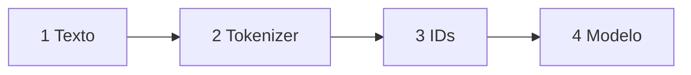

*Se lee de izquierda a derecha. El texto se corta en fichas, se numera, y recién ahí el modelo puede trabajar.*

El streaming no cambia los tokens: cambia **cuándo los ves**. El servidor manda cada ficha apenas la produce.

### 1.6 ⚠️ CONTRA-EJEMPLO / ERROR TÍPICO

Error: esperar la respuesta completa y recién ahí imprimirla. Los tokens son los mismos, pero el usuario mira una pantalla vacía 8 segundos.

Corrección: pedir streaming desde la primera llamada y pintar cada fragmento apenas llega.

### 1.7 🧪 PRÁCTICA

Estimá el costo mensual de un bot interno: 40 turnos por día, 300 tokens por turno, 22 días hábiles, a US$0,10 por millón.

> Respuesta esperada: 40 × 300 × 22 = 264.000 tokens → ≈ US$0,03 al mes. Si te dio miles de dólares, corriste la coma decimal.

### 1.8 🔁 RECALL — Nivel Bloom: Comprender

Sin mirar: ¿por qué el streaming mejora la percepción aunque no acelere el total?

> Respuesta: porque reduce el tiempo hasta el primer token visible.

### 1.9 📌 IDEA CLAVE

El token es la moneda; el primer token visible es la experiencia.

### 1.10 ✅ AUTO-CHEQUEO + SIGUIENTE

- [ ] Sé estimar tokens de un texto sin usar un tokenizer
- [ ] Sé convertir tokens a costo con una regla de tres
- [ ] Entiendo por qué el streaming se mide por el primer token

Siguiente: qué hacer cuando la charla ya no entra en la ventana.

---

## 🪟 PARTE 2: PLANETA 2 — CONTEXTO, HISTORIAL Y RESUMEN (Nivel 2/5)

*🕒 Bloque del curso: 0:13:35 – 0:56:00*

### 2.1 ❓ PRETEST

Tu bot responde bien la primera pregunta y olvida la segunda. ¿Le falta más parámetros, más memoria o más ventana?

> Respuesta esperada: memoria explícita. El modelo no recuerda nada entre llamadas: si no le mandás el historial, no existe.
> Si acertás: camino rápido → andá al punto 7.

### 2.2 🎯 POR QUÉ + LOGRO

Importa porque el 90% de los bugs de "el bot se olvidó" son de presupuesto de contexto, no del modelo. Vas a lograr **armar un presupuesto de ventana** y decidir cuándo recortar y cuándo resumir.

### 2.3 ⚡ VICTORIA RÁPIDA (<5 min)

Dibujá tres columnas: instrucciones, historial, respuesta. Asignales tokens que sumen menos que tu ventana: ese es tu presupuesto.

### 2.4 💡 CONCEPTO

Analogía: la ventana de contexto es la **mesa de trabajo**; el archivo del cajón es tu base de datos. Lo que no entra en la mesa, no existe para el modelo.

Definición: la **ventana de contexto** es el máximo de tokens que el modelo puede mirar en una llamada. Se llena con instrucciones, historial, documentos recuperados y la respuesta que va a escribir.

### 2.5 👀 EJEMPLO RESUELTO

Caso: ventana de 8.000 tokens, turno de 240.

| Pieza | Tokens | Regla |
|-------|--------|-------|
| Instrucciones | 300 | Fijas, nunca se recortan |
| Reserva de salida | 800 | Se aparta antes de todo |
| Historial disponible | 6.900 | 8.000 − 300 − 800 |
| Turnos que entran | ≈ 28 | 6.900 ÷ 240 |

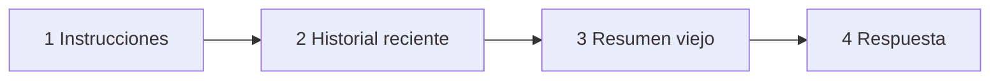

*Se lee de izquierda a derecha. Lo viejo se comprime en un resumen; lo reciente se manda completo.*

Estrategia de **ventana deslizante**: conservás los últimos N turnos completos. Estrategia de **resumen**: cuando el historial se pasa, lo reemplazás por un párrafo que condensa lo importante.

### 2.6 ⚠️ CONTRA-EJEMPLO / ERROR TÍPICO

Error: mandar todo el historial para "no perder nada". Pasado el límite, la API devuelve error o —peor— trunca en silencio y borra las instrucciones del sistema.

Corrección: reservar salida, recortar por turnos completos y resumir lo viejo antes de tocar el system prompt.

### 2.7 🧪 PRÁCTICA

Ventana de 4.000, instrucciones 400, reserva de salida 600, turno 250. ¿Cuántos turnos entran?

> Respuesta esperada: (4.000 − 400 − 600) ÷ 250 = 12 turnos. Con 12 exactos no queda margen: usá 11.

### 2.8 🔁 RECALL — Nivel Bloom: Aplicar

Un usuario dice "como te decía antes". ¿Qué tenés que haber guardado para que funcione?

> Respuesta: los turnos previos, ya sea completos o resumidos, dentro del presupuesto de la ventana.

### 2.9 📌 IDEA CLAVE

La memoria no es del modelo: la construís vos en cada llamada.

### 2.10 ✅ AUTO-CHEQUEO + SIGUIENTE

- [ ] Sé calcular cuántos turnos entran en mi ventana
- [ ] Distingo ventana deslizante de resumen
- [ ] Nunca recorto las instrucciones del sistema

Siguiente: ponerle etiquetas al texto sin entrenar nada.

---

## 🏷️ PARTE 3: PLANETA 3 — SENTIMIENTO Y CLASIFICACIÓN ZERO-SHOT (Nivel 2/5)

*🕒 Bloque del curso: 2:55:53 – 3:10:23*

### 3.1 ❓ PRETEST

¿Podés clasificar tickets en categorías que inventaste hoy, sin entrenar ningún modelo?

> Respuesta esperada: sí. La clasificación zero-shot puntúa cada etiqueta que le des contra el texto, sin ejemplos de entrenamiento.
> Si acertás: camino rápido → andá al punto 7.

### 3.2 🎯 POR QUÉ + LOGRO

Importa porque clasificar es la operación más barata y más rentable de un producto con IA: enrutar, priorizar, filtrar. Vas a lograr **diseñar etiquetas que el modelo acierte** y detectar cuándo el score miente.

### 3.3 ⚡ VICTORIA RÁPIDA (<5 min)

Tomá un mensaje real de tu bandeja y escribí tres etiquetas posibles. Ya tenés un clasificador en potencia.

### 3.4 💡 CONCEPTO

Analogía: el clasificador es una **etiquetadora** que le pone un puntaje a cada etiqueta y después elige la más alta.

Definición: **sentimiento** es un caso particular con dos o tres etiquetas (positivo, negativo, neutro). **Zero-shot** es clasificar con etiquetas nuevas usando un modelo que nunca las vio, apoyado en su comprensión del lenguaje.

### 3.5 👀 EJEMPLO RESUELTO

Caso: "El envío llegó roto y nadie me responde".

| Paso | Qué pasa | Resultado |
|------|----------|-----------|
| 1 Sentimiento | Modelo entrenado en reseñas | Negativo 0,998 |
| 2 Etiquetas | [facturación, envío, producto] | Envío 0,91 |
| 3 Decisión | Score alto y etiqueta clara | Enrutar a logística |
| 4 Registro | Guardás texto, etiqueta y score | Base para auditar |

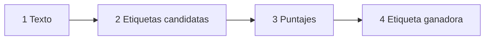

*Se lee de izquierda a derecha. No hay una respuesta "correcta" oculta: hay puntajes que compiten.*

### 3.6 ⚠️ CONTRA-EJEMPLO / ERROR TÍPICO

Error: usar 40 etiquetas o jerga interna ("devolución parcial P2"). Los puntajes se aplanan en 0,3 y el sistema elige casi al azar. Peor: tratar un 0,51 como certeza.

Corrección: 3 a 8 etiquetas, escritas en lenguaje natural, con un umbral de confianza y derivación a humano por debajo de él.

### 3.7 🧪 PRÁCTICA

Un banco quiere clasificar reclamos. Escribí 4 etiquetas y marcá cuál NO usarías.

> Respuesta esperada: tarjeta, transferencia, préstamo, app. No usarías "problema general": no discrimina nada y se come todos los casos dudosos.

### 3.8 🔁 RECALL — Nivel Bloom: Evaluar

¿Con qué evidencia decidís que una etiqueta funciona y no solo "parece"?

> Respuesta: con una muestra etiquetada a mano y la matriz de aciertos por etiqueta; el score promedio solo no alcanza.

### 3.9 📌 IDEA CLAVE

Clasificar es puntuar etiquetas que compiten, no adivinar una sola.

### 3.10 ✅ AUTO-CHEQUEO + SIGUIENTE

- [ ] Sé distinguir sentimiento de clasificación general
- [ ] Mis etiquetas están en lenguaje natural y son pocas
- [ ] Tengo un umbral para derivar a humano

Siguiente: convertir significado en números.

---

## 📐 PARTE 4: PLANETA 4 — EMBEDDINGS Y SIMILITUD COSENO (Nivel 2/5)

*🕒 Bloque del curso: 3:32:48*

### 4.1 ❓ PRETEST

¿Cómo sabe una computadora que "perro" se parece más a "cachorro" que a "factura"?

> Respuesta esperada: convierte cada palabra en un vector y mide el ángulo entre vectores; el coseno alto indica significado cercano.
> Si acertás: camino rápido → andá al punto 7.

### 4.2 🎯 POR QUÉ + LOGRO

Importa porque sin embeddings no hay búsqueda semántica ni RAG: es la pieza que traduce texto a geometría. Vas a lograr **interpretar un score de similitud** y calibrar tu umbral en vez de copiar uno de internet.

### 4.3 ⚡ VICTORIA RÁPIDA (<5 min)

Ordená de más a menos parecido: (a) "auto" y "coche", (b) "auto" y "banana", (c) "auto" y "camión". Guardá tu orden.

### 4.4 💡 CONCEPTO

Analogía: un embedding es la **dirección en un mapa de significados**; dos textos parecidos apuntan hacia el mismo lado.

Definición: **embedding** es un vector de cientos de números que representa el significado de un texto. La **similitud coseno** mide el ángulo entre dos vectores: 1 es misma dirección, 0 es independencia, −1 es oposición.

### 4.5 👀 EJEMPLO RESUELTO

Caso: buscador interno de artículos.

| Par de textos | Coseno | Lectura |
|---------------|--------|---------|
| "cómo cancelo mi plan" / "quiero dar de baja el servicio" | 0,89 | Duplicados semánticos |
| "cómo cancelo mi plan" / "precio del plan" | 0,62 | Mismo dominio, otra intención |
| "cómo cancelo mi plan" / "receta de milanesas" | 0,14 | Sin relación |

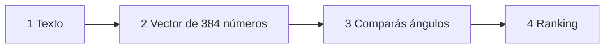

*Se lee de izquierda a derecha. Cada texto se vuelve una flecha; buscar es ordenar flechas por cercanía.*

### 4.6 ⚠️ CONTRA-EJEMPLO / ERROR TÍPICO

Error: usar producto punto con vectores sin normalizar. Los textos largos ganan siempre porque su vector es más grande, no más parecido.

Corrección: normalizar y usar coseno. Y no asumir que 0,7 significa "igual": el umbral depende del modelo y del idioma, se calibra con 20 pares reales.

### 4.7 🧪 PRÁCTICA

Tenés un buscador de soporte y recupera artículos de facturación cuando preguntan por envíos. ¿Qué revisás primero?

> Respuesta esperada: el umbral (quizá demasiado bajo) y la calidad del texto indexado (títulos genéricos).

### 4.8 🔁 RECALL — Nivel Bloom: Analizar

¿Por qué dos textos pueden tener coseno 0,8 y aun así no ser la misma respuesta?

> Respuesta: comparten tema y vocabulario, pero difieren en intención o en el dato concreto que el usuario necesita.

### 4.9 📌 IDEA CLAVE

El embedding no entiende: ordena por cercanía.

### 4.10 ✅ AUTO-CHEQUEO + SIGUIENTE

- [ ] Sé qué significa un coseno de 0,9 y uno de 0,2
- [ ] Normalizo vectores antes de comparar
- [ ] Calibro el umbral con pares reales, no con un número copiado

Siguiente: usar esa cercanía para responder con tus PDFs.

---

## 📚 PARTE 5: PLANETA 5 — RAG: CHATEAR CON TUS PDFS (Nivel 3/5)

*🕒 Bloque del curso: 3:32:48 – 5:13:34*

### 5.1 ❓ PRETEST

¿Por qué no pegar un PDF de 200 páginas directo en el prompt?

> Respuesta esperada: no entra en la ventana, cuesta caro en cada pregunta y diluye la atención del modelo. RAG trae solo los fragmentos relevantes.
> Si acertás: camino rápido → andá al punto 7.

### 5.2 🎯 POR QUÉ + LOGRO

Importa porque RAG es el patrón que convierte un chat genérico en un asistente de tu empresa. Vas a lograr **dimensionar chunking, indexado y recuperación** sin ahogar el contexto.

### 5.3 ⚡ VICTORIA RÁPIDA (<5 min)

Abrí un documento tuyo y marcá con lápiz dónde cortarías cada 600 tokens. Si los cortes caen en medio de una idea, ya viste el problema.

### 5.4 💡 CONCEPTO

Analogía: RAG es un **bibliotecario** que busca cuatro páginas y se las pasa a un redactor; el redactor no leyó la biblioteca.

Definición: **RAG** combina búsqueda por embeddings con generación. Partís el documento en **chunks**, los guardás en una base vectorial (por ejemplo Chroma) y en cada pregunta recuperás los K más cercanos para responder con ellos.

### 5.5 👀 EJEMPLO RESUELTO

Caso: manual de 120 páginas.

| Etapa | Decisión | Número |
|-------|----------|--------|
| 1 Chunking | 600 tokens con 15% de solape | ≈ 300 chunks |
| 2 Indexado | Un vector por chunk | 300 vectores |
| 3 Búsqueda | Top 4 por coseno | 4 chunks |
| 4 Respuesta | 4 × 500 + pregunta | ≈ 2.100 tokens |

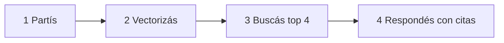

*Se lee de izquierda a derecha. El solape evita que una idea quede cortada entre dos chunks.*

### 5.6 ⚠️ CONTRA-EJEMPLO / ERROR TÍPICO

Error: chunks de 5.000 tokens (mezclan cinco temas y el vector promedio no representa ninguno) o de 50 (cortan la frase que daba sentido). Y subir el top a 20 "para no perder nada".

Corrección: 400–800 tokens con solape del 10–15%, top 4–6 y citar la fuente para poder auditar.

### 5.7 🧪 PRÁCTICA

¿Mismo tamaño de chunk para un FAQ y para un contrato legal?

> Respuesta esperada: no. El FAQ pide chunks chicos y autocontenidos; el contrato pide chunks más grandes con cláusula completa, porque una coma cambia el sentido.

### 5.8 🔁 RECALL — Nivel Bloom: Aplicar

El bot responde bien pero cita la página equivocada. ¿Dónde está el fallo?

> Respuesta: en los metadatos del chunk (fuente y página) o en el paso que arma la respuesta; la recuperación puede ser correcta.

### 5.9 📌 IDEA CLAVE

RAG no memoriza: recupera cuatro fragmentos y redacta con ellos.

### 5.10 ✅ AUTO-CHEQUEO + SIGUIENTE

- [ ] Mi chunk tiene una sola idea completa
- [ ] Uso solape y guardo fuente y página
- [ ] Puedo explicar por qué top 20 empeora la respuesta

Siguiente: dejar que el modelo use herramientas.

---

## 🛠️ PARTE 6: PLANETA 6 — AGENTES CON HERRAMIENTAS (Nivel 3/5)

*🕒 Bloque del curso: 5:26:02*

### 6.1 ❓ PRETEST

¿Qué convierte un chatbot en agente?

> Respuesta esperada: herramientas externas más un bucle de decisión: piensa, actúa, observa el resultado y repite.
> Si acertás: camino rápido → andá al punto 7.

### 6.2 🎯 POR QUÉ + LOGRO

Importa porque un agente deja de responder y empieza a resolver: busca, calcula, consulta tu base. Vas a lograr **describir herramientas que el modelo elija bien** y ponerle freno al bucle.

### 6.3 ⚡ VICTORIA RÁPIDA (<5 min)

Escribí tres acciones que tu bot no puede hacer solo. Cada una es una herramienta candidata.

### 6.4 💡 CONCEPTO

Analogía: el agente es un **pasante brillante con teléfono**: no sabe todo, pero sabe a quién llamar y qué preguntar.

Definición: una **herramienta** es una función con nombre, descripción y parámetros que el modelo puede pedir ejecutar. El patrón habitual es **ReAct**: razona, elige herramienta, recibe observación, vuelve a razonar.

### 6.5 👀 EJEMPLO RESUELTO

Caso: "¿Cuánto salió la última acción de una empresa y qué dicen las noticias?"

| Paso | Qué hace el agente | Resultado |
|------|--------------------|-----------|
| 1 Razona | Necesita precio y noticias | Plan de 2 llamadas |
| 2 Actúa | Llama a `precio_accion` | 148,20 |
| 3 Observa | Falta contexto | Llama a `buscar_noticias` |
| 4 Responde | Combina y cita | Respuesta final |

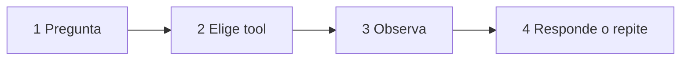

*Se lee de izquierda a derecha. Cada vuelta reenvía todo el contexto: por eso el costo crece con los pasos.*

### 6.6 ⚠️ CONTRA-EJEMPLO / ERROR TÍPICO

Error: descripciones vagas ("busca cosas") y sin tope de iteraciones. El agente elige la herramienta equivocada o entra en un bucle de 30 búsquedas que nadie frena.

Corrección: descripción con cuándo usarla y cuándo no, parámetros tipados, tope de 5 pasos y tiempo máximo por herramienta.

### 6.7 🧪 PRÁCTICA

Escribí la descripción de una herramienta `consultar_pedido` para un e-commerce.

> Respuesta esperada: "Devuelve estado y fecha estimada de un pedido a partir del número de pedido. Usala solo si el usuario dio un número; si no, pedilo antes de llamar."

### 6.8 🔁 RECALL — Nivel Bloom: Evaluar

¿Cómo sabés si el agente falló por la herramienta o por el razonamiento?

> Respuesta: mirando la traza: si la herramienta devolvió lo correcto y el agente la ignoró, falló el razonamiento; si devolvió vacío o error, falló la herramienta.

### 6.9 📌 IDEA CLAVE

El agente no sabe más: sabe pedir ayuda y verificarla.

### 6.10 ✅ AUTO-CHEQUEO + SIGUIENTE

- [ ] Cada herramienta dice cuándo usarse y cuándo no
- [ ] Tengo tope de pasos y de tiempo
- [ ] Leo la traza antes de culpar al modelo

Siguiente: obligarlo a devolver datos, no prosa.

---

## 📋 PARTE 7: PLANETA 7 — STRUCTURED OUTPUT CONFIABLE (Nivel 3/5)

*🕒 Bloque del curso: 5:26:02 – 7:22:32*

### 7.1 ❓ PRETEST

¿Por qué no conviene extraer datos de la respuesta con expresiones regulares?

> Respuesta esperada: porque el formato varía en cada respuesta. Un esquema obliga al modelo a llenar campos y la validación rechaza lo incompleto.
> Si acertás: camino rápido → andá al punto 7.

### 7.2 🎯 POR QUÉ + LOGRO

Importa porque todo lo que se conecta a un sistema real necesita campos, no párrafos. Vas a lograr **definir un esquema que el modelo respete** y qué hacer cuando no lo respeta.

### 7.3 ⚡ VICTORIA RÁPIDA (<5 min)

Escribí los cuatro campos que querés de una factura. Ese es tu esquema inicial.

### 7.4 💡 CONCEPTO

Analogía: el esquema es un **formulario con casillas**; el modelo llena casillas, no escribe una redacción.

Definición: **structured output** es pedirle al modelo una salida que cumpla un esquema (campos, tipos, obligatorios) y validarla antes de usarla. Si no cumple, se reintenta mostrando el error.

### 7.5 👀 EJEMPLO RESUELTO

Caso: extraer datos de facturas para contabilidad.

| Campo | Tipo | Obligatorio |
|-------|------|-------------|
| `proveedor` | texto | Sí |
| `total` | número | Sí |
| `moneda` | lista cerrada | Sí |
| `fecha` | fecha | No |

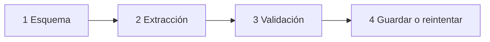

*Se lee de izquierda a derecha. La validación es la aduana: nada entra sin pasar.*

### 7.6 ⚠️ CONTRA-EJEMPLO / ERROR TÍPICO

Error: parsear prosa con regex. El modelo antepone "Aquí tienes tu JSON:", usa comillas tipográficas o cambia `total` por `monto`, y el sistema se cae.

Corrección: esquema impuesto, lista cerrada para campos críticos, reintento con el mensaje de error de validación y un camino de descarte que no rompa el flujo.

### 7.7 🧪 PRÁCTICA

Un turno médico necesita: paciente, motivo, urgencia y obra social. ¿Qué campo harías lista cerrada y por qué?

> Respuesta esperada: `urgencia` (baja, media, alta). Es el campo que dispara acciones y no admite texto libre. `obra social` también puede ser lista, pero necesita opción "otra".

### 7.8 🔁 RECALL — Nivel Bloom: Crear

Diseñá en una línea el reintento cuando la validación falla.

> Respuesta: se reenvía la respuesta inválida junto al error concreto y se pide corregir solo ese campo, con un máximo de dos intentos.

### 7.9 📌 IDEA CLAVE

Si necesitás un dato, pedí un formulario; no una redacción.

### 7.10 ✅ AUTO-CHEQUEO + SIGUIENTE

- [ ] Mi esquema distingue obligatorio de opcional
- [ ] Los campos críticos son listas cerradas
- [ ] Tengo reintento y camino de descarte

Siguiente: que la conversación sobreviva al reinicio.

---

## 💾 PARTE 8: PLANETA 8 — MEMORIA A LARGO PLAZO CON POSTGRESQL (Nivel 4/5)

*🕒 Bloque del curso: 5:26:02 – 7:22:32*

### 8.1 ❓ PRETEST

Reiniciás el servidor y el bot olvida a todos sus usuarios. ¿Dónde estaba la memoria?

> Respuesta esperada: en memoria RAM del proceso. Un checkpointer en memoria muere con el proceso; en PostgreSQL sobrevive.
> Si acertás: camino rápido → andá al punto 7.

### 8.2 🎯 POR QUÉ + LOGRO

Importa porque un asistente que olvida cada deploy no es un producto. Vas a lograr **elegir la clave de conversación** y separar memoria corta de memoria larga.

### 8.3 ⚡ VICTORIA RÁPIDA (<5 min)

Escribí qué identifica a una conversación en tu caso: ¿el usuario, el ticket o el dispositivo? Ese es tu `thread_id`.

### 8.4 💡 CONCEPTO

Analogía: el **checkpointer** es un cuaderno que anota el estado después de cada paso, con el nombre del dueño en la tapa.

Definición: un **checkpoint** guarda el estado del grafo y del historial bajo un identificador (`thread_id`). Memoria corta = ventana de contexto; memoria larga = base de datos consultada cuando hace falta.

### 8.5 👀 EJEMPLO RESUELTO

Caso: asistente de una clínica con tres canales.

| Decisión | Opción | Criterio |
|----------|--------|----------|
| Clave | `paciente_id` + canal | Retoma donde quedó |
| Almacén | PostgreSQL | Sobrevive deploys |
| Retención | 90 días | Datos de salud |
| Lectura | Últimos 10 turnos | Presupuesto de ventana |

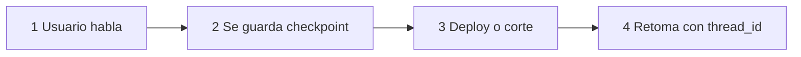

*Se lee de izquierda a derecha. El proceso puede morir en cualquier punto; el estado ya está afuera.*

### 8.6 ⚠️ CONTRA-EJEMPLO / ERROR TÍPICO

Error: usar el saver en memoria en producción. Cada deploy borra todo y el usuario vuelve a empezar. Peor: un `thread_id` global, donde todos comparten historial y se filtran datos entre clientes.

Corrección: almacén persistente, clave por usuario o conversación, y política de retención escrita.

### 8.7 🧪 PRÁCTICA

Un bot de soporte atiende 5.000 usuarios y varios tickets por usuario. ¿`thread_id` por usuario o por ticket?

> Respuesta esperada: por ticket. Cada ticket tiene su hilo; el historial del usuario es memoria larga aparte, no el hilo de la conversación.

### 8.8 🔁 RECALL — Nivel Bloom: Analizar

¿Qué diferencia hay entre "recordar la charla" y "recordar al usuario"?

> Respuesta: la charla es el hilo con checkpoints; el usuario es un perfil consultado aparte y resumido.

### 8.9 📌 IDEA CLAVE

La memoria sobrevive solo si vive fuera del proceso.

### 8.10 ✅ AUTO-CHEQUEO + SIGUIENTE

- [ ] Mi `thread_id` separa usuarios o tickets
- [ ] El almacén es persistente, no RAM
- [ ] Tengo retención y borrado definidos

Siguiente: dibujar el flujo completo como un grafo.

---

## 🕸️ PARTE 9: PLANETA 9 — LANGGRAPH: WORKFLOWS CON ESTADO (Nivel 4/5)

*🕒 Bloque del curso: 7:35:03*

### 9.1 ❓ PRETEST

¿Por qué un flujo de cinco pasos con revisiones no debería ser una cadena de condicionales?

> Respuesta esperada: porque necesitás estado compartido, rutas visibles, reanudación y un tope de vueltas. El grafo lo hace explícito.
> Si acertás: camino rápido → andá al punto 7.

### 9.2 🎯 POR QUÉ + LOGRO

Importa porque los flujos reales no son lineales: investigan, escriben, revisan y vuelven. Vas a lograr **modelar un ciclo de escritura y revisión** con estado y freno.

### 9.3 ⚡ VICTORIA RÁPIDA (<5 min)

Nombrá las estaciones de tu proceso en cuatro palabras: investigar, escribir, revisar, publicar.

### 9.4 💡 CONCEPTO

Analogía: el grafo es una **línea de montaje** con estaciones y una bandeja que viaja con la pieza.

Definición: en **LangGraph** cada **nodo** es una estación, cada **arista** es una vía y el **estado** es la bandeja compartida. Las aristas condicionales deciden el próximo paso según el estado.

### 9.5 👀 EJEMPLO RESUELTO

Caso: artículo con revisión automática.

| Nodo | Qué recibe | Qué deja |
|------|------------|----------|
| 1 Investigar | Tema | Fuentes |
| 2 Escribir | Tema + fuentes | Borrador |
| 3 Revisar | Borrador | Notas y veredicto |
| 4 Decidir | Veredicto | Publicar o reescribir |

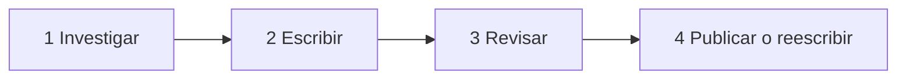

*Se lee de izquierda a derecha. La vuelta a escribir existe, pero se controla con un contador, no con la esperanza.*

### 9.6 ⚠️ CONTRA-EJEMPLO / ERROR TÍPICO

Error: dejar la revisión sin tope. El revisor nunca aprueba del todo y el grafo itera para siempre, quemando tokens. Otro clásico: acumular notas en una lista sin la función de acumulación y perder todas menos la última.

Corrección: máximo de 3 revisiones, criterio de aprobación escrito y acumulación explícita para listas del estado.

### 9.7 🧪 PRÁCTICA

Dibujá el grafo de un email de onboarding de tres pasos con una condición de salida.

> Respuesta esperada: 1 Redactar → 2 Verificar datos faltantes → 3 Enviar o pedir datos. La condición vive en el paso 2 y el estado guarda qué falta.

### 9.8 🔁 RECALL — Nivel Bloom: Crear

¿Qué guardarías en el estado para poder reanudar a mitad de camino?

> Respuesta: la entrada original, el borrador actual, el veredicto, el contador de vueltas y las fuentes usadas.

### 9.9 📌 IDEA CLAVE

El grafo hace visible el estado y el camino; el contador evita el laberinto.

### 9.10 ✅ AUTO-CHEQUEO + SIGUIENTE

- [ ] Distingo nodo, arista y estado
- [ ] Mi ciclo tiene tope y criterio de salida
- [ ] Sé qué guardar para reanudar

Siguiente: repartir el trabajo entre varios agentes.

---

## 🎼 PARTE 10: PLANETA 10 — SUPERVISOR MULTIAGENTE (Nivel 5/5)

*🕒 Bloque del curso: 7:35:03 – 8:21:31*

### 10.1 ❓ PRETEST

En un sistema con tres especialistas, ¿quién decide cuál habla primero y cuándo se termina?

> Respuesta esperada: el supervisor. Sin un coordinador, los agentes se pisan, repiten trabajo y no cierran.
> Si acertás: camino rápido → andá al punto 7.

### 10.2 🎯 POR QUÉ + LOGRO

Importa porque dividir un problema grande en especialistas es la única forma de mantener calidad con contextos acotados. Vas a lograr **asignar roles y un criterio de terminación** a un equipo de agentes.

### 10.3 ⚡ VICTORIA RÁPIDA (<5 min)

Elegí un problema tuyo y partilo en tres roles con una frase cada uno. Ya tenés el equipo.

### 10.4 💡 CONCEPTO

Analogía: el supervisor es el **jefe de cocina**: no cocina cada plato, pero decide el orden y cuándo sale.

Definición: el patrón **supervisor** usa un agente que enruta la tarea a especialistas, recibe el resultado y decide el siguiente paso hasta cumplir el objetivo. Cada derivación es un **handoff**.

### 10.5 👀 EJEMPLO RESUELTO

Caso: armar un informe de mercado.

| Rol | Recibe | Entrega |
|-----|--------|---------|
| Supervisor | Objetivo | Próximo paso |
| Investigador | Pregunta acotada | Datos con fuentes |
| Redactor | Datos | Borrador |
| Crítico | Borrador | Objeciones concretas |

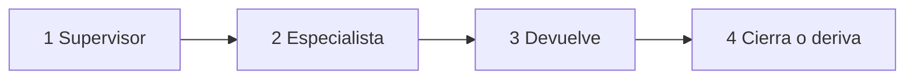

*Se lee de izquierda a derecha. Todo pasa por el supervisor: nadie habla a espaldas del jefe.*

### 10.6 ⚠️ CONTRA-EJEMPLO / ERROR TÍPICO

Error: dejar que los especialistas se hablen directo. La conversación deriva, se duplica el trabajo y nadie sabe quién decide. Y un supervisor sin criterio de fin reparte tareas eternamente.

Corrección: comunicación en estrella, un solo dueño del estado, máximo de 2 rondas y una definición explícita de "listo".

### 10.7 🧪 PRÁCTICA

Diseñá el equipo para un planificador de viajes: tres roles y qué NO debe hacer cada uno.

> Respuesta esperada: supervisor (decide y cierra), buscador de vuelos (solo datos de vuelo), curador de itinerario (arma el plan). Ninguno debe inventar precios ni reservar sin confirmación.

### 10.8 🔁 RECALL — Nivel Bloom: Evaluar

¿Cuándo un solo agente es mejor que un equipo de especialistas?

> Respuesta: cuando la tarea es corta, el contexto entra en una ventana y no hay roles realmente distintos; el equipo agrega latencia y costo.

### 10.9 📌 IDEA CLAVE

Multiagente no es más inteligencia: es división del trabajo con un jefe.

### 10.10 ✅ AUTO-CHEQUEO + SIGUIENTE

- [ ] Cada especialista tiene un alcance escrito
- [ ] Todo pasa por el supervisor
- [ ] Hay tope de rondas y definición de "listo"

Siguiente: mezclar todo en un solo sistema.

---

## 🧪 PRÁCTICA MIXTA FINAL — EL COPILOTO DE DOCUMENTACIÓN INTERNA

*Acá se mezclan los 10 planetas: no hay bloques por tema, hay un sistema completo.*

Diseñá un copiloto que responda con la documentación interna, cree tickets y escale a humano. Completá el mapa:

| Pieza | Planeta que usás | Decisión |
|-------|------------------|----------|
| Responder citando manuales | RAG (5) | Chunks de 600 y top 4 |
| Crear el ticket | Agente (6) | Herramienta `crear_ticket` |
| Devolver datos del ticket | Structured output (7) | Esquema con id y prioridad |
| Recordar al usuario | Memoria (8) | `thread_id` por usuario |

> Respuesta esperada / criterio: cada fila debe nombrar una pieza y una decisión concreta con número. Si escribiste "usar IA" en alguna, no cuenta.

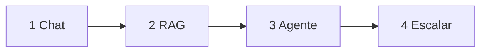

*Se lee de izquierda a derecha. El chat recupera, el agente actúa, y si no alcanza, deriva a una persona.*

---

## 🧾 AUTOEVALUACIÓN DE DOMINIO

- [ ] Puedo estimar tokens, costo y latencia de un chat sin escribir código
- [ ] Sé calcular cuántos turnos entran en una ventana y cuándo resumir
- [ ] Distingo similitud semántica de respuesta correcta
- [ ] Puedo explicar chunking, top-k y citas de un RAG
- [ ] Sé cuándo un agente necesita tope de pasos
- [ ] Elegí la clave de memoria correcta para mi caso
- [ ] Mi grafo tiene criterio de salida y contador
- [ ] Mi equipo de agentes tiene un solo dueño del estado

> **📌 Cierre** — Si marcaste 6 o más, ya pensás como AI Engineer: no preguntás "¿qué modelo uso?", preguntás "¿cuánto entra, cuánto cuesta y quién decide?".
> **⚠️ Último aviso** — El curso muestra el camino; la producción castiga lo que no medís. Instrumentá tokens, latencia y tasa de acierto desde el día uno.

---

## 🧭 SEGUIR EL CAMINO

- 📚 [Masterclass RAG](/blog/masterclass-rag/) — recuperación, embeddings y vectores a fondo
- 🕸️ [Masterclass LangGraph](/blog/guia-langgraph-masterclass/) — el grafo con código, nodo por nodo
- 🐍 [Python para IA](/blog/python-ia/) — el lenguaje con el que se construyen los 10 planetas
