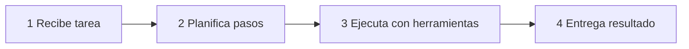

# MASTERCLASS: Agentes Autónomos — Coordinación de IA de Extremo a Extremo 🤖

## INTRODUCCIÓN: POR QUÉ LOS AGENTES NO SOLO CONVERSAN 🎯

Los agentes coordinan múltiples IA para realizar tareas complejas de extremo a extremo. A diferencia de un chatbot simple, un agente planifica, usa herramientas y ejecuta acciones sin intervención humana en cada paso.

> **Objetivo de Aprendizaje** 🎯 — Al terminar, sabrás qué es un agente de IA, cómo se diferencia de un chatbot y cómo diseñar un flujo de agente de varios pasos.

> **Advertencia educativa** ⚠️ — Esta guía es formativa. Los agentes autónomos son sistemas que orquestan modelos de lenguaje con herramientas externas.

## 🗺️ MAPA — Flujo de un Agente



*Se lee de izquierda a derecha. 4 pasos de contenido.*

## 🧩 PARTE 1: Agentes Autónomos (Nivel 1 / 1) 🤖

1. ❓ PRETEST — Antes de enseñar: ¿qué es un agente de IA en una frase?
   > Respuesta esperada: un sistema que usa un modelo de lenguaje para razonar, planificar y ejecutar tareas de extremo a extremo usando herramientas, sin intervención humana en cada paso.
   > Si lo sabés: camino rápido → punto 7.

2. 🎯 POR QUÉ + LOGRO — Importa porque los agentes coordinan varias IA para hacer tareas complejas que un solo prompt no puede resolver. Vas a lograr entender cómo varios agentes se reparten el trabajo.

3. ⚡ VICTORIA RÁPIDA (<5 min) — Pensá en una tarea de varios pasos (por ejemplo: leer un correo, consultar una base de datos y responder). Escribí esos tres pasos en orden. Eso ya es el diseño mental de un agente.
   📌 Un agente es un empleado especializado que se reparten el trabajo.

4. 💡 CONCEPTO — Analogía: un agente es como un empleado autónomo que recibe un objetivo, decide qué herramientas usar y avisa cuando termina. Definición: un sistema que orquesta uno o más modelos de IA para planificar y ejecutar tareas complejas usando herramientas externas (bases de datos, APIs, búsqueda web). Una idea nueva: los agentes no solo responden; actúan.

5. 👀 EJEMPLO RESUELTO — Caso: un agente que procese facturas de proveedores. Pasos: (1) el agente recibe el correo con la factura adjunta, (2) extrae los datos clave (monto, proveedor, fecha), (3) consulta la base de datos para verificar si el proveedor existe, (4) genera el pago o alerta si hay un error.
   ```mermaid
   flowchart LR
   A["1 Recibe factura"] --> B["2 Extrae datos"]
   B --> C["3 Verifica proveedor"]
   C --> D["4 Genera pago o alerta"]
   ```
   *Se lee de izquierda a derecha. 4 pasos de contenido.*

6. ⚠️ CONTRA-EJEMPLO / ERROR TÍPICO — Crear un agente que tome decisiones críticas (por ejemplo, aprobar pagos) sin revisión humana. Eso es riesgoso. Corrección: dejá siempre un paso de aprobación humana para acciones sensibles.

7. 🧪 PRÁCTICA — Escribí los tres pasos de un agente que lea un correo de cliente, consulte el estado del pedido y responda. (Contexto distinto: acá es diseño de flujo, no implementación.)
   > Respuesta esperada / criterio: tres pasos ordenados: leer correo, consultar estado, responder al cliente.

8. 🔁 RECALL — Sin mirar: ¿qué diferencia a un agente de un chatbot simple? (Nivel Bloom: comprender)
   > Respuesta esperada: el agente planifica y ejecuta acciones con herramientas; el chatbot solo responde conversando.

9. 📌 IDEA CLAVE — Los agentes coordinan IA para ejecutar tareas de extremo a extremo, no solo conversar.

10. ✅ AUTO-CHEQUEO + SIGUIENTE — [ ] Entendí qué es un agente. [ ] Vi el ejemplo de facturas. [ ] Conozco el error de falta de revisión humana. Siguiente: guía de MCP.

## ✅ CIERRE

Los agentes ejecutan tareas complejas de extremo a extremo. El siguiente paso es aprender MCP, el protocolo que conecta agentes con herramientas y datos de forma estandarizada.
