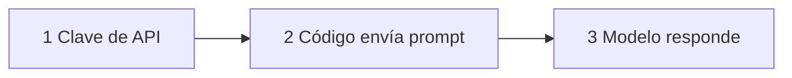

# MASTERCLASS: AI APIs — Integración con OpenAI y Anthropic desde Python 🔌

## INTRODUCCIÓN: POR QUÉ INTEGRAR MODELOS POR CÓDIGO 🎯

Usar una IA por chat es cosa de usuarios; llamarla desde código es cosa de ingeniero de IA. Las AI APIs permiten integrar modelos de OpenAI o Anthropic mediante Python para automatizar tareas reales.

> **Objetivo de Aprendizaje** 🎯 — Al terminar, sabrás qué se necesita para llamar a una AI API desde Python y cómo estructurar la petición.

> **Advertencia educativa** ⚠️ — Esta guía es formativa. OpenAI y Anthropic son proveedores de modelos de lenguaje; sus API requieren claves de acceso y cumplen términos de uso.

## 🗺️ MAPA — Llamada a una AI API



*Se lee de izquierda a derecha. 3 pasos de contenido.*

## 🧩 PARTE 1: AI APIs (Nivel 1 / 1) 🔌

1. ❓ PRETEST — Antes de enseñar: ¿qué necesitás para llamar a un modelo de OpenAI o Anthropic desde Python?
   > Respuesta esperada: una clave de API, la librería del proveedor y el código que hace la petición pasando el prompt y el modelo.
   > Si sabés los tres elementos: camino rápido → punto 7.

2. 🎯 POR QUÉ + LOGRO — Importa porque integrar modelos potentes por código es lo que diferencia a un usuario de un ingeniero de IA. Vas a lograr escribir el esqueleto de una llamada a una API de modelo.

3. ⚡ VICTORIA RÁPIDA (<5 min) — Entrá a la documentación de OpenAI o Anthropic y buscá el ejemplo de "chat completion" en Python. Leer las primeras cinco líneas es éxito.
   📌 La documentación es el primer paso antes de escribir código.

4. 💡 CONCEPTO — Analogía: las AI APIs son el enchufe por donde tu programa se conecta a la inteligencia del modelo sin tener que entrenarlo. Definición: interfaces que permiten enviar prompts y recibir respuestas de modelos como GPT o Claude mediante llamadas HTTP desde código. Una idea nueva: tu valor está en saber qué modelo elegir y cómo estructurar la petición.

5. 👀 EJEMPLO RESUELTO — Caso: necesitás clasificar si un correo es spam o no. Pasos: (1) preparás la clave de API, (2) escribís el código que envía el texto del correo al modelo con la instrucción de clasificar, (3) recibís la respuesta y la usá en tu aplicación.
   ```mermaid
   flowchart LR
   A["1 Clave de API lista"] --> B["2 Código envía el texto"]
   B --> C["3 Modelo responde spam/no spam"]
   ```
   *Se lee de izquierda a derecha. 3 pasos de contenido.*

6. ⚠️ CONTRA-EJEMPLO / ERROR TÍPICO — Enviar datos sensibles o personales de clientes a una API pública sin anonimizarlos. Eso viola privacidad. Corrección: nunca envíes datos sensibles a modelos externos sin consentimiento y sin revisar los términos del proveedor.

7. 🧪 PRÁCTICA — Escribí en palabras el esqueleto de una llamada a una AI API: qué necesitás (clave, librería, modelo, prompt) y qué recibís (respuesta).
   > Respuesta esperada / criterio: se identifican clave de API, librería, modelo, prompt de entrada y respuesta de salida.

8. 🔁 RECALL — Sin mirar: ¿qué se necesita para llamar a una AI API desde Python? (Nivel Bloom: recordar)
   > Respuesta esperada: clave de API, la librería del proveedor y el código que envía el prompt y recibe la respuesta.

9. 📌 IDEA CLAVE — Integrar modelos por API es lo que convierte un script en un sistema de IA.

10. ✅ AUTO-CHEQUEO + SIGUIENTE — [ ] Sé qué necesita una AI API. [ ] Entendí el ejemplo de clasificación. [ ] Conozco el error de datos sensibles. Siguiente: guía de Modelos locales.

## ✅ CIERRE

Las AI APIs te conectan con modelos potentes. El siguiente paso es aprender a correr modelos locales desde Hugging Face para tener privacidad y control total.
