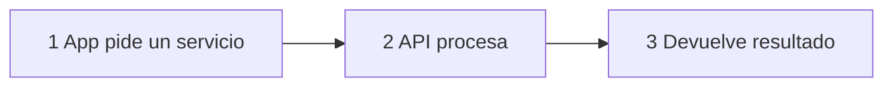

# MASTERCLASS: Arquitectura de APIs para Ingeniero de IA — Comunicación entre Sistemas 🌐

## INTRODUCCIÓN: POR QUÉ LAS APIs SON EL PUENTE 🎯

Las APIs permiten que los sistemas se comuniquen. Así como un cajero automático actúa como interfaz para un banco, las APIs permiten a las aplicaciones interactuar con modelos de IA de forma segura. Esta guía explica cómo funcionan y por qué son esenciales en IA.

> **Objetivo de Aprendizaje** 🎯 — Al terminar, sabrás qué es una API, cómo se comunican dos sistemas y por qué las APIs son el puente entre tu código y la inteligencia artificial.

> **Advertencia educativa** ⚠️ — Esta guía es formativa. Las APIs son una infraestructura de software estándar.

## 🗺️ MAPA — Flujo de una API



*Se lee de izquierda a derecha. 3 pasos de contenido.*

## 🧩 PARTE 1: Arquitectura de APIs (Nivel 1 / 1) 🌐

1. ❓ PRETEST — Antes de enseñar: ¿qué es una API en una frase?
   > Respuesta esperada: una interfaz que permite que dos programas se comuniquen y se intercambien datos de forma segura.
   > Si lo sabés: camino rápido → punto 7.

2. 🎯 POR QUÉ + LOGRO — Importa porque los modelos de IA no viven en tu computadora; se acceden a ellos mediante APIs. Vas a lograr entender cómo una aplicación pide un servicio a otro sistema.

3. ⚡ VICTORIA RÁPIDA (<5 min) — Abrí un navegador y visitá una URL pública de API que devuelva JSON. Ver los datos en pantalla es éxito.
   📌 Una API es como una ventana por donde un programa pide algo a otro.

4. 💡 CONCEPTO — Analogía: una API es el cajero automático que te deja pedir dinero al banco sin entrar a la oficina. Definición: un conjunto de reglas que define cómo dos sistemas se comunican, generalmente mediante HTTP y formatos como JSON. Una idea nueva: las APIs permiten que tu código use modelos de IA sin tener que instalarlos localmente.

5. 👀 EJEMPLO RESUELTO — Caso: una app de clima necesita mostrar la temperatura de una ciudad. Pasos: (1) la app envía el nombre de la ciudad a la API del servicio de clima, (2) la API procesa la petición, (3) devuelve la temperatura en JSON.
   ```mermaid
   flowchart LR
   A["1 App pide clima"] --> B["2 API procesa"]
   B --> C["3 Devuelve temperatura"]
   ```
   *Se lee de izquierda a derecha. 3 pasos de contenido.*

6. ⚠️ CONTRA-EJEMPLO / ERROR TÍPICO — Exponer claves de API directamente en el código subido a GitHub. Eso es un riesgo de seguridad grave. Corrección: guardá las claves en variables de entorno y nunca las subas al repositorio.

7. 🧪 PRÁCTICA — Describí con palabras el flujo de una aplicación que consulta una API de IA para resumir un texto. (Contexto distinto: acá es diseño de flujo, no código.)
   > Respuesta esperada / criterio: el flujo tiene petición, procesamiento por la API y devolución del resumen.

8. 🔁 RECALL — Sin mirar: ¿para qué sirve una API en el roadmap de IA? (Nivel Bloom: recordar)
   > Respuesta esperada: permite que tu aplicación se comunique con modelos de IA y otros sistemas de forma segura.

9. 📌 IDEA CLAVE — La API es el puente entre tu código y la inteligencia artificial.

10. ✅ AUTO-CHEQUEO + SIGUIENTE — [ ] Entendí qué es una API. [ ] Conocí el ejemplo cliente-servidor. [ ] Sé que las claves no se suben a GitHub. Siguiente: guía de Context Engineering.

## ✅ CIERRE

Las APIs conectan tu código con el mundo de la IA. El siguiente paso es aprender a darle contexto a los modelos mediante system y master prompts.
