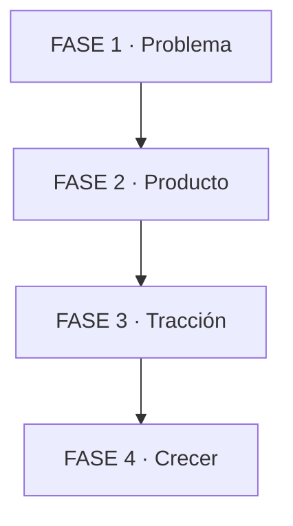

# MASTERCLASS: Casos Exitosos al Crear una Startup — De la Idea al Producto 🚀💡

## INTRODUCCIÓN: POR QUÉ ALGUNAS STARTUPS TRIUNFAN Y OTRAS FRACASAN 🎯

La mayoría de las startups no mueren por falta de tecnología, sino porque construyen algo que nadie quiere. Esta guía analiza casos exitosos y desarrolla los pasos que los fundadores repiten: validar un problema real, construir un producto mínimo, conseguir tracción, financiar y escalar sin romperse.

> **Objetivo de Aprendizaje** 🎯 — Al terminar, sabrás identificar un problema válido, definir un producto mínimo viable, medir tracción y conocer las etapas de financiación de una startup.

> **Advertencia educativa** ⚠️ — Esta guía es formativa. Los casos mencionados son referencias del mercado; cada contexto es distinto y no garantizan resultados similares.

## 🗺️ MAPA DE 4 FASES — Startup Exitosa



*Se lee de arriba hacia abajo. 4 fases: problema → producto → tracción → crecer.*

Las 5 partes se recorren en orden:

1️⃣ PARTE 1: Validar el problema real  
2️⃣ PARTE 2: Construir el producto mínimo viable (MVP)  
3️⃣ PARTE 3: Conseguir tracción y clientes  
4️⃣ PARTE 4: Financiar y escalar  
5️⃣ PARTE 5: Lecciones de casos exitosos

## 📖 Glosario (declarado)

| Término | Definición en una línea |
|---------|------------------------|
| Startup | Empresa temprana que busca un modelo de negocio escalable |
| Problema real | Dolor que los clientes pagan para resolver |
| MVP | Producto mínimo con las funciones suficientes para validar |
| Tracción | Evidencia de que clientes pagan o usan el producto de forma recurrente |
| Producto mercado ajuste | Momento en que el producto satisface una demanda real |
| Semilla | Primera ronda de financiación externa |
| Serie A | Ronda para escalar tras validar el modelo |
| Escalamiento | Crecer ingresos sin crecer costos al mismo ritmo |

*(Glosario declarado: excepción de la regla de tablas de ≤4 filas.)*

Cada PARTE sigue la plantilla fija: pretest → por qué/logro → victoria rápida → concepto con analogía → ejemplo resuelto + diagrama ≤4 pasos → contra-ejemplo → práctica con respuesta esperada → recall → idea clave → auto-chequeo.

---

## 🧩 PARTE 1: Validar el Problema Real (Nivel 1 / 5) 🔍

1. ❓ PRETEST — Antes de enseñar: ¿qué significa validar un problema en una startup?
   > Respuesta esperada: confirmar que existe un grupo de personas que tiene un dolor específico y está dispuesta a pagar para resolverlo.
   > Si sabés la respuesta: camino rápido → punto 7.

2. 🎯 POR QUÉ + LOGRO — Importa porque construir una solución sin un problema real es el error más común y caro. Vas a lograr identificar si un problema vale la pena resolverlo antes de escribir una línea de producto.

3. ⚡ VICTORIA RÁPIDA (<5 min) — Pensá en una molestia que tenés tú o alguien cercano cada semana. Escribíla en una oración. Tener ese problema escrito es éxito.
   📌 Un problema real duele lo suficiente como para que alguien pague por quitarlo.

4. 💡 CONCEPTO — Analogía: validar un problema es como ir al médico antes de tomar medicina; si no hay dolor, la medicina no sirve. Definición: validar es hablar con potenciales clientes y confirmar que el problema es frecuente, urgente y caro para ellos. Una idea nueva: enamórate del problema, no de tu solución.

5. 👀 EJEMPLO RESUELTO — Caso: una startup que quería ayudar a dueños de restaurantes a reducir desperdicio de comida. Pasos: (1) entrevistaron a 20 dueños, (2) confirmaron que el desperdicio les costaba dinero cada mes, (3) descubrieron que ya usaban hojas de cálculo mal organizadas, (4) solo entonces empezaron a diseñar la solución.
   ```mermaid
   flowchart LR
   A["1 Entrevistaron clientes"] --> B["2 Confirmaron el dolor"]
   B --> C["3 Vieron soluciones actuales"]
   C --> D["4 Diseñaron la solución"]
   ```
   *Se lee de izquierda a derecha. 4 pasos de contenido.*

6. ⚠️ CONTRA-EJEMPLO / ERROR TÍPICO — Construir una aplicación completa antes de hablar con un solo cliente. Eso genera un producto que nadie usa. Corrección: hablá con al menos 10 personas antes de definir el producto.

7. 🧪 PRÁCTICA — Escribí un problema que hayas observado y tres preguntas para hacerle a alguien que lo sufre. (Contexto distinto: acá es diseñar entrevistas, no construir producto.)
   > Respuesta esperada / criterio: un problema escrito y tres preguntas claras para validarlo.

8. 🔁 RECALL — Sin mirar: ¿qué significa validar un problema? (Nivel Bloom: recordar)
   > Respuesta esperada: confirmar que existe un grupo dispuesto a pagar por resolver ese dolor.

9. 📌 IDEA CLAVE — Enamorate del problema, no de tu solución.

10. ✅ AUTO-CHEQUEO + SIGUIENTE — [ ] Identifiqué un problema real. [ ] Hablé o preparé entrevistas con afectados. [ ] Confirmé que pagan por resolverlo. Siguiente: PARTE 2 (Producto mínimo viable).

---

## 🧩 PARTE 2: Construir el Producto Mínimo Viable (MVP) (Nivel 2 / 5) 🛠️

1. ❓ PRETEST — Antes de enseñar: ¿qué es un MVP?
   > Respuesta esperada: la versión más simple de un producto que permite validar si los clientes lo usan y pagan por él.
   > Si sabés la respuesta: camino rápido → punto 7.

2. 🎯 POR QUÉ + LOGRO — Importa porque desarrollar un producto completo antes de validar consume tiempo y dinero que no tenés. Vas a lograr definir qué funciones son esenciales y cuáles se pueden dejar para después.

3. ⚡ VICTORIA RÁPIDA (<5 min) — Tomá tu problema de la PARTE 1 y escribí la función más pequeña que lo resuelva, aunque sea hecha a mano o con una hoja de cálculo.
   📌 El MVP no es el producto final; es la prueba más barata de que funciona.

4. 💡 CONCEPTO — Analogía: un MVP es como un boceto a lápiz antes de pintar el cuadro definitivo; sirve para ver si la composición funciona sin gastar pintura cara. Definición: versión mínima del producto con solo las funciones necesarias para aprender si los clientes lo adoptan. Una idea nueva: lanzar rápido y feo es mejor que lanzar lento y perfecto a nadie.

5. 👀 EJEMPLO RESUELTO — Caso: una startup de entrega de comida saludable. Pasos: (1) en vez de una app, crearon un grupo de WhatsApp y un formulario de Google, (2) tomaron los pedidos manualmente, (3) cocinaron y entregaron ellos mismos, (4) validaron que la gente pedía antes de construir la app.
   ```mermaid
   flowchart LR
   A["1 Grupo y formulario"] --> B["2 Pedidos manuales"]
   B --> C["3 Entrega propia"]
   C --> D["4 Validaron demanda"]
   ```
   *Se lee de izquierda a derecha. 4 pasos de contenido.*

6. ⚠️ CONTRA-EJEMPLO / ERROR TÍPICO — Pasar seis meses construyendo una plataforma compleja sin mostrarla a nadie. Eso es construir en el vacío. Corrección: lanzá algo rudimentario en dos semanas y mejorá con feedback real.

7. 🧪 PRÁCTICA — Escribí las tres funciones mínimas de tu MVP y qué función dejarías para la versión 2. (Contexto distinto: acá es priorizar funciones, no desarrollarlas.)
   > Respuesta esperada / criterio: tres funciones esenciales y una diferida con justificación.

8. 🔁 RECALL — Sin mirar: ¿qué es un MVP? (Nivel Bloom: recordar)
   > Respuesta esperada: la versión más simple de un producto que permite validar si los clientes lo usan y pagan por él.

9. 📌 IDEA CLAVE — El MVP es la prueba más barata de que tu solución tiene sentido.

10. ✅ AUTO-CHEQUEO + SIGUIENTE — [ ] Definí mi MVP. [ ] Prioricé tres funciones mínimas. [ ] Dejé funciones para la versión 2. Siguiente: PARTE 3 (Conseguir tracción y clientes).

---

## 🧩 PARTE 3: Conseguir Tracción y Clientes (Nivel 3 / 5) 📈

1. ❓ PRETEST — Antes de enseñar: ¿qué es tracción en una startup?
   > Respuesta esperada: evidencia de que clientes reales usan el producto de forma recurrente y, idealmente, pagan por él.
   > Si sabés la respuesta: camino rápido → punto 7.

2. 🎯 POR QUÉ + LOGRO — Importa porque sin tracción no hay negocio; los inversores y el mercado solo creen en datos de uso real. Vas a lograr identificar canales de adquisición y medir si tu producto tiene tracción.

3. ⚡ VICTORIA RÁPIDA (<5 min) — Escribí el nombre de cinco personas o empresas que podrían ser tus primeros clientes y cómo les llegarías (email, LinkedIn, visita, recomendación).
   📌 Tracción no es tener likes; es tener usuarios que pagan o vuelven.

4. 💡 CONCEPTO — Analogía: la tracción es como el motor de un auto; una idea linda sin motor no se mueve. Definición: métricas que demuestran crecimiento sostenido en usuarios, ingresos o uso recurrente del producto. Una idea nueva: los primeros clientes se consiguen hablando uno a uno, no con publicidad masiva.

5. 👀 EJEMPLO RESUELTO — Caso: una startup de software para gimnasios. Pasos: (1) los fundadores visitaron gimnasios locales y hablaron con los dueños, (2) ofrecieron una prueba gratuita de 30 días, (3) cinco gimnasios aceptaron y dos pagaron al mes siguiente, (4) con esos dos casos de éxito contactaron a otros gimnasios.
   ```mermaid
   flowchart LR
   A["1 Visitar gimnasios"] --> B["2 Prueba gratuita"]
   B --> C["3 Dos pagan al mes"]
   C --> D["4 Usar casos para escalar"]
   ```
   *Se lee de izquierda a derecha. 4 pasos de contenido.*

6. ⚠️ CONTRA-EJEMPLO / ERROR TÍPICO — Gastar el presupuesto en anuncios antes de saber si el producto retiene usuarios. Eso es quemar dinero. Corrección: conseguí los primeros clientes manualmente y midé su uso antes de invertir en publicidad.

7. 🧪 PRÁCTICA — Escribí un canal de adquisición para tus primeros 10 clientes y una métrica para saber si funciona. (Contexto distinto: acá es planificar adquisición, no ejecutar campaña.)
   > Respuesta esperada / criterio: un canal concreto (por ejemplo, LinkedIn o visitas) y una métrica (por ejemplo, tres reuniones agendadas).

8. 🔁 RECALL — Sin mirar: ¿qué es tracción? (Nivel Bloom: recordar)
   > Respuesta esperada: evidencia de que clientes reales usan el producto de forma recurrente y pagan por él.

9. 📌 IDEA CLAVE — Los primeros clientes se consiguen uno a uno, no con publicidad masiva.

10. ✅ AUTO-CHEQUEO + SIGUIENTE — [ ] Definí mi canal de adquisición. [ ] Tengo una métrica de tracción. [ ] Sé que los primeros clientes son manuales. Siguiente: PARTE 4 (Financiar y escalar).

---

## 🧩 PARTE 4: Financiar y Escalar (Nivel 4 / 5) 💰

1. ❓ PRETEST — Antes de enseñar: ¿cuál es la diferencia entre una ronda semilla y una Serie A?
   > Respuesta esperada: la semilla es la primera financiación externa para validar el modelo; la Serie A viene después, cuando ya hay tracción y se busca escalar.
   > Si sabés la diferencia: camino rápido → punto 7.

2. 🎯 POR QUÉ + LOGRO — Importa porque no todas las startups necesitan inversores, y pedir dinero en el momento equivocado puede diluir demasiado la empresa. Vas a lograr entender cuándo y cómo buscar financiación.

3. ⚡ VICTORIA RÁPIDA (<5 min) — Escribí cuánto dinero necesitarías para los próximos seis meses y para qué exactamente (producto, marketing, personas).
   📌 Pedir dinero sin un plan claro es la forma más rápida de perder inversores.

4. 💡 CONCEPTO — Analogía: financiar una startup es como cargar combustible en un viaje; solo cargás lo que necesitás para llegar a la próxima parada, no llenás el tanque para siempre. Definición: la ronda semilla financia la validación inicial; la Serie A financia el crecimiento tras validar el producto mercado ajuste. Una idea nueva: escalar antes de tener producto mercado ajuste es como construir el segundo piso antes de cimentar el primero.

5. 👀 EJEMPLO RESUELTO — Caso: una startup de fintech para pagos. Pasos: (1) levantaron una ronda semilla para construir el MVP y conseguir los primeros 100 usuarios pagos, (2) con esos datos buscaron inversores para la Serie A, (3) usaron ese capital para contratar equipo y expandirse a otra ciudad.
   ```mermaid
   flowchart LR
   A["1 Ronda semilla"] --> B["2 Primeros 100 usuarios pagos"]
   B --> C["3 Serie A para escalar"]
   C --> D["4 Expansión a otra ciudad"]
   ```
   *Se lee de izquierda a derecha. 4 pasos de contenido.*

6. ⚠️ CONTRA-EJEMPLO / ERROR TÍPICO — Buscar inversores antes de tener tracción o un MVP claro. Eso genera rechazos y condiciones desfavorables. Corrección: validá problema, MVP y tracción antes de salir a financiar.

7. 🧪 PRÁCTICA — Escribí cuánto necesitarías para los próximos seis meses y en qué lo gastarías. (Contexto distinto: acá es planificar presupuesto, no presentar a inversores.)
   > Respuesta esperada / criterio: un monto estimado y tres partidas de gasto con justificación.

8. 🔁 RECALL — Sin mirar: ¿cuándo es el momento adecuado para buscar una Serie A? (Nivel Bloom: comprender)
   > Respuesta esperada: cuando ya hay tracción validada y producto mercado ajuste, no antes.

9. 📌 IDEA CLAVE — Escalar antes de validar es construir el segundo piso sin cimiento.

10. ✅ AUTO-CHEQUEO + SIGUIENTE — [ ] Calculé mis necesidades de capital. [ ] Sé la diferencia entre semilla y Serie A. [ ] Conozco el error de financiar sin tracción. Siguiente: PARTE 5 (Lecciones de casos exitosos).

---

## 🧩 PARTE 5: Lecciones de Casos Exitosos (Nivel 5 / 5) 🏆

1. ❓ PRETEST — Antes de enseñar: ¿qué tienen en común las startups exitosas?
   > Respuesta esperada: resolvieron un problema real, lanzaron rápido, escucharon a los clientes y escalaron solo después de validar.
   > Si sabés la respuesta: camino rápido → punto 7.

2. 🎯 POR QUÉ + LOGRO — Importa porque los casos exitosos no son magia; repiten patrones que vos podés aplicar. Vas a lograr resumir los patrones comunes y evitando errores típicos.

3. ⚡ VICTORIA RÁPIDA (<5 min) — Pensá en una startup que admires y escribí una razón por la que creés que triunfó. Tener esa razón escrita es éxito.
   📌 El éxito se repite en patrones, no en suerte.

4. 💡 CONCEPTO — Analogía: los casos exitosos son como recetas probadas; los ingredientes varían, pero el método de cocción es similar. Definición: análisis de startups que crecieron para extraer principios aplicables: obsesión por el cliente, lanzamiento rápido, métricas claras y equipo adaptable. Una idea nueva: copiar el método, no el producto.

5. 👀 EJEMPLO RESUELTO — Caso: una empresa de software colaborativo que empezó como una herramienta simple para equipos pequeños. Pasos: (1) resolvieron un problema concreto de comunicación, (2) lanzaron una versión gratuita limitada, (3) mejoraron según el feedback de los primeros equipos, (4) escalaron cuando las empresas empezaron a pagar por funciones avanzadas.
   ```mermaid
   flowchart LR
   A["1 Problema concreto"] --> B["2 Versión gratuita limitada"]
   B --> C["3 Mejoraron con feedback"]
   C --> D["4 Escalaron con pago"]
   ```
   *Se lee de izquierda a derecha. 4 pasos de contenido.*

6. ⚠️ CONTRA-EJEMPLO / ERROR TÍPICO — Copiar el producto de una startup exitosa sin entender el problema que resolvía. Eso lleva a construir algo irrelevante para tu mercado. Corrección: copiá el método de validación, no el producto final.

7. 🧪 PRÁCTICA — Escribí una lección de un caso exitoso que puedas aplicar a tu propia idea. (Contexto distinto: acá es transferir aprendizaje, no analizar más casos.)
   > Respuesta esperada / criterio: una lección concreta y cómo se aplica a tu idea.

8. 🔁 RECALL — Sin mirar: ¿qué tienen en común las startups exitosas? (Nivel Bloom: recordar)
   > Respuesta esperada: resolvieron un problema real, lanzaron rápido, escucharon a los clientes y escalaron tras validar.

9. 📌 IDEA CLAVE — Copiá el método de validación, no el producto de otros.

10. ✅ AUTO-CHEQUEO + SIGUIENTE — [ ] Identifiqué una lección aplicable. [ ] Sé copiar el método, no el producto. [ ] Tengo las cuatro fases claras. Fin del roadmap.

---

## ✅ CIERRE Y LISTA DE VERIFICACIÓN FINAL

Resumen del camino:

- PARTE 1: Validar el problema real — enamorate del dolor, no de la solución.
- PARTE 2: Construir el MVP — versión mínima para aprender rápido.
- PARTE 3: Conseguir tracción — clientes reales que usan y pagan.
- PARTE 4: Financiar y escalar — dinero solo tras validar el modelo.
- PARTE 5: Casos exitosos — copiá el método, no el producto.

> ✅ Checklist final — [ ] Validé un problema con clientes reales. [ ] Definí mi MVP con tres funciones mínimas. [ ] Tengo un canal y una métrica de tracción. [ ] Sé cuándo buscar financiación. [ ] Apliqué una lección de un caso exitoso.

Con este ciclo, tenés el método para pasar de una idea a una startup con posibilidades reales de éxito. No esperes el momento perfecto: empezá validando el problema hoy.
