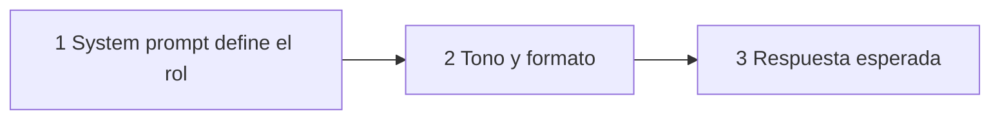

# MASTERCLASS: Context Engineering — System y Master Prompts para IA 🧠

## INTRODUCCIÓN: POR QUÉ EL CONTEXTO MANDA 🎯

El mismo modelo da respuestas distintas según el contexto que le des. El Context Engineering va más allá de los prompts básicos: consiste en diseñar system prompts y master prompts para que la IA entienda quién sos y qué esperás exactamente.

> **Objetivo de Aprendizaje** 🎯 — Al terminar, sabrás escribir un system prompt que haga que la IA responda con un rol, tono y formato definidos.

> **Advertencia educativa** ⚠️ — Esta guía es formativa. El prompting es una técnica de interacción con modelos de lenguaje.

## 🗺️ MAPA — Componentes del Contexto



*Se lee de izquierda a derecha. 3 pasos de contenido.*

## 🧩 PARTE 1: Context Engineering (Nivel 1 / 1) 🧠

1. ❓ PRETEST — Antes de enseñar: ¿cuál es la diferencia entre un prompt básico y un system prompt?
   > Respuesta esperada: el prompt básico es una pregunta suelta; el system prompt define quién es la IA y cómo debe comportarse en toda la conversación.
   > Si sabés la diferencia: camino rápido → punto 7.

2. 🎯 POR QUÉ + LOGRO — Importa porque sin contexto la IA adivina tus intenciones y da respuestas genéricas. Vas a lograr escribir un system prompt que haga que la IA responda exactamente como querés.

3. ⚡ VICTORIA RÁPIDA (<5 min) — Abrí un chat de IA y pegá este system prompt: "Sos un asistente que responde siempre en español y en una sola oración." Hacé una pregunta y verificá que obedece.
   📌 El contexto manda sobre el modelo.

4. 💡 CONCEPTO — Analogía: el system prompt es el manual de reglas que se le da a un empleado nuevo el primer día. Definición: el Context Engineering diseña system prompts y master prompts para que la IA entienda su rol, el tono, el formato y las expectativas. Una idea nueva: un buen contexto vale más que un modelo más caro.

5. 👀 EJEMPLO RESUELTO — Caso: necesitás que la IA redacte correos de venta en tono profesional. Pasos: (1) escribís un system prompt que defina el rol (redactor de ventas), el tono (profesional) y el formato (asunto + cuerpo); (2) desde código llamás a la API pasando ese system prompt y los datos del cliente; (3) probá el resultado y ajustá el prompt si es necesario.
   ```mermaid
   flowchart LR
   A["1 System prompt define el rol"] --> B["2 Se llama a la API"]
   B --> C["3 Se ajusta el prompt"]
   ```
   *Se lee de izquierda a derecha. 3 pasos de contenido.*

6. ⚠️ CONTRA-EJEMPLO / ERROR TÍPICO — Pedirle al modelo "escribí un correo de ventas" sin contexto. Resultado: texto genérico que no convence. Corrección: especificá rol, tono, audiencia y formato en el system prompt.

7. 🧪 PRÁCTICA — Escribí un system prompt que haga que la IA resuma noticias en máximo tres viñetas, y probalo con un titular cualquiera.
   > Respuesta esperada / criterio: el sistema devuelve exactamente tres viñetas cortas sobre la noticia.

8. 🔁 RECALL — Sin mirar: ¿qué hace el "C" de CAM? (Nivel Bloom: recordar)
   > Respuesta esperada: Context Engineering, diseñar system/master prompts para que la IA entienda el rol y la tarea.

9. 📌 IDEA CLAVE — Un buen contexto (system prompt) vale más que un modelo más caro.

10. ✅ AUTO-CHEQUEO + SIGUIENTE — [ ] Escribí un system prompt. [ ] Definí rol, tono y formato. [ ] Probé el resultado con un caso real. Siguiente: guía de AI APIs.

## ✅ CIERRE

Con Context Engineering controlás cómo se comporta la IA. El siguiente paso es aprender a llamar a modelos desde código mediante AI APIs.
