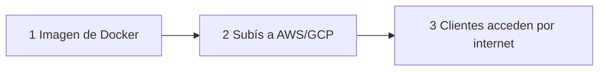

# MASTERCLASS: Despliegue de IA — Docker, AWS y GCP en Producción ☁️

## INTRODUCCIÓN: POR QUÉ DESPLEGAR DIFERENCIA AL CANDIDATO 🎯

Un modelo que funciona en tu laptop no sirve si los clientes no pueden usarlo. El despliegue pone el sistema a disposición en la nube. El autor destaca que este conocimiento es lo que realmente diferencia a un candidato en las entrevistas.

> **Objetivo de Aprendizaje** 🎯 — Al terminar, sabrás qué hace Docker, qué son AWS y GCP, y los pasos para llevar un sistema de IA de tu laptop a la nube.

> **Advertencia educativa** ⚠️ — Esta guía es formativa. Docker, AWS y GCP son herramientas de infraestructura y nube pública.

## 🗺️ MAPA — Despliegue en la Nube



*Se lee de izquierda a derecha. 3 pasos de contenido.*

## 🧩 PARTE 1: Despliegue (Nivel 1 / 1) ☁️

1. ❓ PRETEST — Antes de enseñar: ¿qué significa desplegar un sistema de IA en producción?
   > Respuesta esperada: poner el sistema a disposición de los usuarios en un servidor de la nube, para que esté disponible las 24 horas y no solo en tu computadora.
   > Si lo sabés: camino rápido → punto 7.

2. 🎯 POR QUÉ + LOGRO — Importa porque un modelo que funciona en tu laptop no sirve si los clientes no pueden usarlo. Vas a lograr entender cómo empaquetar y alojar un sistema de IA en la nube.

3. ⚡ VICTORIA RÁPIDA (<5 min) — Entrá a la página de inicio de Docker, AWS o GCP y leé qué ofrecen. Reconocer una de las tres plataformas es éxito.
   📌 Desplegar es mudarte de tu casa a un edificio donde todos pueden entrar.

4. 💡 CONCEPTO — Analogía: desplegar es como mudarte de tu casa (donde solo vos podés usar tu sistema) a un edificio público donde cualquiera con acceso puede usarlo.
   - Docker: analogía, es una caja estandarizada que lleva tu programa y todo lo que necesita para correr igual en cualquier computadora. Definición: empaqueta la aplicación y sus dependencias para que funcione igual en desarrollo y producción.
   - AWS / GCP: analogía, son edificios de oficinas en la nube donde alquilás espacio y potencia para tu sistema. Definición: proveedores de nube pública que ofrecen servidores, almacenamiento y servicios para alojar aplicaciones.

5. 👀 EJEMPLO RESUELTO — Caso: tenés un chatbot de IA que funciona en tu computadora y querés que los clientes lo usen. Pasos: (1) creás una imagen de Docker con tu código y dependencias, (2) subís esa imagen a un servidor de AWS o GCP, (3) configurás el acceso para que los clientes lleguen por internet.
   ```mermaid
   flowchart LR
   A["1 Imagen de Docker"] --> B["2 Subís a AWS/GCP"]
   B --> C["3 Clientes acceden por internet"]
   ```
   *Se lee de izquierda a derecha. 3 pasos de contenido.*

6. ⚠️ CONTRA-EJEMPLO / ERROR TÍPICO — Dejar el sistema corriendo solo en tu laptop y decir que "está en producción". Si apagás la computadora, el servicio muere. Corrección: siempre desplegá en un servidor remoto que esté encendido las 24 horas.

7. 🧪 PRÁCTICA — Escribí los tres pasos para llevar un sistema de IA de tu laptop a la nube. (Contexto distinto: acá es secuencia conceptual, no comandos.)
   > Respuesta esperada / criterio: empaquetar (Docker), subir a la nube (AWS/GCP) y habilitar acceso por internet.

8. 🔁 RECALL — Sin mirar: ¿qué hace Docker en el despliegue? (Nivel Bloom: recordar)
   > Respuesta esperada: empaqueta la aplicación y sus dependencias para que funcione igual en cualquier entorno.

9. 📌 IDEA CLAVE — Desplegar en la nube es lo que hace que un sistema de IA esté realmente disponible para los usuarios.

10. ✅ AUTO-CHEQUEO + SIGUIENTE — [ ] Entendí Docker. [ ] Conozco AWS y GCP. [ ] Sabía el error de dejarlo solo en la laptop. Siguiente: guía de Evaluación y Gobernanza.

## ✅ CIERRE

Desplegar en la nube hace que tu sistema esté disponible. El siguiente paso es aprender a evaluar la calidad de las respuestas y controlar costos con gobernanza.
