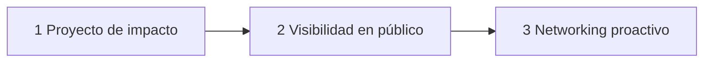

# MASTERCLASS: Conseguir Empleo — Portafolio, Visibilidad y Networking en IA 💼

## INTRODUCCIÓN: TE CONTRATAN POR LO QUE CONSTRUISTE 🎯

En el nivel empleo, las tres palancas son: proyectos de impacto, visibilidad construyendo en público, y networking proactivo. No esperes a que los reclutadores te contacten; busca activamente referencias y conexiones.

> **Objetivo de Aprendizaje** 🎯 — Al terminar, sabrás definir un proyecto de portafolio, compartir avances en público y redactar un mensaje de networking personalizado.

> **Advertencia educativa** ⚠️ — Esta guía es formativa. Las estrategias de empleo son referencias del mercado, no garantías de contratación.

## 🗺️ MAPA — Tres Palancas del Empleo



*Se lee de izquierda a derecha. 3 pasos de contenido.*

## 🧩 PARTE 1: Conseguir Empleo (Nivel 1 / 1) 💼

1. ❓ PRETEST — Antes de enseñar: ¿qué diferencia un proyecto tutorial de un proyecto de portafolio?
   > Respuesta esperada: el tutorial lo copias paso a paso; el portafolio lo diseñás vos, resuelve un problema real y se puede demostrar públicamente.
   > Si la sabés: camino rápido → punto 7.

2. 🎯 POR QUÉ + LOGRO — Importa porque te contratan por lo que construiste, no por lo que cursaste. Vas a lograr definir un proyecto de portafolio que demuestre habilidad de ingeniero de IA.

3. ⚡ VICTORIA RÁPIDA (<5 min) — Abrí una hoja o un bloc de notas y escribí un problema real que puedas resolver con IA en dos semanas. Tener ese problema escrito es éxito.
   📌 Empezar es más importante que esperar a estar listo.

4. 💡 CONCEPTO — Analogía: el portafolio es tu currículum demostrable; LinkedIn es el altavoz que lo hace visible; el networking es tocar puertas directamente. Definición: construí proyectos de impacto (multi-agente o modelo entrenado desde cero), compartí avances en público y busqué referencias activamente. Una idea nueva: la visibilidad atrae oportunidades sin que busques.

5. 👀 EJEMPLO RESUELTO — Caso: Juan construyó un agente que resume contratos de alquiler y lo publicó con un demo. Pasos: (1) eligió un problema real (entender contratos), (2) construyó el sistema con RAG + agente, (3) subió el código a GitHub con README y demo, (4) compartió el avance en LinkedIn.
   ```mermaid
   flowchart LR
   A["1 Problema real"] --> B["2 Construí el sistema"]
   B --> C["3 Código público en GitHub"]
   C --> D["4 Compartí en público"]
   ```
   *Se lee de izquierda a derecha. 4 pasos de contenido.*

6. ⚠️ CONTRA-EJEMPLO / ERROR TÍPICO — Hacer solo cursos y certificados sin mostrar nada construido. Los reclutadores ignoran certificados sin evidencia. Corrección: un proyecto funcionando vale más que diez certificados.

7. 🧪 PRÁCTICA — Escribí el título y una frase de qué problema resuelve tu primer proyecto de impacto. (Contexto distinto: acá es definición de alcance, no implementación.)
   > Respuesta esperada / criterio: un título claro y un problema real identificado.

8. 🔁 RECALL — Sin mirar: ¿cuáles son las tres palancas del nivel empleo? (Nivel Bloom: recordar)
   > Respuesta esperada: proyectos de impacto, visibilidad en público y networking proactivo.

9. 📌 IDEA CLAVE — No esperes al reclutador; construí en público y pedí referencias.

10. ✅ AUTO-CHEQUEO + SIGUIENTE — [ ] Definí mi proyecto de impacto. [ ] Tengo cuenta en GitHub. [ ] Compartí un avance en público. Fin del roadmap.

## ✅ CIERRE

Las tres palancas del empleo son portafolio, visibilidad y networking. Cuando tengas un proyecto terminado y publicado, tenés el perfil de ingeniero de IA que el mercado valora.
