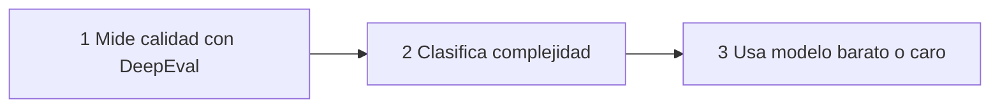

# MASTERCLASS: Evaluación y Gobernanza — DeepEval y Model Routing 📊

## INTRODUCCIÓN: CALIDAD Y COSTO EN PRODUCCIÓN 🎯

Un sistema en producción necesita saber si funciona bien y cuánto cuesta. La evaluación mide el rendimiento con herramientas como DeepEval; la gobernanza controla costos mediante model routing (seleccionar el modelo más económico según la complejidad de la tarea).

> **Objetivo de Aprendizaje** 🎯 — Al terminar, sabrás qué hace DeepEval, qué es el model routing y cómo clasificar tareas por complejidad para elegir el modelo adecuado.

> **Advertencia educativa** ⚠️ — Esta guía es formativa. DeepEval es un framework de evaluación de LLMs; el model routing es una estrategia de optimización de costos.

## 🗺️ MAPA — Evaluación y Gobernanza



*Se lee de izquierda a derecha. 3 pasos de contenido.*

## 🧩 PARTE 1: Evaluación y Gobernanza (Nivel 1 / 1) 📊

1. ❓ PRETEST — Antes de enseñar: ¿cuáles son las dos actividades de esta parte y qué hace cada una?
   > Respuesta esperada: evaluación mide la calidad de las respuestas (con herramientas como DeepEval); gobernanza controla costos eligiendo el modelo más barato para cada tarea (model routing).
   > Si sabés las dos: camino rápido → punto 7.

2. 🎯 POR QUÉ + LOGRO — Importa porque un sistema en producción necesita saber si funciona bien y cuánto cuesta. Vas a lograr entender cómo medir respuestas y controlar el gasto en modelos de IA.

3. ⚡ VICTORIA RÁPIDA (<5 min) — Pensá en una respuesta de IA que recibiste. Preguntate: ¿fue correcta, útil y segura? Si respondiste sí/no con un criterio, ya hiciste evaluación informal.
   📌 Evaluar es inspeccionar la calidad; gobernar es administrar el costo.

4. 💡 CONCEPTO — Analogía: la evaluación es el inspector de calidad que revisa cada producto antes de salir; la gobernanza es el empleado que elige la herramienta más barata para cada tarea sin perder calidad.
   - Evaluación (DeepEval): analogía, es el inspector de calidad. Definición: mide si las respuestas de la IA son correctas, útiles y seguras usando pruebas automáticas.
   - Gobernanza / Model routing: analogía, es el empleado que elige la herramienta más barata. Definición: selecciona el modelo más económico según la complejidad de la tarea (modelos simples para tareas simples, modelos potentes solo cuando sea necesario).

5. 👀 EJEMPLO RESUELTO — Caso: una empresa recibe miles de consultas diarias a su IA. Pasos: (1) usás DeepEval para medir si las respuestas son correctas; (2) clasificás las consultas por complejidad; (3) enviás las simples a un modelo barato y las complejas a uno más caro.
   ```mermaid
   flowchart LR
   A["1 Mide calidad con DeepEval"] --> B["2 Clasifica complejidad"]
   B --> C["3 Usa modelo barato o caro"]
   ```
   *Se lee de izquierda a derecha. 3 pasos de contenido.*

6. ⚠️ CONTRA-EJEMPLO / ERROR TÍPICO — Usar el modelo más caro y potente para todas las consultas, incluso las simples. Eso dispara los costos sin mejorar la calidad. Corrección: aplicá model routing para usar modelos baratos en tareas simples.

7. 🧪 PRÁCTICA — Escribí dos ejemplos de tareas: una que podrías resolver con un modelo barato y otra que necesita un modelo caro. (Contexto distinto: acá es clasificación, no código.)
   > Respuesta esperada / criterio: se nombran dos tareas con distinto nivel de complejidad y se justifica el modelo para cada una.

8. 🔁 RECALL — Sin mirar: ¿qué hace DeepEval y qué hace el model routing? (Nivel Bloom: comprender)
   > Respuesta esperada: DeepEval mide la calidad de las respuestas; el model routing elige el modelo más económico según la complejidad.

9. 📌 IDEA CLAVE — Evaluar mide calidad; gobernar controla costos con el modelo adecuado para cada tarea.

10. ✅ AUTO-CHEQUEO + SIGUIENTE — [ ] Entendí DeepEval. [ ] Entendí model routing. [ ] Clasifiqué tareas por complejidad. Siguiente: guía de Proyectos de impacto, Visibilidad y Networking.

## ✅ CIERRE

Evaluar mide calidad; gobernar controla costos. El siguiente paso es construir tu portafolio, ganar visibilidad y hacer networking proactivo para conseguir empleo.
