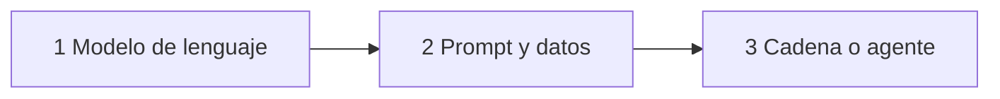

# MASTERCLASS: LangChain para IA — Aplicaciones que Conectan Modelos con Datos 🔗

## INTRODUCCIÓN: POR QUÉ LANCHAIN UNA TODO 🎯

Usar un modelo de lenguaje por chat es limitado. LangChain permite construir aplicaciones que encadenan modelos de lenguaje con prompts, datos externos y herramientas, creando sistemas de IA que razonan y actúan sobre información real.

> **Objetivo de Aprendizaje** 🎯 — Al terminar, sabrás qué es LangChain, para qué sirve y cuáles son sus bloques básicos: modelos, prompts, datos y cadenas.

> **Advertencia educativa** ⚠️ — Esta guía es formativa. LangChain es un framework de código abierto para desarrollar aplicaciones con modelos de lenguaje.

## 🗺️ MAPA — Bloques de LangChain



*Se lee de izquierda a derecha. 3 pasos de contenido.*

## 🧩 PARTE 1: LangChain (Nivel 1 / 1) 🔗

1. ❓ PRETEST — Antes de enseñar: ¿para qué sirve LangChain en el camino de ingeniero de IA?
   > Respuesta esperada: construir aplicaciones que encadenan modelos de lenguaje con prompts, datos externos y herramientas para crear sistemas complejos.
   > Si sabés la respuesta: camino rápido → punto 7.

2. 🎯 POR QUÉ + LOGRO — Importa porque un modelo de lenguaje solo responde lo que sabe; LangChain le permite consultar documentos, bases de datos y APIs para responder con información actualizada y privada. Vas a lograr entender qué problema resuelve.

3. ⚡ VICTORIA RÁPIDA (<5 min) — Pensá en un asistente que lea un PDF y responda preguntas sobre él. Ese es el tipo de aplicación que LangChain permite construir.
   📌 LangChain conecta al modelo con el mundo real.

4. 💡 CONCEPTO — Analogía: LangChain es un kit de piezas LEGO para IA: unís el modelo, el prompt, los datos y las herramientas para construir una aplicación que haga más que conversar. Definición: un framework que permite encadenar componentes (modelos, prompts, recuperadores de datos, herramientas) para crear aplicaciones con modelos de lenguaje. Una idea nueva: el modelo es el motor; LangChain es el chasis que lo conecta a todo lo demás.

5. 👀 EJEMPLO RESUELTO — Caso: un chatbot que responde preguntas sobre el manual de una empresa. Pasos: (1) cargás el manual en LangChain y lo dividís en fragmentos, (2) conectás esos fragmentos a una base de datos vectorial, (3) creás una cadena que recibe la pregunta, busca el fragmento relevante y le pide al modelo que responda usando solo ese fragmento.
   ```mermaid
   flowchart LR
   A["1 Cargar manual y fragmentar"] --> B["2 Conectar a BD vectorial"]
   B --> C["3 Cadena: pregunta + fragmento + modelo"]
   ```
   *Se lee de izquierda a derecha. 3 pasos de contenido.*

6. ⚠️ CONTRA-EJEMPLO / ERROR TÍPICO — Intentar usar LangChain para todo, incluso para tareas que un simple prompt directo resuelve mejor. Eso añade complejidad innecesaria. Corrección: usá LangChain solo cuando necesites conectar varios componentes (datos, herramientas, pasos).

7. 🧪 PRÁCTICA — Escribí una aplicación que quieras construir con LangChain y decí qué componentes necesitarías (modelo, datos, herramienta). (Contexto distinto: acá es diseño de aplicación, no código.)
   > Respuesta esperada / criterio: se nombra la aplicación y al menos dos componentes de LangChain.

8. 🔁 RECALL — Sin mirar: ¿para qué sirve LangChain? (Nivel Bloom: recordar)
   > Respuesta esperada: construir aplicaciones que encadenan modelos de lenguaje con prompts, datos externos y herramientas.

9. 📌 IDEA CLAVE — LangChain conecta al modelo de lenguaje con datos y herramientas para crear aplicaciones reales.

10. ✅ AUTO-CHEQUEO + SIGUIENTE — [ ] Entendí qué es LangChain. [ ] Conozco sus bloques básicos. [ ] Diseñé una aplicación con sus componentes. Fin de las guías de librerías Python.

## ✅ CIERRE

LangChain une modelos, datos y herramientas en aplicaciones coherentes. Con esto completás las librerías clave de Python para ingeniero de IA: NumPy, Scikit-learn, PyTorch, TensorFlow, LangChain y Hugging Face.
