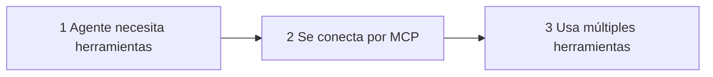

# MASTERCLASS: MCP — Model Context Protocol para Conectar Agentes y Datos 🔌🔗

## INTRODUCCIÓN: POR QUÉ MCP EVITA REINVENTAR LA RUEDA 🎯

Sin MCP, cada agente necesita integraciones a medida con cada base de datos o API. MCP estandariza cómo los agentes de IA se conectan a herramientas y datos, para que no tengas que construir un conector diferente para cada combinación.

> **Objetivo de Aprendizaje** 🎯 — Al terminar, sabrás qué es MCP, qué problema resuelve y por qué facilita conectar agentes con múltiples herramientas.

> **Advertencia educativa** ⚠️ — Esta guía es formativa. MCP es un protocolo abierto para la interoperabilidad de agentes de IA.

## 🗺️ MAPA — Conexión por MCP



*Se lee de izquierda a derecha. 3 pasos de contenido.*

## 🧩 PARTE 1: MCP (Nivel 1 / 1) 🔌🔗

1. ❓ PRETEST — Antes de enseñar: ¿qué problema resuelve MCP en una frase?
   > Respuesta esperada: estandariza cómo los agentes de IA se conectan a herramientas y datos, para que no tengas que construir un conector diferente para cada combinación.
   > Si lo sabés: camino rápido → punto 7.

2. 🎯 POR QUÉ + LOGRO — Importa porque sin MCP cada agente necesita integraciones a medida con cada base de datos o API. Vas a lograr entender que MCP es el "enchufe estándar" de la IA.

3. ⚡ VICTORIA RÁPIDA (<5 min) — Buscá en la web "Model Context Protocol" y leé la definición en una oración. Entender el concepto en una línea es éxito.
   📌 MCP es el enchufe estándar que deja conectar cualquier aparato.

4. 💡 CONCEPTO — Analogía: MCP es el enchufe estándar de pared que deja conectar cualquier aparato eléctrico sin necesidad de adaptadores especiales. Definición: un protocolo abierto que estandariza cómo los agentes de IA acceden a herramientas, datos y recursos externos. Una idea nueva: MCP evita que reinventes la rueda cada vez que conectás un agente a un nuevo sistema.

5. 👀 EJEMPLO RESUELTO — Caso: tenés un agente que necesita leer archivos de Google Drive, consultar una base de datos PostgreSQL y enviar mensajes por Slack. Sin MCP, construirías tres integraciones diferentes. Con MCP, usás servidores MCP estándar para cada uno y el agente se conecta por un protocolo común.
   ```mermaid
   flowchart LR
   A["1 Agente necesita herramientas"] --> B["2 Se conecta por MCP"]
   B --> C["3 Usa Drive, BD y Slack"]
   ```
   *Se lee de izquierda a derecha. 3 pasos de contenido.*

6. ⚠️ CONTRA-EJEMPLO / ERROR TÍPICO — Construir conectores personalizados para cada herramienta sin usar un estándar, lo que genera código difícil de mantener. Corrección: adoptá MCP o protocolos similares para estandarizar las conexiones.

7. 🧪 PRÁCTICA — Listá tres herramientas que quisieras conectar a un agente de IA y escribí por qué MCP facilitaría esa conexión. (Contexto distinto: acá es análisis, no código.)
   > Respuesta esperada / criterio: se nombran tres herramientas y se explica el beneficio de un protocolo estándar.

8. 🔁 RECALL — Sin mirar: ¿qué es MCP? (Nivel Bloom: recordar)
   > Respuesta esperada: un protocolo abierto que estandariza cómo los agentes de IA se conectan a herramientas y datos externos.

9. 📌 IDEA CLAVE — MCP evita construir integraciones a medida para cada herramienta.

10. ✅ AUTO-CHEQUEO + SIGUIENTE — [ ] Sé qué es MCP. [ ] Entendí el ejemplo de Drive, BD y Slack. [ ] Conozco el error de conectores personalizados. Siguiente: guía de Despliegue.

## ✅ CIERRE

MCP estandariza cómo los agentes acceden a herramientas. El siguiente paso es aprender a desplegar sistemas de IA en la nube con Docker, AWS y GCP.
