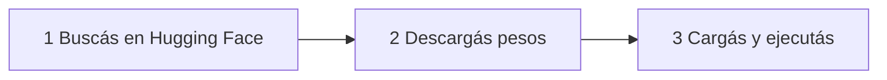

# MASTERCLASS: Modelos Locales — Hugging Face y Experimentación Real 💾

## INTRODUCCIÓN: POR QUÉ CORRER MODELOS EN TU MÁQUINA 🎯

Correr modelos locales te da control total: privacidad de los datos, no depender de internet, no pagar por cada llamada y poder experimentar libremente. Esta guía enseña cómo descargar y ejecutar modelos desde Hugging Face.

> **Objetivo de Aprendizaje** 🎯 — Al terminar, sabrás qué es Hugging Face, qué ventajas tienen los modelos locales y cómo elegir uno según tu hardware.

> **Advertencia educativa** ⚠️ — Esta guía es formativa. Hugging Face es un repositorio de modelos de IA pre-entrenados.

## 🗺️ MAPA — Flujo de Modelo Local



*Se lee de izquierda a derecha. 3 pasos de contenido.*

## 🧩 PARTE 1: Modelos Locales (Nivel 1 / 1) 💾

1. ❓ PRETEST — Antes de enseñar: ¿qué ventajas tiene correr un modelo de IA en tu propia computadora en lugar de usar una API pública?
   > Respuesta esperada: privacidad de los datos, no depender de internet, no pagar por cada llamada y poder experimentar libremente.
   > Si sabés dos o más: camino rápido → punto 7.

2. 🎯 POR QUÉ + LOGRO — Importa porque correr modelos locales te da control total y te permite experimentar sin costos por uso. Vas a lograr entender cómo se descarga y ejecuta un modelo desde Hugging Face.

3. ⚡ VICTORIA RÁPIDA (<5 min) — Entrá a Hugging Face y buscá un modelo pequeño (por ejemplo, para análisis de sentimientos). Ver la tarjeta del modelo con su descripción es éxito.
   📌 Conocer el catálogo es el primer paso para usar modelos locales.

4. 💡 CONCEPTO — Analogía: un modelo local es una herramienta que comprás y tenés en tu propio taller, en lugar de alquilar un servicio cada vez que la usás. Definición: modelos de IA descargados desde repositorios como Hugging Face que se ejecutan en tu máquina o servidor sin depender de una API externa. Una idea nueva: los modelos locales son ideales para privacidad, experimentación y costos predecibles.

5. 👀 EJEMPLO RESUELTO — Caso: querés analizar el sentimiento de reseñas de productos sin enviar datos a un servicio externo. Pasos: (1) buscás un modelo de análisis de sentimientos en Hugging Face, (2) descargás los pesos del modelo, (3) cargás el modelo en tu código y pasás una reseña para obtener si es positiva o negativa.
   ```mermaid
   flowchart LR
   A["1 Buscás modelo en Hugging Face"] --> B["2 Descargás los pesos"]
   B --> C["3 Cargás y analizás la reseña"]
   ```
   *Se lee de izquierda a derecha. 3 pasos de contenido.*

6. ⚠️ CONTRA-EJEMPLO / ERROR TÍPICO — Intentar correr un modelo gigante de 70 mil millones de parámetros en una laptop común sin suficiente memoria RAM o GPU. Eso falla o va extremadamente lento. Corrección: elegí un modelo del tamaño adecuado para tu hardware (por ejemplo, modelos de 1 a 7 mil millones de parámetros para empezar).

7. 🧪 PRÁCTICA — Elegí en Hugging Face un modelo pequeño para una tarea concreta (por ejemplo, resumir texto o clasificar sentimientos) y escribí para qué lo usarías. (Contexto distinto: acá es selección y justificación, no ejecución.)
   > Respuesta esperada / criterio: se nombra el modelo, la tarea y la razón de la elección.

8. 🔁 RECALL — Sin mirar: ¿qué es Hugging Face en el contexto de modelos locales? (Nivel Bloom: recordar)
   > Respuesta esperada: un repositorio donde se descargan modelos de IA pre-entrenados para ejecutarlos localmente.

9. 📌 IDEA CLAVE — Los modelos locales dan privacidad, control y experimentación sin costos por llamada.

10. ✅ AUTO-CHEQUEO + SIGUIENTE — [ ] Sé qué es Hugging Face. [ ] Entendí la ventaja de privacidad. [ ] Conozco el error de hardware insuficiente. Siguiente: guía de RAG y bases de datos vectoriales.

## ✅ CIERRE

Los modelos locales te permiten experimentar con privacidad. El siguiente paso es aprender RAG para que la IA consulte tus datos privados mediante bases de datos vectoriales.
