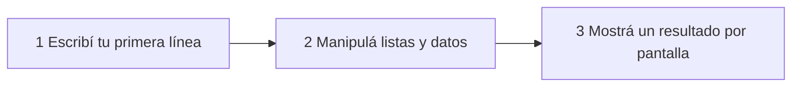

# MASTERCLASS: Python para Ingeniero de IA — Fundamentos sin Tutorial Hell 🐍

## INTRODUCCIÓN: POR QUÉ PYTHON ES LA PIEDRA ANGULAR 🎯

Python es el lenguaje principal de la inteligencia artificial. Casi toda la infraestructura de IA está escrita en Python o se controla desde él. La trampa más común es el "tutorial hell": ver decenas de videos sin escribir una sola línea. Esta guía enseña Python construyendo, no mirando.

> **Objetivo de Aprendizaje** 🎯 — Al terminar, sabrás escribir un script de Python que procese datos, manipule listas y muestre resultados, sin caer en el tutorial hell.

> **Advertencia educativa** ⚠️ — Esta guía es formativa. Python es un lenguaje de propósito general; aquí se presenta en el contexto de la ingeniería de IA.

## 🗺️ MAPA — Flujo de Aprendizaje



*Se lee de izquierda a derecha. 3 pasos de contenido.*

## 🧩 PARTE 1: Python (Nivel 1 / 1) 🐍

1. ❓ PRETEST — Antes de enseñar: ¿para qué sirve Python en el camino de ingeniero de IA?
   > Respuesta esperada: escribir la lógica que conecta datos, modelos y APIs de IA; es el lenguaje principal de la IA.
   > Si sabés la respuesta: camino rápido → punto 7.

2. 🎯 POR QUÉ + LOGRO — Importa porque sin Python no podés automatizar tareas ni integrar modelos de IA en aplicaciones. Vas a lograr escribir un script sencillo que procese datos.

3. ⚡ VICTORIA RÁPIDA (<5 min) — Abrí una terminal o editor y escribí una sola línea que imprima un texto. Ver la salida en pantalla es éxito garantizado.
   📌 Tu primera línea ya es un programa.

4. 💡 CONCEPTO — Analogía: Python es el idioma que le hablas a la computadora para decirle qué hacer paso a paso. Definición: un lenguaje de programación legible, usado para automatizar tareas, manipular datos y llamar a modelos de IA. Una idea nueva: Python es el pegamento que une el roadmap.

5. 👀 EJEMPLO RESUELTO — Caso: calcular el precio total de una lista de productos. Pasos: (1) creás una lista con tres precios, (2) sumás los valores, (3) mostrá el resultado.
   ```mermaid
   flowchart LR
   A["1 Lista de precios"] --> B["2 Sumar valores"]
   B --> C["3 Mostrar total"]
   ```
   *Se lee de izquierda a derecha. 3 pasos de contenido.*

6. ⚠️ CONTRA-EJEMPLO / ERROR TÍPICO — Ver veinte horas de tutoriales de Python sin escribir una sola línea. Eso es "tutorial hell" y no produce habilidad. Corrección: por cada concepto que veas, escribí vos mismo el código correspondiente.

7. 🧪 PRÁCTICA — Escribí en Python una lista con tres productos y sus precios, y mostrá el producto más caro. (Contexto distinto al ejemplo: acá comparás, no sumás.)
   > Respuesta esperada / criterio: el programa imprime el nombre del producto con el precio más alto de los tres.

8. 🔁 RECALL — Sin mirar: ¿para qué sirve Python en este roadmap? (Nivel Bloom: recordar)
   > Respuesta esperada: escribir la lógica que conecta datos, modelos y APIs; es el lenguaje principal de la IA.

9. 📌 IDEA CLAVE — Python no se aprende viendo; se aprende escribiendo.

10. ✅ AUTO-CHEQUEO + SIGUIENTE — [ ] Escribí un script de Python. [ ] Manipulé una lista de datos. [ ] Mostré un resultado por pantalla. Siguiente: guía de SQL.

## ✅ CIERRE

Dominar Python es el primer paso del ingeniero de IA. Cuando completes este checklist, pasá a SQL para aprender a consultar los datos que alimentarán a tus modelos.
