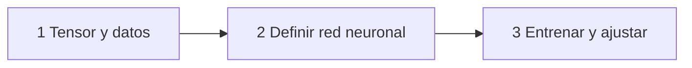

# MASTERCLASS: PyTorch para IA — Redes Neuronales y Aprendizaje Profundo 🔥

## INTRODUCCIÓN: POR QUÉ PYTORCH ES EL ESTÁNDAR DE INVESTIGACIÓN 🎯

PyTorch es la librería líder para construir y entrenar redes neuronales. Es usada en investigación y producción para crear modelos de aprendizaje profundo, desde clasificación de imágenes hasta modelos de lenguaje.

> **Objetivo de Aprendizaje** 🎯 — Al terminar, sabrás qué es un tensor en PyTorch, cómo se define una red neuronal y cuál es el ciclo básico de entrenamiento.

> **Advertencia educativa** ⚠️ — Esta guía es formativa. PyTorch es una librería de código abierto para aprendizaje profundo desarrollada por Meta.

## 🗺️ MAPA — Ciclo de Entrenamiento



*Se lee de izquierda a derecha. 3 pasos de contenido.*

## 🧩 PARTE 1: PyTorch (Nivel 1 / 1) 🔥

1. ❓ PRETEST — Antes de enseñar: ¿qué es un tensor en PyTorch?
   > Respuesta esperada: un tensor es una estructura de datos multidimensional similar a un arreglo de NumPy, pero que puede correr en GPU y calcular gradientes.
   > Si sabés la respuesta: camino rápido → punto 7.

2. 🎯 POR QUÉ + LOGRO — Importa porque PyTorch te permite construir modelos de IA desde cero en lugar de solo usarlos. Vas a lograr entender la estructura básica de una red neuronal y su entrenamiento.

3. ⚡ VICTORIA RÁPIDA (<5 min) — Pensá en una red neuronal como una cadena de filtros que transforma datos de entrada en una respuesta. Identificar entrada, transformación y salida es éxito.
   📌 Un tensor es el dato que viaja por la red neuronal.

4. 💡 CONCEPTO — Analogía: una red neuronal es una línea de ensamblaje donde cada estación (neurona) transforma un poco la información y la pasa a la siguiente. Definición: PyTorch es una librería que define tensores, construye redes neuronales y las entrena mediante propagación hacia atrás. Una idea nueva: PyTorch es para crear modelos, no solo consumirlos.

5. 👀 EJEMPLO RESUELTO — Caso: clasificar imágenes de gatos y perros. Pasos: (1) cargás las imágenes como tensores, (2) definís una red neuronal con capas de PyTorch, (3) entrenás la red mostrando miles de imágenes etiquetadas y ajustando sus pesos.
   ```mermaid
   flowchart LR
   A["1 Imágenes como tensores"] --> B["2 Red neuronal de PyTorch"]
   B --> C["3 Entrenar con imágenes etiquetadas"]
   ```
   *Se lee de izquierda a derecha. 3 pasos de contenido.*

6. ⚠️ CONTRA-EJEMPLO / ERROR TÍPICO — Intentar entrenar una red neuronal enorme en una laptop sin GPU. Eso será lentísimo o fallará por falta de memoria. Corrección: empezá con redes pequeñas y usá GPU cuando sea posible.

7. 🧪 PRÁCTICA — Escribí los tres componentes mínimos que necesitás para entrenar un modelo en PyTorch: datos, red neuronal y función de pérdida. (Contexto distinto: acá es diseño conceptual, no código.)
   > Respuesta esperada / criterio: se nombran datos, red neuronal y función de pérdida/optimizador.

8. 🔁 RECALL — Sin mirar: ¿qué es un tensor en PyTorch? (Nivel Bloom: recordar)
   > Respuesta esperada: un arreglo multidimensional que puede usar GPU y calcular gradientes para entrenar redes neuronales.

9. 📌 IDEA CLAVE — PyTorch te permite construir modelos de IA desde cero, no solo usar modelos ajenos.

10. ✅ AUTO-CHEQUEO + SIGUIENTE — [ ] Sé qué es un tensor. [ ] Entendí la red neuronal como línea de ensamblaje. [ ] Conozco el error de entrenar sin GPU. Siguiente: guía de TensorFlow.

## ✅ CIERRE

PyTorch es para construir y entrenar redes neuronales. El siguiente paso es TensorFlow, otra librería clave para aprendizaje profundo con foco en despliegue.
