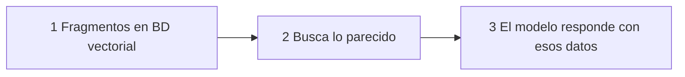

# MASTERCLASS: RAG y Bases de Datos Vectoriales — Datos Privados para la IA 🔍

## INTRODUCCIÓN: POR QUÉ RAG ES CLAVE EN PRODUCCIÓN 🎯

Los modelos públicos no conocen los datos internos de tu empresa. RAG (Retrieval-Augmented Generation) crea tuberías que permiten a la IA consultar datos privados mediante bases de datos vectoriales antes de responder.

> **Objetivo de Aprendizaje** 🎯 — Al terminar, sabrás qué es RAG, qué hace una base de datos vectorial y cómo conectar ambos para responder con información privada.

> **Advertencia educativa** ⚠️ — Esta guía es formativa. RAG es una arquitectura de sistemas de IA que combina recuperación de información con generación de lenguaje.

## 🗺️ MAPA — Tubería RAG



*Se lee de izquierda a derecha. 3 pasos de contenido.*

## 🧩 PARTE 1: RAG y Bases de Datos Vectoriales (Nivel 1 / 1) 🔍

1. ❓ PRETEST — Antes de enseñar: ¿qué significa RAG y para qué sirve en una frase?
   > Respuesta esperada: Retrieval-Augmented Generation, es dejar que la IA consulte datos externos privados antes de responder, para que use información real y no solo lo que memorizó en entrenamiento.
   > Si lo sabés: camino rápido → punto 7.

2. 🎯 POR QUÉ + LOGRO — Importa porque los modelos públicos no conocen los datos internos de tu empresa. Vas a lograr entender cómo conectar una base de datos vectorial a un modelo para que responda con información privada.

3. ⚡ VICTORIA RÁPIDA (<5 min) — Subí un PDF pequeño a una herramienta de chat con documentos y hacé una pregunta sobre su contenido. Si responde usando el archivo, ya hiciste RAG básico.
   📌 La IA + tus datos = RAG.

4. 💡 CONCEPTO — Analogía principal: RAG es un examen abierto donde el estudiante puede consultar el libro de texto antes de responder.
   - Base de datos vectorial: analogía, es el índice al final del libro que te dice en qué página está cada tema. Definición: guarda fragmentos de datos convertidos en vectores para que la IA los encuentre rápido por similitud.
   - Generación aumentada: analogía, es el estudiante que lee el índice, abre la página y responde con esa información. Definición: el modelo usa los fragmentos recuperados para generar una respuesta fundamentada.

5. 👀 EJEMPLO RESUELTO — Caso: un departamento de soporte quiere responder preguntas de su manual interno. Pasos: (1) partís el manual en fragmentos y los guardás en una base de datos vectorial; (2) cuando llega una pregunta, el sistema busca los fragmentos más parecidos; (3) se los pasás al modelo con un system prompt para que responda solo con esos datos.
   ```mermaid
   flowchart LR
   A["1 Fragmentos en BD vectorial"] --> B["2 Busca lo parecido"]
   B --> C["3 El modelo responde con esos datos"]
   ```
   *Se lee de izquierda a derecha. 3 pasos de contenido.*

6. ⚠️ CONTRA-EJEMPLO / ERROR TÍPICO — Subir toda la empresa al modelo como "entrenamiento" en lugar de consultarla por RAG. Eso es caro, inseguro y no funciona bien. Corrección: usá RAG para consultar datos privados sin reentrenar el modelo.

7. 🧪 PRÁCTICA — Diseñá en una hoja el flujo de un sistema RAG para responder preguntas de una política de recursos humanos. (Contexto distinto: acá es diseño de arquitectura, no código.)
   > Respuesta esperada / criterio: el flujo tiene carga de documentos, búsqueda de fragmentos y respuesta del modelo con esos fragmentos.

8. 🔁 RECALL — Sin mirar: ¿qué hace la base de datos vectorial en RAG? (Nivel Bloom: recordar)
   > Respuesta esperada: guarda fragmentos de datos para que la IA los encuentre rápido por similitud antes de responder.

9. 📌 IDEA CLAVE — RAG permite que la IA use datos privados sin reentrenarla.

10. ✅ AUTO-CHEQUEO + SIGUIENTE — [ ] Entendí RAG. [ ] Sé qué hace la base de datos vectorial. [ ] Diseñé un flujo de RAG. Siguiente: guía de Agentes autónomos.

## ✅ CIERRE

RAG conecta la IA con tus datos privados. El siguiente paso es aprender a construir agentes que coordinen múltiples IA para tareas complejas.
