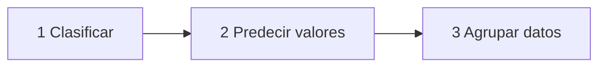

# MASTERCLASS: Scikit-learn para IA — Aprendizaje Automático Clásico 📈

## INTRODUCCIÓN: POR QUÉ SCIKIT-LEARN AÚN IMPORTA 🎯

Antes de los modelos de lenguaje masivos, el aprendizaje automático clásico ya resolvía problemas reales: clasificar correos, predecir precios y agrupar clientes. Scikit-learn es la librería estándar para esos modelos y sigue siendo el punto de partida de todo ingeniero de IA.

> **Objetivo de Aprendizaje** 🎯 — Al terminar, sabrás qué es scikit-learn, cuándo usarlo y qué tipo de problemas resuelve (clasificación, regresión, clustering).

> **Advertencia educativa** ⚠️ — Esta guía es formativa. Scikit-learn es una librería de código abierto para aprendizaje automático en Python.

## 🗺️ MAPA — Tres Tipos de Modelo



*Se lee de izquierda a derecha. 3 pasos de contenido.*

## 🧩 PARTE 1: Scikit-learn (Nivel 1 / 1) 📈

1. ❓ PRETEST — Antes de enseñar: ¿para qué sirve scikit-learn en el camino de ingeniero de IA?
   > Respuesta esperada: crear modelos de aprendizaje automático tradicionales como clasificación, regresión y clustering sobre datos estructurados.
   > Si sabés la respuesta: camino rápido → punto 7.

2. 🎯 POR QUÉ + LOGRO — Importa porque no todo problema de IA necesita un modelo de lenguaje gigante; muchos se resuelven mejor con modelos clásicos rápidos y baratos. Vas a lograr entender cuándo usar scikit-learn.

3. ⚡ VICTORIA RÁPIDA (<5 min) — Pensá en un problema que tenga datos en tabla (por ejemplo: predecir si un cliente compra o no). Identificarlo como un problema de clasificación es éxito.
   📌 Scikit-learn trabaja con datos tabulares, no con texto libre.

4. 💡 CONCEPTO — Analogía: scikit-learn es una caja de herramientas lista para usar: eliges la herramienta según el problema (clasificar, predecir, agrupar) y la aplicás a tus datos. Definición: una librería de Python con algoritmos de aprendizaje automático supervisado y no supervisado para datos estructurados. Una idea nueva: modelo clásico ≠ modelo obsoleto.

5. 👀 EJEMPLO RESUELTO — Caso: un banco quiere predecir si un cliente pagará un préstamo. Pasos: (1) prepará una tabla con datos de clientes (ingreso, deudas, edad), (2) elegí un modelo de clasificación de scikit-learn, (3) entrená el modelo con los datos y probá con un cliente nuevo.
   ```mermaid
   flowchart LR
   A["1 Tabla de clientes"] --> B["2 Modelo de clasificación"]
   B --> C["3 Predicción pagar/no pagar"]
   ```
   *Se lee de izquierda a derecha. 3 pasos de contenido.*

6. ⚠️ CONTRA-EJEMPLO / ERROR TÍPICO — Usar scikit-learn para procesar texto libre o imágenes sin convertir primero los datos a números. Eso no funciona directamente. Corrección: transformá texto e imágenes en vectores numéricos antes de usar scikit-learn.

7. 🧪 PRÁCTICA — Escribí un problema real que puedas resolver con scikit-learn y decí si es clasificación, regresión o clustering. (Contexto distinto: acá es análisis del problema, no código.)
   > Respuesta esperada / criterio: se nombra el problema y se clasifica correctamente en uno de los tres tipos.

8. 🔁 RECALL — Sin mirar: ¿qué tres tipos de problemas resuelve scikit-learn? (Nivel Bloom: recordar)
   > Respuesta esperada: clasificación, regresión y clustering.

9. 📌 IDEA CLAVE — Scikit-learn es para problemas con datos estructurados; no reemplaza a los modelos de lenguaje, los complementa.

10. ✅ AUTO-CHEQUEO + SIGUIENTE — [ ] Entendí qué es scikit-learn. [ ] Conozco los tres tipos de modelo. [ ] Identifiqué un problema real para usarlo. Siguiente: guía de PyTorch.

## ✅ CIERRE

Scikit-learn te da modelos rápidos para datos estructurados. El siguiente paso es PyTorch, la librería para construir redes neuronales y modelos de aprendizaje profundo.
