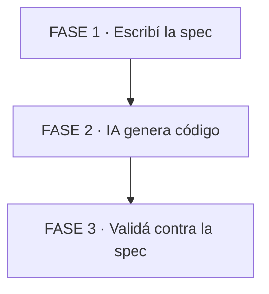

# MASTERCLASS: Spec-Driven Development con IA — Especificar y Construir Software 📋💻

## INTRODUCCIÓN: POR QUÉ LA SPEC ES EL PUENTE ENTRE LA IDEA Y EL CÓDIGO 🎯

La mayoría escribe código directamente y corrige sobre la marcha. Eso genera bugs, rehacer y frustración. El Spec-Driven Development con IA invierte el orden: primero escribís qué debe hacer el software (la spec), luego dejás que la IA genere el código a partir de esa especificación, y finalmente validás que cumpla lo prometido.

> **Objetivo de Aprendizaje** 🎯 — Al terminar, sabrás escribir una especificación de software, usar IA para generar código desde ella, validar que el resultado cumpla la spec y saber cuándo intervenir manualmente.

> **Advertencia educativa** ⚠️ — Esta guía es formativa. La IA puede generar código con errores; la revisión humana sigue siendo obligatoria antes de llevar algo a producción.

## 🗺️ MAPA DE 3 FASES — Spec → Código → Validación



*Se lee de arriba hacia abajo. 3 fases: escribir la spec → IA genera código → validar contra la spec.*

Las 5 partes se recorren en orden:

1️⃣ PARTE 1: Qué es Spec-Driven Development con IA  
2️⃣ PARTE 2: Escribir la spec (especificación)  
3️⃣ PARTE 3: IA genera código desde la spec  
4️⃣ PARTE 4: Validar y corregir  
5️⃣ PARTE 5: Desplegar y mantener

## 📖 Glosario (declarado)

| Término | Definición en una línea |
|---------|------------------------|
| Spec | Documento que describe qué debe hacer el software, no cómo |
| Spec-Driven Development | Metodología que parte de la especificación antes de escribir código |
| IA generativa de código | Modelo que produce código a partir de instrucciones escritas |
| Validación | Comprobar que el código generado cumple la spec original |

*(Glosario declarado: excepción de la regla de tablas de ≤4 filas.)*

Cada PARTE sigue la plantilla fija: pretest → por qué/logro → victoria rápida → concepto con analogía → ejemplo resuelto + diagrama ≤4 pasos → contra-ejemplo → práctica con respuesta esperada → recall → idea clave → auto-chequeo.

---

## 🧩 PARTE 1: Qué es Spec-Driven Development con IA (Nivel 1 / 5) 📋

1. ❓ PRETEST — Antes de enseñar: ¿qué significa "spec-driven" en desarrollo de software?
   > Respuesta esperada: que el desarrollo parte de una especificación escrita antes de escribir código, en lugar de programar directamente.
   > Si sabés la respuesta: camino rápido → punto 7.

2. 🎯 POR QUÉ + LOGRO — Importa porque escribir código sin spec genera rehacer, bugs y funciones que nadie pidió. Vas a lograr entender que la spec es el contrato entre lo que querés y lo que se construye.

3. ⚡ VICTORIA RÁPIDA (<5 min) — Abrí un bloc de notas y escribí una sola oración describiendo qué debe hacer una función de tu software. Eso ya es una spec mínima.
   📌 Una oración clara vale más que cien líneas de código sin propósito.

4. 💡 CONCEPTO — Analogía: la spec es el plano de una casa antes de empezar a construir; la IA es el equipo de albañiles que sigue ese plano. Definición: Spec-Driven Development es la metodología de definir primero qué debe hacer el sistema y luego generar o escribir el código que lo cumpla. Una idea nueva: la IA no reemplaza al programador; reemplaza el paso de escribir código desde cero sin dirección.

5. 👀 EJEMPLO RESUELTO — Caso: necesitás una función que valide correos electrónicos. Pasos: (1) escribís la spec: "la función recibe un texto y devuelve true si tiene formato de correo", (2) se la pasás a la IA pidiendo código, (3) la IA genera la función, (4) probás con ejemplos válidos e inválidos.
   ```mermaid
   flowchart LR
   A["1 Escribí la spec"] --> B["2 IA genera código"]
   B --> C["3 Probá la función"]
   ```
   *Se lee de izquierda a derecha. 3 pasos de contenido.*

6. ⚠️ CONTRA-EJEMPLO / ERROR TÍPICO — Pedirle a la IA "hacé un sistema de facturación" sin especificar qué datos guarda, quién usa el sistema ni qué reglas aplica. Resultado: código genérico que no sirve. Corrección: definí la spec antes de pedir código.

7. 🧪 PRÁCTICA — Escribí una spec de una oración para una función que calcule el descuento de un producto. (Contexto distinto al ejemplo: acá es descuento, no correo.)
   > Respuesta esperada / criterio: una oración que diga entrada, salida y regla de descuento.

8. 🔁 RECALL — Sin mirar: ¿qué es Spec-Driven Development? (Nivel Bloom: recordar)
   > Respuesta esperada: metodología que define la especificación antes de escribir código.

9. 📌 IDEA CLAVE — La spec es el contrato; el código es solo la entrega.

10. ✅ AUTO-CHEQUEO + SIGUIENTE — [ ] Escribí una spec de una oración. [ ] Entendí el rol de la IA como ejecutora. [ ] Conozco el error de pedir sin spec. Siguiente: PARTE 2 (Escribir la spec).

---

## 🧩 PARTE 2: Escribir la Spec (Especificación) (Nivel 2 / 5) ✍️

1. ❓ PRETEST — Antes de enseñar: ¿qué tres elementos debe tener una spec mínima?
   > Respuesta esperada: entrada (qué recibe), salida (qué devuelve) y reglas (qué hace en medio).
   > Si sabés los tres: camino rápido → punto 7.

2. 🎯 POR QUÉ + LOGRO — Importa porque una spec vaga genera código vagamente correcto. Vas a lograr escribir una spec completa con entrada, salida y reglas.

3. ⚡ VICTORIA RÁPIDA (<5 min) — Tomá una función que necesites y escribí: "Entrada: X. Salida: Y. Reglas: Z." Tener eso escrito es éxito.
   📌 Tres elementos: entrada, salida, reglas.

4. 💡 CONCEPTO — Analogía: una spec es una receta de cocina; si no decís los ingredientes, las cantidades y el tiempo, el plato sale distinto cada vez. Definición: una spec mínima describe qué datos entran, qué datos salen y qué reglas se aplican en medio. Una idea nueva: cuanto más precisa sea la spec, menos errores comete la IA generando el código.

5. 👀 EJEMPLO RESUELTO — Caso: función que calcule el precio final con impuesto. Pasos: (1) Entrada: precio base y tasa de impuesto, (2) Salida: precio final, (3) Reglas: precio base × (1 + tasa), redondeado a dos decimales.
   ```mermaid
   flowchart LR
   A["1 Entrada"] --> B["2 Reglas"]
   B --> C["3 Salida"]
   ```
   *Se lee de izquierda a derecha. 3 pasos de contenido.*

6. ⚠️ CONTRA-EJEMPLO / ERROR TÍPICO — Escribir "hacé un programa de ventas" sin decir qué se vende, a quién ni cómo se cobra. Eso obliga a la IA a adivinar. Corrección: especificá entrada, salida y reglas antes de pedir código.

7. 🧪 PRÁCTICA — Escribí una spec mínima para una función que convierta temperatura de Celsius a Fahrenheit. (Contexto distinto al ejemplo: acá es conversión de temperatura, no impuesto.)
   > Respuesta esperada / criterio: especifica entrada (Celsius), salida (Fahrenheit) y regla de conversión.

8. 🔁 RECALL — Sin mirar: ¿cuáles son los tres elementos de una spec mínima? (Nivel Bloom: recordar)
   > Respuesta esperada: entrada, salida y reglas.

9. 📌 IDEA CLAVE — Una spec precisa reduce los errores de la IA generando código.

10. ✅ AUTO-CHEQUEO + SIGUIENTE — [ ] Definí entrada. [ ] Definí salida. [ ] Definí reglas. Siguiente: PARTE 3 (IA genera código desde la spec).

---

## 🧩 PARTE 3: IA Genera Código Desde la Spec (Nivel 3 / 5) 🤖

1. ❓ PRETEST — Antes de enseñar: ¿qué le pasás a la IA para que genere código desde una spec?
   > Respuesta esperada: la especificación escrita (entrada, salida, reglas) y el lenguaje de programación deseado.
   > Si sabés la respuesta: camino rápido → punto 7.

2. 🎯 POR QUÉ + LOGRO — Importa porque la IA necesita contexto claro para generar código útil; sin la spec, genera código genérico. Vas a lograr pedirle código a la IA a partir de una spec definida.

3. ⚡ VICTORIA RÁPIDA (<5 min) — Pegá una spec simple en un chat de IA y pedí: "Escribí esta función en Python según esta spec". Ver código generado es éxito.
   📌 La IA convierte palabras en código, pero necesita la spec como entrada.

4. 💡 CONCEPTO — Analogía: la spec es el pedido escrito al chef; el código es el plato que sale de la cocina. Definición: le pasás la spec a la IA junto con el lenguaje de programación y ella genera el código que cumple esa especificación. Una idea nueva: la calidad del código depende de la calidad de la spec.

5. 👀 EJEMPLO RESUELTO — Caso: tenés la spec de validar correos. Pasos: (1) pegás la spec en el chat de IA, (2) pedís el código en Python, (3) la IA devuelve una función con expresiones regulares o lógica simple, (4) copiás ese código a tu archivo.
   ```mermaid
   flowchart LR
   A["1 Spec + lenguaje"] --> B["2 IA genera código"]
   B --> C["3 Copiás el código"]
   ```
   *Se lee de izquierda a derecha. 3 pasos de contenido.*

6. ⚠️ CONTRA-EJEMPLO / ERROR TÍPICO — Pegar el código generado directamente en producción sin leerlo. La IA puede inventar librerías que no existen o usar funciones obsoletas. Corrección: siempre leé y probá el código antes de usarlo.

7. 🧪 PRÁCTICA — Escribí el pedido que le harías a la IA para generar una función de descuento, citando tu spec de la PARTE 2. (Contexto distinto: acá es redactar el prompt, no ejecutar código.)
   > Respuesta esperada / criterio: un texto que incluya la spec y pida código en un lenguaje específico.

8. 🔁 RECALL — Sin mirar: ¿qué le pasás a la IA para generar código desde una spec? (Nivel Bloom: recordar)
   > Respuesta esperada: la especificación escrita y el lenguaje de programación deseado.

9. 📌 IDEA CLAVE — La IA genera el código, pero la spec define lo que debe hacer.

10. ✅ AUTO-CHEQUEO + SIGUIENTE — [ ] Pegué la spec a la IA. [ ] Pedí código en un lenguaje. [ ] Sé que debo leer el código antes de usarlo. Siguiente: PARTE 4 (Validar y corregir).

---

## 🧩 PARTE 4: Validar y Corregir (Nivel 4 / 5) 🧪

1. ❓ PRETEST — Antes de enseñar: ¿cómo sabés si el código generado por la IA cumple la spec?
   > Respuesta esperada: probándolo con entradas de ejemplo y comparando la salida contra lo que dice la spec.
   > Si sabés la respuesta: camino rápido → punto 7.

2. 🎯 POR QUÉ + LOGRO — Importa porque la IA puede generar código que parece correcto pero falla en casos edge. Vas a lograr validar el código contra tu spec original.

3. ⚡ VICTORIA RÁPIDA (<5 min) — Tomá una función generada por la IA y probála con un caso sencillo. Ver que devuelve el resultado esperado es éxito.
   📌 Validar es preguntar: ¿hace lo que prometió la spec?

4. 💡 CONCEPTO — Analogía: validar es como probar el plato contra la receta; si la receta decía "sin sal" y el plato está salado, hay que corregir. Definición: ejecutar el código generado con datos de entrada conocidos y verificar que la salida coincida con la spec. Una idea nueva: la IA escribe el código, pero vos seguís siendo el responsable de que funcione.

5. 👀 EJEMPLO RESUELTO — Caso: la IA generó una función de descuento. Pasos: (1) probás con precio 100 y descuento 10 %, (2) esperás 90 como salida, (3) si sale otro número, corregís la spec o pedís a la IA que ajuste el código.
   ```mermaid
   flowchart LR
   A["1 Probá con ejemplo"] --> B["2 Comparás con spec"]
   B --> C["3 Corregís si falla"]
   ```
   *Se lee de izquierda a derecha. 3 pasos de contenido.*

6. ⚠️ CONTRA-EJEMPLO / ERROR TÍPICO — Asumir que el código funciona porque la IA lo escribió con confianza. Eso lleva a bugs ocultos. Corrección: siempre probá con al menos tres casos: uno normal, uno límite y uno inválido.

7. 🧪 PRÁCTICA — Escribí tres casos de prueba para la función de descuento: uno normal, uno con descuento 0 % y uno con descuento 100 %. (Contexto distinto: acá es diseñar pruebas, no ejecutarlas.)
   > Respuesta esperada / criterio: tres casos con entrada y salida esperada definida.

8. 🔁 RECALL — Sin mirar: ¿cómo validás el código generado por la IA? (Nivel Bloom: comprender)
   > Respuesta esperada: probándolo con entradas de ejemplo y comparando la salida contra la spec.

9. 📌 IDEA CLAVE — La IA escribe el código; vos validás que cumple la spec.

10. ✅ AUTO-CHEQUEO + SIGUIENTE — [ ] Probé el código con un ejemplo. [ ] Comparé contra la spec. [ ] Diseñé casos de prueba. Siguiente: PARTE 5 (Desplegar y mantener).

---

## 🧩 PARTE 5: Desplegar y Mantener (Nivel 5 / 5) 🚀

1. ❓ PRETEST — Antes de enseñar: ¿qué hacés con el código validado antes de que los usuarios lo usen?
   > Respuesta esperada: desplegarlo en un servidor o entorno de acceso y mantenerlo actualizado según cambien los requisitos.
   > Si sabés la respuesta: camino rápido → punto 7.

2. 🎯 POR QUÉ + LOGRO — Importa porque un código que funciona en tu computadora no sirve si nadie puede usarlo. Vas a lograr entender los pasos finales para llevar el software validado a los usuarios.

3. ⚡ VICTORIA RÁPIDA (<5 min) — Abrí GitHub (o creá una cuenta) y subí tu archivo de código validado. Tenerlo público es éxito.
   📌 Desplegar es poner el software donde otros puedan usarlo.

4. 💡 CONCEPTO — Analogía: desplegar es como abrir el local al público; mantener es como arreglar lo que se rompe con el uso. Definición: subir el código validado a un entorno accesible (nube, servidor, dispositivo) y ajustarlo cuando la spec o los usuarios cambien. Una idea nueva: el Spec-Driven Development no termina al desplegar; la spec se actualiza y el ciclo vuelve a empezar.

5. 👀 EJEMPLO RESUELTO — Caso: tu función de descuento ya está probada. Pasos: (1) subís el código a un repositorio, (2) lo conectás a un entorno de prueba en la nube, (3) permitís que un usuario lo pruebe y recopileás comentarios para actualizar la spec.
   ```mermaid
   flowchart LR
   A["1 Código validado"] --> B["2 Subir a entorno"]
   B --> C["3 Usuario prueba y da feedback"]
   ```
   *Se lee de izquierda a derecha. 3 pasos de contenido.*

6. ⚠️ CONTRA-EJEMPLO / ERROR TÍPICO — Desplegar sin leer el código generado ni validar contra la spec. Eso expone a los usuarios a errores que podrías haber evitado. Corrección: solo desplegá lo que ya validaste contra la spec.

7. 🧪 PRÁCTICA — Escribí el siguiente paso para mejorar tu función de descuento basado en un posible comentario de usuario. (Contexto distinto: acá es planificar mantenimiento, no desplegar.)
   > Respuesta esperada / criterio: una mejora concreta y cómo se reflejaría en una nueva spec.

8. 🔁 RECALL — Sin mirar: ¿qué tres fases cubre este roadmap de Spec-Driven Development con IA? (Nivel Bloom: recordar)
   > Respuesta esperada: escribir la spec, IA genera código, validar contra la spec.

9. 📌 IDEA CLAVE — Desplegar es empezar; mantener es volver a la spec cuando cambian las necesidades.

10. ✅ AUTO-CHEQUEO + SIGUIENTE — [ ] Subí el código validado. [ ] Entendí que la spec se actualiza con el feedback. [ ] Conozco el error de desplegar sin validar. Fin del roadmap.

---

## ✅ CIERRE Y LISTA DE VERIFICACIÓN FINAL

Resumen del camino:

- PARTE 1: Qué es Spec-Driven Development con IA — la spec es el contrato.
- PARTE 2: Escribir la spec — entrada, salida, reglas.
- PARTE 3: IA genera código desde la spec — la IA convierte palabras en código.
- PARTE 4: Validar y corregir — probar contra la spec antes de usar.
- PARTE 5: Desplegar y mantener — poner a disposición y actualizar la spec.

> ✅ Checklist final — [ ] Escribí una spec completa. [ ] Le pedí código a la IA desde la spec. [ ] Validé el código contra la spec. [ ] Desplegué el código validado. [ ] Sé que la spec se actualiza con el uso.

Con este ciclo, usás la IA como motor de generación y vos como arquitecto que especifica y valida. Eso es Spec-Driven Development con IA.
