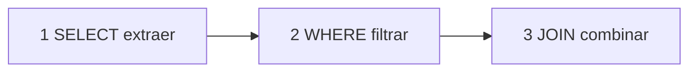

# MASTERCLASS: SQL para Ingeniero de IA — Consultar, Filtrar y Combinar Datos 🗄️

## INTRODUCCIÓN: POR QUÉ SQL ES FUNDAMENTAL 🎯

Los modelos de IA necesitan datos, y esos datos viven en bases de datos que se consultan con SQL. Sin SQL no podés alimentar a un modelo con la información correcta. Esta guía enseña los comandos básicos: SELECT, WHERE y JOIN.

> **Objetivo de Aprendizaje** 🎯 — Al terminar, sabrás escribir una consulta SQL que extraiga, filtre y combine datos de una base de datos.

> **Advertencia educativa** ⚠️ — Esta guía es formativa. SQL es un lenguaje estándar para bases de datos relacionales.

## 🗺️ MAPA — Tres Comandos Clave



*Se lee de izquierda a derecha. 3 pasos de contenido.*

## 🧩 PARTE 1: SQL (Nivel 1 / 1) 🗄️

1. ❓ PRETEST — Antes de enseñar: ¿qué tres comandos básicos de SQL debés dominar antes de trabajar con datos de IA?
   > Respuesta esperada: SELECT (extraer), WHERE (filtrar) y JOIN (combinar tablas).
   > Si sabés los tres: camino rápido → punto 7.

2. 🎯 POR QUÉ + LOGRO — Importa porque los datos son el combustible de la IA y SQL es cómo los conseguís. Vas a lograr escribir una consulta que extraiga y filtre información.

3. ⚡ VICTORIA RÁPIDA (<5 min) — Abrí una consola de SQL (incluso una online) y escribí: SELECT nombre FROM clientes WHERE ciudad = 'Buenos Aires'. Ver una fila devuelta es éxito.
   📌 Consultar datos es hacer una pregunta precisa a la base de datos.

4. 💡 CONCEPTO — Analogía: SQL es el lenguaje para preguntarle a una biblioteca dónde está cada libro y cuántos hay. Definición: un lenguaje para extraer datos (SELECT), filtrarlos (WHERE) y combinar varias tablas (JOIN). Una idea nueva: sin SQL no podés alimentar a un modelo de IA con la información correcta.

5. 👀 EJEMPLO RESUELTO — Caso: una tienda quiere saber cuántos productos vendió ayer. Pasos: (1) identificá la tabla de ventas, (2) filtrá por fecha de ayer con WHERE, (3) contá los registros con SELECT.
   ```mermaid
   flowchart LR
   A["1 Tabla de ventas"] --> B["2 WHERE filtra ayer"]
   B --> C["3 SELECT cuenta registros"]
   ```
   *Se lee de izquierda a derecha. 3 pasos de contenido.*

6. ⚠️ CONTRA-EJEMPLO / ERROR TÍPICO — Intentar traer toda la base de datos a Python y filtrar ahí en vez de dejar que SQL filtre. Eso es lento y consume memoria. Corrección: filtrá en la base de datos con WHERE antes de traer los datos.

7. 🧪 PRÁCTICA — Escribí una consulta SQL que extraiga los nombres de clientes que gastaron más de $100. (Contexto distinto: acá filtrás por monto, no por fecha.)
   > Respuesta esperada / criterio: la consulta usa SELECT, FROM y WHERE con el monto.

8. 🔁 RECALL — Sin mirar: ¿qué hace WHERE en SQL? (Nivel Bloom: recordar)
   > Respuesta esperada: filtra las filas según una condición.

9. 📌 IDEA CLAVE — SQL filtra y combina datos para que la IA reciba solo lo que necesita.

10. ✅ AUTO-CHEQUEO + SIGUIENTE — [ ] Escribí una consulta SELECT. [ ] Usé WHERE para filtrar. [ ] Entendí qué hace JOIN. Siguiente: guía de Arquitectura de APIs.

## ✅ CIERRE

Con SQL podés extraer los datos que necesitas. El siguiente paso es aprender cómo esos datos viajan entre sistemas mediante APIs.
