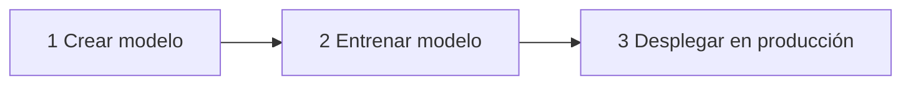

# MASTERCLASS: TensorFlow para IA — Modelos de Despliegue y Producción 🌀

## INTRODUCCIÓN: POR QUÉ TENSORFLOW SE USA EN PRODUCCIÓN 🎯

TensorFlow es una librería de aprendizaje profundo desarrollada por Google, diseñada para llevar modelos desde la experimentación hasta el despliegue real en dispositivos, servidores y navegadores.

> **Objetivo de Aprendizaje** 🎯 — Al terminar, sabrás qué es TensorFlow, cuál es su foco en despliegue y cómo se diferencia de otras librerías de IA.

> **Advertencia educativa** ⚠️ — Esta guía es formativa. TensorFlow es una plataforma de código abierto para aprendizaje automático y profundo.

## 🗺️ MAPA — Flujo TensorFlow



*Se lee de izquierda a derecha. 3 pasos de contenido.*

## 🧩 PARTE 1: TensorFlow (Nivel 1 / 1) 🌀

1. ❓ PRETEST — Antes de enseñar: ¿cuál es el enfoque principal de TensorFlow en el ecosistema de IA?
   > Respuesta esperada: construir y desplegar modelos de aprendizaje profundo en entornos de producción, incluyendo servidores, dispositivos móviles y navegadores.
   > Si sabés la respuesta: camino rápido → punto 7.

2. 🎯 POR QUÉ + LOGRO — Importa porque un modelo que solo funciona en un notebook no sirve si no se puede desplegar. TensorFlow se enfoca en llevar modelos a producción de forma escalable. Vas a lograr entender su propósito principal.

3. ⚡ VICTORIA RÁPIDA (<5 min) — Pensá en una app de teléfono que reconoce voz o imágenes sin internet. Ese es un ejemplo de modelo desplegado en el dispositivo, el terreno de TensorFlow Lite.
   📌 TensorFlow lleva modelos a donde los usuarios están.

4. 💡 CONCEPTO — Analogía: TensorFlow es una fábrica que no solo diseña el producto (el modelo), sino que lo empaqueta y lo envía a miles de tiendas (dispositivos y servidores). Definición: una plataforma de código abierto para crear, entrenar y desplegar modelos de aprendizaje automático y profundo a gran escala. Una idea nueva: crear el modelo es solo la mitad; desplegarlo es la otra mitad.

5. 👀 EJEMPLO RESUELTO — Caso: un sistema de recomendación de productos para una tienda online. Pasos: (1) definís el modelo en TensorFlow con los datos de compras, (2) entrenás el modelo para predecir qué producto le interesa a cada usuario, (3) desplegás el modelo en un servidor para que la web lo consulte en tiempo real.
   ```mermaid
   flowchart LR
   A["1 Definir modelo en TensorFlow"] --> B["2 Entrenar con datos de compras"]
   B --> C["3 Desplegar servidor en tiempo real"]
   ```
   *Se lee de izquierda a derecha. 3 pasos de contenido.*

6. ⚠️ CONTRA-EJEMPLO / ERROR TÍPICO — Quedarse solo en la fase de entrenamiento en un notebook y no pensar en cómo el modelo será usado por una aplicación real. Eso deja el modelo inutilizable. Corrección: desde el inicio, diseñá pensando en el despliegue.

7. 🧪 PRÁCTICA — Escribí un escenario donde un modelo de IA deba correr en un dispositivo con pocos recursos (por ejemplo, un teléfono o una cámara). (Contexto distinto: acá es análisis de escenario, no código.)
   > Respuesta esperada / criterio: se nombra el dispositivo y se explica por qué necesita un modelo ligero y desplegado.

8. 🔁 RECALL — Sin mirar: ¿cuál es el foco principal de TensorFlow? (Nivel Bloom: recordar)
   > Respuesta esperada: construir y desplegar modelos de aprendizaje profundo en entornos de producción de forma escalable.

9. 📌 IDEA CLAVE — TensorFlow se destaca por llevar modelos de IA a producción, no solo entrenarlos.

10. ✅ AUTO-CHEQUEO + SIGUIENTE — [ ] Entendí qué es TensorFlow. [ ] Conozco su foco en despliegue. [ ] Analicé un escenario de dispositivo con pocos recursos. Siguiente: guía de LangChain.

## ✅ CIERRE

TensorFlow lleva modelos a producción. El siguiente paso es LangChain, la librería para construir aplicaciones que conectan modelos de lenguaje con datos y herramientas.
