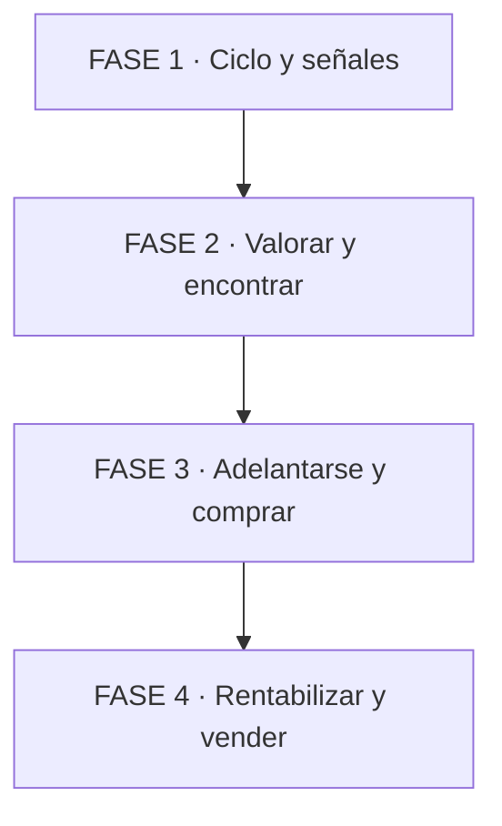

# MASTERCLASS: Compra y Venta de Inmuebles con Lógica de Economista y Analista de Bienes Raíces 🏠📈

## INTRODUCCIÓN: POR QUÉ ESTA MASTERCLASS ES DIFERENTE 🎯

Comprar una propiedad no es solo elegir una casa bonita. Es una decisión de inversión que combina macroeconomía (tasas, inflación, empleo) con análisis micro de mercado (ubicación, oferta, demanda, estado del inmueble). Esta guía une el rol de economista y el de analista de bienes raíces para que sepas cuándo comprar, cómo adelantarte a la adquisición y cómo obtener rendimiento o ganancia.

> **Objetivo de Aprendizaje** 🎯 — Al terminar, sabrás leer señales del ciclo inmobiliario, valorar una propiedad, identificar oportunidades antes que otros, calcular rendimiento y planificar la salida con ganancia.

> **Advertencia educativa** ⚠️ — Esta guía es formativa. Los mercados de bienes raíces varían por país, ciudad y momento. No constituye asesoría financiera ni de inversión personalizada.

## 🗺️ MAPA DE 4 FASES — Del Análisis a la Salida con Ganancia



*Se lee de arriba hacia abajo. 4 fases: ciclo y señales → valorar y encontrar → adelantarse y comprar → rentabilizar y vender.*

Las 5 partes se recorren en orden:

1️⃣ PARTE 1: Ciclos inmobiliarios y señales macro (rol economista)
2️⃣ PARTE 2: Análisis de mercado local y valoración (rol analista)
3️⃣ PARTE 3: Adelantarse a la adquisición (off-market, preventa, subasta)
4️⃣ PARTE 4: Rendimiento económico y ganancia (renta, plusvalía, flip)
5️⃣ PARTE 5: Cierre de compra, negociación y estrategia de salida

## 📖 Glosario (declarado)

| Término | Definición en una línea |
|---------|------------------------|
| Ciclo inmobiliario | Fases de expansión, pico, contracción y recuperación del mercado |
| Tasa de interés | Costo del dinero que afecta hipotecas y demanda de compra |
| Plusvalía | Aumento del valor de una propiedad por mejoras en el entorno |
| Rendimiento de alquiler | Ingreso anual por renta dividido entre el precio de compra |
| Off-market | Propiedad que se vende sin publicarse en portales públicos |
| Preventa | Compra de inmueble antes de que esté terminado |
| Cap rate | Tasa de capitalización: ingreso neto dividido entre valor del activo |
| Flip | Comprar, mejorar y vender rápido para ganar diferencia de precio |

*(Glosario declarado: excepción de la regla de tablas de ≤4 filas.)*

Cada PARTE sigue la plantilla fija: pretest → por qué/logro → victoria rápida → concepto con analogía → ejemplo resuelto + diagrama ≤4 pasos → contra-ejemplo → práctica con respuesta esperada → recall → idea clave → auto-chequeo.

---

## 🧩 PARTE 1: Ciclos Inmobiliarios y Señales Macro (Nivel 1 / 5) 📊

1. ❓ PRETEST — Antes de enseñar: ¿en qué fase del ciclo inmobiliario conviene más comprar?
   > Respuesta esperada: en fase de recuperación o contracción, cuando los precios están bajos o estancados y hay más oferta que demanda.
   > Si sabés la respuesta: camino rápido → punto 7.

2. 🎯 POR QUÉ + LOGRO — Importa porque comprar en el pico del ciclo significa pagar caro y arriesgar caída de precios. Vas a lograr identificar en qué fase está tu mercado antes de decidir.

3. ⚡ VICTORIA RÁPIDA (<5 min) — Buscá en una web de noticias o banco central la tasa de interés hipotecaria actual y comparala con la del año pasado. Si bajó o se mantuvo baja, es una señal positiva para comprar.
   📌 Las tasas bajas impulsan la demanda; las altas la enfrían.

4. 💡 CONCEPTO — Analogía: el ciclo inmobiliario es como el clima; no comprás abrigo en pleno verano al precio máximo, esperás la temporada de descuentos. Definición: el mercado inmobiliario pasa por expansión, pico, contracción y recuperación. El economista lee tasas de interés, empleo, inflación y construcción nueva para ubicar la fase actual. Una idea nueva: comprar en contracción es comprar con margen de seguridad.

5. 👀 EJEMPLO RESUELTO — Caso: una ciudad sube tasas de interés y los créditos hipotecarios se encarecen. Pasos: (1) las tasas suben, (2) menos gente puede pedir crédito, (3) la demanda cae, (4) los precios se estabilizan o bajan; es momento de evaluar compra con poder de negociación.
   ```mermaid
   flowchart LR
   A["1 Tasas suben"] --> B["2 Crédito se encarece"]
   B --> C["3 Demanda cae"]
   C --> D["4 Precios se estabilizan"]
   ```
   *Se lee de izquierda a derecha. 4 pasos de contenido.*

6. ⚠️ CONTRA-EJEMPLO / ERROR TÍPICO — Comprar porque "todos dicen que ahora es buen momento" sin revisar tasas ni oferta. Eso es comprar en el pico por efecto manada. Corrección: esperá señales macro objetivas antes de firmar.

7. 🧪 PRÁCTICA — Escribí tres señales macro que revisarías antes de comprar en tu ciudad (por ejemplo, tasas, desempleo, nuevas construcciones). (Contexto distinto: acá es análisis macro, no visita a inmuebles.)
   > Respuesta esperada / criterio: tres indicadores macroeconómicos relevantes para el mercado inmobiliario local.

8. 🔁 RECALL — Sin mirar: ¿en qué fase del ciclo inmobiliario conviene comprar? (Nivel Bloom: recordar)
   > Respuesta esperada: en fase de recuperación o contracción, con precios bajos o estancados y mayor oferta.

9. 📌 IDEA CLAVE — Comprar en el pico del ciclo es pagar el precio más alto; comprar en contracción es comprar con margen.

10. ✅ AUTO-CHEQUEO + SIGUIENTE — [ ] Sé leer tasas de interés. [ ] Entendí las fases del ciclo. [ ] Identifiqué señales para mi ciudad. Siguiente: PARTE 2 (Valorar y encontrar).

---

## 🧩 PARTE 2: Análisis de Mercado Local y Valoración (Nivel 2 / 5) 🔍

1. ❓ PRETEST — Antes de enseñar: ¿qué tres factores determinan el valor de una propiedad?
   > Respuesta esperada: ubicación, estado y características del inmueble, y oferta/demande de la zona.
   > Si sabés los tres: camino rápido → punto 7.

2. 🎯 POR QUÉ + LOGRO — Importa porque pagar más de lo que vale una propiedad destruye el rendimiento antes de empezar. Vas a lograr valorar un inmueble comparándolo con otros similares.

3. ⚡ VICTORIA RÁPIDA (<5 min) — Entrá a un portal inmobiliario y buscá tres propiedades en venta en la misma cuadra o zona similar. Anotá sus precios y superficies. Eso ya es un análisis de comparación.
   📌 El valor de una propiedad se mide contra las de al lado, no contra lo que el vendedor quiere.

4. 💡 CONCEPTO — Analogía: valorar una propiedad es como tasar un auto usado; mirás el modelo, el año, el estado y cuánto piden otros por uno igual. Definición: el analista de bienes raíces compara ventas recientes (comps), ajusta por estado y ubicación, y calcula valor de mercado. Una idea nueva: el precio de oferta es lo que piden; el precio de venta es lo que realmente pagan.

5. 👀 EJEMPLO RESUELTO — Caso: departamento de 2 ambientes en una zona céntrica. Pasos: (1) buscás tres departamentos similares vendidos en los últimos 90 días, (2) anotás precio por metro cuadrado de cada uno, (3) promediás y ajustás si el tuyo tiene cochera o necesita pintura, (4) llegás al valor estimado.
   ```mermaid
   flowchart LR
   A["1 Buscá tres ventas recientes"] --> B["2 Precio por m2"]
   B --> C["3 Ajustás por estado"]
   C --> D["4 Valor estimado"]
   ```
   *Se lee de izquierda a derecha. 4 pasos de contenido.*

6. ⚠️ CONTRA-EJEMPLO / ERROR TÍPICO — Pagar el precio de lista sin negociar, basándose solo en lo que dice el vendedor o el corredor. Eso es comprar sin margen. Corrección: usá ventas reales comparables como base de negociación.

7. 🧪 PRÁCTICA — Escribí cómo calcularías el precio por metro cuadrado de una propiedad usando tres anuncios de venta de la misma zona. (Contexto distinto: acá es cálculo de valoración, no visita física.)
   > Respuesta esperada / criterio: se explica dividir precio de venta entre metros cuadrados y promediar los tres casos.

8. 🔁 RECALL — Sin mirar: ¿cuáles son los tres factores que determinan el valor de una propiedad? (Nivel Bloom: recordar)
   > Respuesta esperada: ubicación, estado y características del inmueble, y oferta/demanda de la zona.

9. 📌 IDEA CLAVE — No pagues el precio de lista; paga el valor de mercado basado en ventas comparables.

10. ✅ AUTO-CHEQUEO + SIGUIENTE — [ ] Sé usar portales para comparar. [ ] Entendí precio por m2. [ ] Puedo ajustar por estado. Siguiente: PARTE 3 (Adelantarse a la adquisición).

---

## 🧩 PARTE 3: Adelantarse a la Adquisición (Nivel 3 / 5) ⚡

1. ❓ PRETEST — Antes de enseñar: ¿qué significa comprar off-market?
   > Respuesta esperada: comprar una propiedad que no está publicada en portales públicos, a través de contactos directos o corredores con cartera privada.
   > Si sabés la respuesta: camino rápido → punto 7.

2. 🎯 POR QUÉ + LOGRO — Importa porque las mejores oportunidades no aparecen en los portales; aparecen antes, cuando pocos saben que la propiedad se vende. Vas a lograr acceder a inventario con menos competencia.

3. ⚡ VICTORIA RÁPIDA (<5 min) — Hacé una lista de cinco personas que podrían saber de alguien que quiere vender (corredores, administradores de edificios, abogados, constructores). Contactar a uno es éxito.
   📌 La información llega antes por redes que por portales.

4. 💡 CONCEPTO — Analogía: comprar off-market es como conseguir entradas para un show antes de que salgan a la venta general; pagás menos y tenés más opciones. Definición: adquirir una propiedad mediante canales privados antes de que llegue al mercado masivo. Incluye preventas, subastas judiciales, herencias y contactos directos. Una idea nueva: quien tiene mejor información, compra mejor.

5. 👀 EJEMPLO RESUELTO — Caso: un edificio donde el dueño de un departamento necesita mudarse rápido por trabajo. Pasos: (1) el portero o administrador te avisa antes de que se publique, (2) contactás al dueño directamente, (3) negociás precio bajo por la urgencia, (4) cerrás la compra sin competencia de otros compradores.
   ```mermaid
   flowchart LR
   A["1 Aviso temprano"] --> B["2 Contacto directo"]
   B --> C["3 Negociación por urgencia"]
   C --> D["4 Compra sin competencia"]
   ```
   *Se lee de izquierda a derecha. 4 pasos de contenido.*

6. ⚠️ CONTRA-EJEMPLO / ERROR TÍPICO — Esperar a que la propiedad esté en todos los portales y pujar contra diez compradores. Eso sube el precio. Corrección: construí una red de contactos que te avise primero.

7. 🧪 PRÁCTICA — Escribí tres canales off-market que usarías para enterarte de ventas antes que el público general. (Contexto distinto: acá es diseño de red de contactos, no visita a inmuebles.)
   > Respuesta esperada / criterio: tres canales concretos (por ejemplo, corredores, administradores, abogados de sucesiones).

8. 🔁 RECALL — Sin mirar: ¿qué es comprar off-market? (Nivel Bloom: recordar)
   > Respuesta esperada: comprar una propiedad antes de que se publique en portales, mediante canales privados y contactos directos.

9. 📌 IDEA CLAVE — Las mejores oportunidades se compran antes de que estén a la vista de todos.

10. ✅ AUTO-CHEQUEO + SIGUIENTE — [ ] Conozco tres canales off-market. [ ] Entendí la ventaja de comprar temprano. [ ] Sé por qué evitar pujas públicas. Siguiente: PARTE 4 (Rendimiento y ganancia).

---

## 🧩 PARTE 4: Rendimiento Económico y Ganancia (Nivel 4 / 5) 💰

1. ❓ PRETEST — Antes de enseñar: ¿qué es el rendimiento de alquiler y cómo se calcula?
   > Respuesta esperada: es el ingreso anual por alquiler dividido entre el precio de compra, expresado en porcentaje.
   > Si sabés la respuesta: camino rápido → punto 7.

2. ⚡ VICTORIA RÁPIDA (<5 min) — Pensá en un inmueble que se alquila a $500 mensuales y que compraste a $100.000. El ingreso anual es $6.000; el rendimiento bruto es 6 %. Ese cálculo es éxito.
   📌 El rendimiento mide qué tan eficiente es tu inversión.

3. 🎯 POR QUÉ + LOGRO — Importa porque una propiedad puede subir de valor (plusvalía) o generar renta; idealmente hace ambas. Vas a lograr calcular rendimiento y decidir entre renta o reventa rápida.

4. 💡 CONCEPTO — Analogía: el rendimiento de alquiler es como el interés de un depósito bancario, pero con un inmueble; el flip es como comprar barato, arreglar y vender caro. Definición: rendimiento bruto = renta anual ÷ precio de compra; plusvalía = diferencia entre precio de venta y compra por mejora del entorno; flip = comprar, reformar y vender rápido. Una idea nueva: no todas las propiedades sirven para alquilar; algunas sirven para vender rápido.

5. 👀 EJEMPLO RESUELTO — Caso: departamento comprado a $80.000, alquilado a $450 mensuales. Pasos: (1) renta anual = $450 × 12 = $5.400, (2) rendimiento bruto = $5.400 ÷ $80.000 = 6,75 %, (3) si después de 3 años lo vendés a $100.000, ganaste $20.000 de plusvalía más la renta acumulada.
   ```mermaid
   flowchart LR
   A["1 Compra a $80.000"] --> B["2 Renta mensual $450"]
   B --> C["3 Rendimiento bruto 6,75 %"]
   C --> D["4 Venta a $100.000"]
   ```
   *Se lee de izquierda a derecha. 4 pasos de contenido.*

6. ⚠️ CONTRA-EJEMPLO / ERROR TÍPICO — Comprar un inmueble solo porque "los precios siempre suben", sin calcular si la renta cubre gastos. Eso puede dejarte con un activo que no genera flujo. Corrección: exigí rendimiento mínimo antes de comprar.

7. 🧪 PRÁCTICA — Escribí cómo decidirías entre alquilar una propiedad o hacerle flip, dado su estado y la demanda de alquiler en la zona. (Contexto distinto: acá es toma de decisión de estrategia, no cálculo numérico.)
   > Respuesta esperada / criterio: se menciona comparar rendimiento de alquiler vs ganancia estimada de reventa tras reforma.

8. 🔁 RECALL — Sin mirar: ¿cómo se calcula el rendimiento bruto de alquiler? (Nivel Bloom: recordar)
   > Respuesta esperada: ingreso anual por alquiler dividido entre el precio de compra, expresado en porcentaje.

9. 📌 IDEA CLAVE — Una buena inversión inmobiliaria genera renta mientras esperas la plusvalía, o ganancia rápida si hacés flip.

10. ✅ AUTO-CHEQUEO + SIGUIENTE — [ ] Sé calcular rendimiento bruto. [ ] Entendí la diferencia entre renta y flip. [ ] Puedo elegir estrategia según la zona. Siguiente: PARTE 5 (Cierre, negociación y salida).

---

## 🧩 PARTE 5: Cierre de Compra, Negociación y Estrategia de Salida (Nivel 5 / 5) 🤝

1. ❓ PRETEST — Antes de enseñar: ¿qué es una estrategia de salida en bienes raíces?
   > Respuesta esperada: el plan definido desde la compra sobre cómo y cuándo vender o refinanciar para recuperar la inversión y obtener ganancia.
   > Si sabés la respuesta: camino rápido → punto 7.

2. 🎯 POR QUÉ + LOGRO — Importa porque comprar sin saber cuándo vas a salir es como embarcarse sin destino. Vas a lograr negociar mejor precio y planificar la venta con ganancia.

3. ⚡ VICTORIA RÁPIDA (<5 min) — Escribí una fecha objetivo para vender o refinanciar tu próxima propiedad (por ejemplo, dentro de 3 o 5 años). Tener esa fecha es éxito.
   📌 Sin fecha de salida, no hay plan de inversión.

4. 💡 CONCEPTO — Analogía: negociar el precio de compra es como regatear en un mercado; cuanto más sepas del vendedor y del bien, más bajo podés llegar. Definición: la estrategia de salida define si venderás al alza, alquilarás a largo plazo o refinanciarás para liberar capital. Una idea nueva: el precio de compra se negocia antes de firmar; el precio de venta se decide con la salida planificada.

5. 👀 EJEMPLO RESUELTO — Caso: comprás un departamento en preventa. Pasos: (1) negociás precio directo con la constructora antes del lanzamiento, (2) al entregarlo, el mercado subió y hay lista de espera, (3) lo vendés con plusvalía o lo alquilas con rendimiento alto.
   ```mermaid
   flowchart LR
   A["1 Negociación preventa"] --> B["2 Entrega y mercado alto"]
   B --> C["3 Venta con plusvalía o renta"]
   ```
   *Se lee de izquierda a derecha. 3 pasos de contenido.*

6. ⚠️ CONTRA-EJEMPLO / ERROR TÍPICO — Firmar una compra sin cláusulas de salida ni sin saber los costos de cierre (impuestos, escrituras, comisión). Eso reduce la ganancia real. Corrección: calculá todos los costos de entrada y salida antes de ofrecer.

7. 🧪 PRÁCTICA — Escribí tu estrategia de salida para una propiedad que compres hoy: vender en 5 años, alquilar 10 años o flip en 12 meses. (Contexto distinto: acá es planificación de salida, no cierre de operación.)
   > Respuesta esperada / criterio: una estrategia clara con plazo y motivo.

8. 🔁 RECALL — Sin mirar: ¿qué es una estrategia de salida? (Nivel Bloom: recordar)
   > Respuesta esperada: el plan definido desde la compra sobre cómo y cuándo vender o refinanciar para recuperar la inversión y obtener ganancia.

9. 📌 IDEA CLAVE — Comprar bien es la mitad del éxito; saber cuándo y cómo salir es la otra mitad.

10. ✅ AUTO-CHEQUEO + SIGUIENTE — [ ] Definí mi estrategia de salida. [ ] Conozco los costos de cierre. [ ] Sé negociar el precio de compra. Fin del roadmap.

---

## ✅ CIERRE Y LISTA DE VERIFICACIÓN FINAL

Resumen del camino:

- PARTE 1: Ciclos y señales macro — comprar en contracción, no en el pico.
- PARTE 2: Valoración local — precio por m2 basado en ventas comparables.
- PARTE 3: Adelantarse — comprar off-market antes que el público.
- PARTE 4: Rendimiento — renta, plusvalía o flip según la zona.
- PARTE 5: Cierre y salida — negociar compra y planificar venta con ganancia.

> ✅ Checklist final — [ ] Leí señales macro de mi mercado. [ ] Valoré una propiedad con ventas comparables. [ ] Tengo tres canales off-market. [ ] Calcularé rendimiento bruto antes de comprar. [ ] Definí mi estrategia de salida con fecha.

Con este método de economista y analista de bienes raíces, tendrás el criterio para comprar en el momento ideal, adelantarte a la mayoría y convertir cada inmueble en rendimiento o ganancia. No esperes el momento perfecto; empezá analizando el ciclo hoy.
