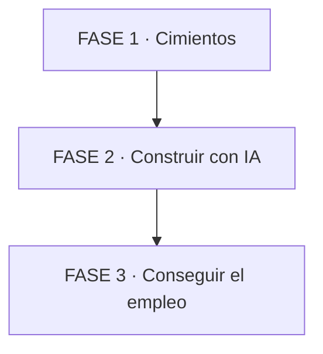

# MASTERCLASS: Ingeniero de IA de Alto Impacto — Roadmap de 5 Niveles hasta $300.000 USD 🚀🧠

## INTRODUCCIÓN: POR QUÉ ESTA MASTERCLASS ES DIFERENTE 🎯

La mayoría de los cursos de IA enseñan teoría: historia de las redes neuronales, matemáticas densas y arquitecturas que nunca usarás. Este masterclass sigue el camino opuesto: **aprender construyendo**, sin caer en el "tutorial hell" de ver tutoriales sin practicar.

La hoja de ruta original tiene cuatro niveles: fundamentos, dominio de modelos, implementación de sistemas y búsqueda de empleo. Le agrego un **quinto nivel: capstone de impacto**, un proyecto de portafolio propio que demuestre que sabes construir, no solo consumir.

El objetivo no es saber todo de IA. El objetivo es entregar sistemas que usen IA de forma segura, medible y rentable. Eso es lo que paga hasta $300.000 USD anuales.

> **Objetivo de Aprendizaje** 🎯 — Al terminar, sabrás programar en Python para IA, consultar datos con SQL, conectar modelos por API, montar una tubería RAG, desplegar en la nube y presentar un proyecto de impacto que atraiga ofertas de empleo.

> **Advertencia educativa** ⚠️ — Esta guía resume una hoja de ruta en video y le agrega estructura de enseñanza. Las cifras salariales son referencias del mercado, no garantías. No se inventan citas científicas; todas las técnicas de enseñanza se aplican según la especificación del blog.

## 🗺️ MAPA DE 3 FASES — Niveles 1 → 5



*Se lee de arriba hacia abajo. 3 pasos: cimientos → construir con IA → conseguir el empleo.*

Los cinco niveles se recorren en orden, y cada uno es requisito del siguiente:

1️⃣ **Nivel 1 · Fundamentos:** Python, SQL, API.
2️⃣ **Nivel 2 · Dominio de modelos:** CAM (contexto, APIs de modelos, modelos locales).
3️⃣ **Nivel 3 · Sistemas en producción:** RAG, agentes, despliegue, gobernanza.
4️⃣ **Nivel 4 · Conseguir el empleo:** portafolio, visibilidad, networking.
5️⃣ **Nivel 5 · Capstone de impacto:** proyecto terminado y publicado.

## 📖 Términos clave (glosario, declarado)

| Término | Definición |
|---------|-----------|
| Python | Lenguaje principal para escribir la lógica de IA |
| SQL | Lenguaje para extraer, filtrar y combinar datos |
| API | Interfaz que deja que dos programas se comuniquen |
| LLM | Modelo de lenguaje grande que genera texto |
| RAG | Tubería que deja que la IA consulte datos privados |
| Despliegue | Poner un sistema a disposición en la nube |

*(Glosario declarado: excepción de la regla de tablas de ≤4 filas.)*

Cada PARTE sigue la plantilla fija: pretest → por qué/logro → victoria rápida → concepto con analogía → ejemplo resuelto → contra-ejemplo → práctica con respuesta esperada → recall → idea clave → auto-chequeo.

---

## 🧩 PARTE 1: Nivel 1 — Fundamentos (Nivel 1/5) 🐍

1. ❓ PRETEST — Antes de enseñar: ¿qué tres herramientas necesitas dominar antes de tocar cualquier modelo de IA?
   > Respuesta esperada: Python (lenguaje), SQL (datos) y una API (comunicación entre sistemas).
   > Si acertás las tres: camino rápido → andá al punto 7 (PRÁCTICA).

2. 🎯 POR QUÉ + LOGRO — Importa porque sin estos cimientos cualquier sistema de IA es frágil e imposible de mantener. Vas a lograr escribir un script de Python, consultar una tabla con SQL y exponer un dato por una API.

3. ⚡ VICTORIA RÁPIDA (<5 min) — Abrí una terminal y escribí una sola línea que imprima un texto. Éxito garantizado: ver la salida en pantalla.
   📌 Tu primera línea de código ya es un programa.

4. 💡 CONCEPTO — Analogía: Python es el idioma que habla la computadora; SQL es el lenguaje para preguntarle a una biblioteca dónde está cada libro; la API es el cajero automático que te deja pedir dinero al banco sin entrar a la oficina. Definición: dominás Python para lógica, SQL para datos y APIs para conectar sistemas. Una idea nueva por sección: los tres cimientos.

5. 👀 EJEMPLO RESUELTO — Caso: una tienda quiere saber cuántos productos vendió ayer. Pasos: (1) abrís Python, (2) usás SQL para extraer las ventas de ayer filtrando por fecha, (3) envolvés ese número en una función de API que lo devuelve al consultarla.
   ```mermaid
   flowchart LR
   A["1 Pedís la venta"] --> B["2 SQL filtra ayer"]
   B --> C["3 API devuelve el número"]
   ```
   *Se lee de izquierda a derecha. 3 pasos de contenido.*

6. ⚠️ CONTRA-EJEMPLO / ERROR TÍPICO — Intentar aprender Python viendo veinte horas de tutoriales sin escribir una sola línea. Eso es "tutorial hell" y no produce habilidad. Corrección: por cada video que veas, escribí vos mismo el código que muestra.

7. 🧪 PRÁCTICA — Escribí en Python una lista con tres productos y sus precios, y mostrá el más caro. (Contexto distinto al ejemplo: acá es una lista en memoria, no una base de datos.)
   > Respuesta esperada / criterio: el programa imprime el producto con el precio más alto de los tres.

8. 🔁 RECALL — Sin mirar arriba: ¿para qué sirve SQL en este nivel? (Nivel Bloom: recordar)
   > Respuesta esperada: extraer, filtrar y combinar datos (SELECT, WHERE, JOIN).

9. 📌 IDEA CLAVE — Los tres cimientos son Python, SQL y API; sin ellos no construís sistemas de IA, solo los usás.

10. ✅ AUTO-CHEQUEO + SIGUIENTE — [ ] Escribí un script de Python. [ ] Consulté datos con SQL. [ ] Expuse un resultado por una API. Siguiente: PARTE 2 (Nivel 2, Dominio de modelos).

---

## 🧩 PARTE 2: Nivel 2 — Dominio de modelos (Nivel 2/5) 🤖

1. ❓ PRETEST — ¿Cuál es la diferencia entre un prompt básico y un system prompt?
   > Respuesta esperada: el prompt básico es una pregunta suelta; el system prompt define quién es la IA y cómo debe comportarse en toda la conversación.
   > Si sabés la diferencia: camino rápido → punto 7.

2. 🎯 POR QUÉ + LOGRO — Importa porque el mismo modelo da respuestas distintas según el contexto que le des. Vas a lograr escribir un system prompt y hacer que un modelo responda como querés.

3. ⚡ VICTORIA RÁPIDA (<5 min) — Abrí un chat de IA y pegá este system prompt: "Sos un asistente que responde siempre en español y en una sola oración." Luego hacé una pregunta y verificá que obedece.
   📌 El contexto manda sobre el modelo.

4. 💡 CONCEPTO — Analogía: el system prompt es el manual de reglas que se le da a un empleado nuevo el primer día. Definición: CAM = Context Engineering (diseñar system/master prompts), AI APIs (llamar a modelos desde código Python), Models (correr modelos locales de Hugging Face). Una idea nueva: el modelo obedece el contexto, no adivina tus intenciones.

5. 👀 EJEMPLO RESUELTO — Caso: necesitás que la IA redacte correos de venta en tono profesional. Pasos: (1) escribís un system prompt que defina el rol (redactor de ventas), el tono (profesional) y el formato (asunto + cuerpo); (2) desde Python llamás a la API de OpenAI o Anthropic pasando ese system prompt y el cliente; (3) probá con un modelo local de Hugging Face para comparar costo y calidad.
   ```mermaid
   flowchart LR
   A["1 System prompt define el rol"] --> B["2 Python llama a la API"]
   B --> C["3 Comparás con modelo local"]
   ```
   *Se lee de izquierda a derecha. 3 pasos de contenido.*

6. ⚠️ CONTRA-EJEMPLO / ERROR TÍPICO — Pedirle al modelo "escribí un correo de ventas" sin contexto. Resultado: texto genérico que no convence. Corrección: especificar rol, tono, audiencia y formato en el system prompt.

7. 🧪 PRÁCTICA — Escribí un system prompt que haga que la IA resuma noticias en máximo tres viñetas, y probalo con un titular cualquiera.
   > Respuesta esperada / criterio: el sistema devuelve exactamente tres viñetas cortas sobre la noticia.

8. 🔁 RECALL — Sin mirar: ¿qué hace el "C" de CAM? (Nivel Bloom: recordar)
   > Respuesta esperada: Context Engineering, diseñar system/master prompts para que la IA entienda el rol y la tarea.

9. 📌 IDEA CLAVE — Un buen contexto (system prompt) vale más que un modelo más caro.

10. ✅ AUTO-CHEQUEO + SIGUIENTE — [ ] Escribí un system prompt. [ ] Llamé a una API de IA desde Python. [ ] Probé un modelo local. Siguiente: PARTE 3 (Nivel 3, Sistemas en producción).

---

## 🧩 PARTE 3: Nivel 3 — Sistemas en producción (Nivel 3/5) 🏗️

1. ❓ PRETEST — ¿Qué significa RAG en una frase?
   > Respuesta esperada: Retrieval-Augmented Generation, dejar que la IA consulte datos externos privados antes de responder.
   > Si lo sabés: camino rápido → punto 7.

2. 🎯 POR QUÉ + LOGRO — Importa porque los modelos públicos no conocen los datos de tu empresa. Vas a lograr conectar una base de datos vectorial a un modelo para que responda con información privada.

3. ⚡ VICTORIA RÁPIDA (<5 min) — Subí un PDF pequeño a una herramienta de chat con documentos y hacé una pregunta sobre su contenido. Si responde usando el archivo, ya hiciste RAG básico.
   📌 La IA + tus datos = RAG.

4. 💡 CONCEPTO — Analogía principal: RAG es un examen abierto donde el estudiante puede consultar el libro de texto antes de responder. Definición: la tubería de producción tiene cuatro estaciones del mismo sistema.
   - Base de datos vectorial: analogía, es el índice al final del libro que te dice en qué página está cada tema. Definición: guarda fragmentos de datos para que la IA los encuentre rápido.
   - Agentes: analogía, son empleados especializados que se reparten el trabajo. Definición: varias IA que coordinan tareas de extremo a extremo.
   - MCP: analogía, es el enchufe estándar que deja conectar cualquier aparato. Definición: protocolo que conecta agentes con herramientas y datos.
   - Despliegue: analogía, es mudarte de casa a un edificio donde todos pueden entrar. Definición: poner el sistema en la nube (Docker, AWS/GCP).
   - Evaluación y gobernanza: analogía, son el inspector de calidad y el empleado que elige la herramienta más barata para cada tarea. Definición: DeepEval mide respuestas y el model routing elige el modelo más económico según la complejidad.

5. 👀 EJEMPLO RESUELTO — Caso: un departamento de soporte quiere responder preguntas de su manual interno. Pasos: (1) partís el manual en fragmentos y los guardás en una base de datos vectorial; (2) cuando llega una pregunta, el sistema busca los fragmentos más parecidos; (3) se los pasás al modelo con un system prompt para que responda solo con eso; (4) desplegás en Docker en la nube.
   ```mermaid
   flowchart LR
   A["1 Fragmentos en BD vectorial"] --> B["2 Busca lo parecido"]
   B --> C["3 El modelo responde con esos datos"]
   C --> D["4 Desplegás en la nube"]
   ```
   *Se lee de izquierda a derecha. 4 pasos de contenido.*

6. ⚠️ CONTRA-EJEMPLO / ERROR TÍPICO — Subir toda la empresa al modelo como "entrenamiento" en lugar de consultarla por RAG. Eso es caro, inseguro y no funciona. Corrección: usá RAG para consultar datos privados sin reentrenar.

7. 🧪 PRÁCTICA — Diseñá en una hoja el flujo de un agente que: lea un correo, consulte el estado del pedido en una base de datos y responda al cliente. (Contexto distinto: acá es diseño de flujo, no código.)
   > Respuesta esperada / criterio: el flujo tiene tres pasos ordenados y dice dónde consulta el dato.

8. 🔁 RECALL — Sin mirar: ¿cuáles son las cuatro estaciones de la tubería de producción? (Nivel Bloom: comprender)
   > Respuesta esperada: RAG (consultar datos privados), agentes (coordinar tareas), despliegue (Docker/nube), evaluación y gobernanza (DeepEval y model routing).

9. 📌 IDEA CLAVE — En producción no importa solo el modelo; importa que los datos sean privados, el sistema esté desplegado y los costos controlados.

10. ✅ AUTO-CHEQUEO + SIGUIENTE — [ ] Entendí RAG. [ ] Diseñé un flujo de agente. [ ] Sé qué es el despliegue en Docker. Siguiente: PARTE 4 (Nivel 4, Conseguir el empleo).

---

## 🧩 PARTE 4: Nivel 4 — Conseguir el empleo (Nivel 4/5) 💼

1. ❓ PRETEST — ¿Qué diferencia un proyecto tutorial de un proyecto de portafolio?
   > Respuesta esperada: el tutorial lo copias paso a paso; el portafolio lo diseñás vos, resuelve un problema real y se puede demostrar.
   > Si la sabés: camino rápido → punto 7.

2. 🎯 POR QUÉ + LOGRO — Importa porque te contratan por lo que construiste, no por lo que cursaste. Vas a lograr tener un proyecto público que demuestre habilidad de ingeniero de IA.

3. ⚡ VICTORIA RÁPIDA (<5 min) — Abrí GitHub (o creá una cuenta) y subí un archivo README que describa una idea de proyecto de IA. Ya tenés presencia pública.
   📌 Empezar es más importante que esperar a estar listo.

4. 💡 CONCEPTO — Analogía: el portafolio es tu currículum demostrable; LinkedIn es el altavoz que lo hace visible; el networking es tocar puertas directamente. Definición: construí proyectos de impacto (multi-agente o modelo entrenado desde cero), compartí avances en público y busqué referencias activamente. Una idea nueva: la visibilidad atrae oportunidades sin que busques.

5. 👀 EJEMPLO RESUELTO — Caso: Juan construyó un agente que resume contratos de alquiler y lo publicó con un demo. Pasos: (1) eligió un problema real (entender contratos), (2) construyó el sistema con RAG + agente, (3) subió el código a GitHub con README y demo, (4) compartió el avance en LinkedIn.
   ```mermaid
   flowchart LR
   A["1 Problema real"] --> B["2 Construí el sistema"]
   B --> C["3 Código público en GitHub"]
   C --> D["4 Compartí en público"]
   ```
   *Se lee de izquierda a derecha. 4 pasos de contenido.*

6. ⚠️ CONTRA-EJEMPLO / ERROR TÍPICO — Hacer solo cursos y certificados sin mostrar nada construido. Los reclutadores ignoran los certificados sin evidencia. Corrección: un proyecto funcionando vale más que diez certificados.

7. 🧪 PRÁCTICA — Escribí el título y una frase de qué problema resuelve tu primer proyecto de impacto.
   > Respuesta esperada / criterio: un título claro y un problema real identificado.

8. 🔁 RECALL — Sin mirar: ¿cuáles son las tres palancas del nivel empleo? (Nivel Bloom: recordar)
   > Respuesta esperada: proyectos de impacto, visibilidad en público y networking proactivo.

9. 📌 IDEA CLAVE — No esperes al reclutador; construí en público y pedí referencias.

10. ✅ AUTO-CHEQUEO + SIGUIENTE — [ ] Definí mi proyecto de impacto. [ ] Tengo cuenta en GitHub. [ ] Compartí un avance en público. Siguiente: PARTE 5 (Nivel 5, Capstone de impacto).

---

## 🧩 PARTE 5: Nivel 5 — Capstone de impacto (Nivel 5/5) 🏆

1. ❓ PRETEST — ¿Qué debe tener un proyecto de capstone para contar como portafolio?
   > Respuesta esperada: problema real, construido por vos, código público, demo funcionando y resultados medibles.
   > Si la sabés: camino rápido → punto 7 (ya podés empezar a construir).

2. 🎯 POR QUÉ + LOGRO — Importa porque es la prueba definitiva de que sos ingeniero de IA, no solo estudiante. Vas a terminar con un proyecto terminado y publicado.

3. ⚡ VICTORIA RÁPIDA (<5 min) — Elegí un problema que puedas resolver en dos semanas y escribilo en una línea. Esa es tu meta del capstone.
   📌 Un problema chico terminado vale más que un proyecto grande abandonado.

4. 💡 CONCEPTO — Analogía: el capstone es tu proyecto de fin de carrera, pero aplicado: algo real que alguien pueda usar. Definición: un proyecto de principio a fin que use al menos dos niveles del roadmap (por ejemplo, fundamentos + modelos o RAG + despliegue), con código público, demo y métrica de calidad. Una idea nueva: termina y publica; lo incompleto no cuenta.

5. 👀 EJEMPLO RESUELTO — Caso: un sistema que responda preguntas de una normativa interna usando RAG y se despliegue en la nube. Pasos: (1) elegí la normativa y la dividí en fragmentos, (2) cargué los fragmentos a una base de datos vectorial, (3) conecté un modelo con system prompt, (4) desplegué en Docker en la nube y medí respuestas con DeepEval.
   ```mermaid
   flowchart LR
   A["1 Elegí la normativa"] --> B["2 Cargué a BD vectorial"]
   B --> C["3 Conecté al modelo"]
   C --> D["4 Desplegué y medí"]
   ```
   *Se lee de izquierda a derecha. 4 pasos de contenido.*

6. ⚠️ CONTRA-EJEMPLO / ERROR TÍPICO — Abandonar el proyecto al 90 % porque "falta pulirlo". Un proyecto sin publicar es como si no existiera. Corrección: publícalo aunque sea simple; lo terminado vence al perfecto.

7. 🧪 PRÁCTICA — Escribí los tres entregables de tu capstone: código, demo y una métrica de calidad.
   > Respuesta esperada / criterio: lista los tres entregables con una frase cada uno.

8. 🔁 RECALL — Sin mirar: ¿cuáles son los cinco niveles del roadmap? (Nivel Bloom: recordar)
   > Respuesta esperada: fundamentos, dominio de modelos, sistemas en producción, conseguir el empleo, capstone de impacto.

9. 📌 IDEA CLAVE — Termina un proyecto real y publícalo; eso es lo que te consigue el empleo.

10. ✅ AUTO-CHEQUEO + SIGUIENTE — [ ] Elegí el problema del capstone. [ ] Tengo los tres entregables definidos. [ ] Publicaré el proyecto. Siguiente: empezá a construir hoy.

---

## ✅ CIERRE Y LISTA DE VERIFICACIÓN FINAL

Resumen del camino:

- Nivel 1 · Fundamentos: Python, SQL, API.
- Nivel 2 · Dominio de modelos: CAM.
- Nivel 3 · Sistemas en producción: RAG, agentes, despliegue, gobernanza.
- Nivel 4 · Empleo: portafolio, visibilidad, networking.
- Nivel 5 · Capstone: proyecto terminado y publicado.

> ✅ Checklist final — [ ] Dominé los tres cimientos. [ ] Construí con un modelo por API. [ ] Diseñé una tubería RAG o agente. [ ] Tengo un proyecto público. [ ] Compartí mi avance en público.

Cuando completes las cinco casillas, tenés el perfil de ingeniero de IA que el mercado paga hasta $300.000 USD anuales. No necesitas permiso para empezar: escribí tu primera línea de código ahora.
