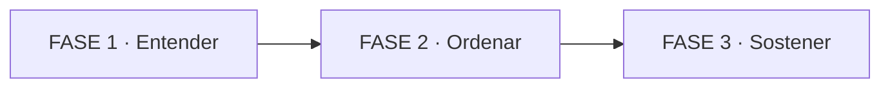

# 🧠 MASTERCLASS: La app que se cerraba sola

Una app no se cierra "porque sí". Se cierra porque varias decisiones razonables se alinean en el mismo segundo. En este caso fueron tres: una cancelación que no cancelaba, tres llamadas al mismo objeto de hardware y una búsqueda que seguía pintando la pantalla desde atrás.

> 🎯 **Objetivo** — Al terminar vas a poder leer el informe técnico de RFID y explicar, sin código, por qué se cerraba la app, qué defensas lo evitaron y cómo se prueba un arreglo cuando no hay logs.

👀 **Cómo leer esta masterclass** — Cada PARTE enseña una sola idea. Los ejemplos usan la misma historia y los conceptos se repiten a propósito. Si ya entendés una PARTE, el pretest te deja saltar directo a la práctica.

## 🗺️ Mapa de 3 FASES

👀 Se lee de izquierda a derecha: primero el diagnóstico, después las defensas, al final el mantenimiento y la prueba.

- **FASE 1 · Entender** (PARTE 1): qué se alineó para que la app se cerrara.
- **FASE 2 · Ordenar** (PARTES 2, 3 y 4): turnos, cola y cuarentena.
- **FASE 3 · Sostener** (PARTE 5): mantener el enlace vivo y demostrar que funciona.

### 📚 Pre-training: 8 términos antes de empezar

| Término            | Idea en 1 línea                                     |
| ------------------ | --------------------------------------------------- |
| Intento            | Una vez que la app pide conectarse a la lectora     |
| Resultado obsoleto | Respuesta que llega cuando ya no corresponde usarla |
| Singleton          | Un único objeto nativo compartido por toda la app   |
| Cola               | Fila donde cada operación espera su turno           |

_Continúa la tabla (2/2) — partida en bloques de ≤4 para no saturar._

| Término      | Idea en 1 línea                                                |
| ------------ | -------------------------------------------------------------- |
| Timeout      | Límite de paciencia de quien está esperando                    |
| Health-check | Chequeo periódico que diagnostica si el enlace sigue vivo      |
| Keep-alive   | Tráfico real y pequeño que impide que el enlace se enfríe      |
| Abandonado   | La interfaz dejó de esperar, pero el hardware sigue trabajando |

👀 Cómo leer las tablas: la izquierda es la etiqueta; la derecha, la idea que vas a usar. No hace falta memorizar: cada término vuelve dentro de un ejemplo.

---

## 🧨 PARTE 1: Anatomía de un cierre que parecía imposible (Nivel 1/5)

**1. ❓ PRETEST** — La app se cierra después de cancelar una reconexión y buscar otra lectora. ¿Qué pasa primero: el usuario cancela, o el hardware termina de conectar? (Activa previas | Media)

> **Respuesta esperada:** el hardware termina de conectar después de que el usuario canceló. La cancelación sólo ocultó el intento; no lo detuvo.
> **Si acertás:** camino rápido → andá al punto 7.

**2. 🎯 POR QUÉ + LOGRO** — Importa porque el mismo patrón aparece en cualquier app que habla con hardware: impresoras, balanzas, sensores. Vas a lograr separar síntoma, causa y coincidencia. (Motivación | Media)

**3. ⚡ VICTORIA RÁPIDA (<5 min)** — Dibujá una línea de tiempo con tres marcas: segundo 1, "cancela"; segundo 4, "busca"; segundo 6, "se conecta sola". Ya tenés la película del crash. (Motivación | Heurística)

**4. 💡 CONCEPTO** — Analogía: un choque en una esquina sin semáforo; ningún auto tuvo la culpa solo. Definición: un cierre es la suma de una **falla latente** (algo que ya estaba mal) y un **disparador** (la acción que la vuelve visible). (Pre-training + señalización | Media)

| Falla latente    | En palabras simples                  | Qué permitió          |
| ---------------- | ------------------------------------ | --------------------- |
| Conexión zombi   | El intento cancelado siguió vivo     | Conectarse solo       |
| Concurrencia     | Tres llamadas al mismo objeto nativo | Choque en el hardware |
| Resultado tardío | La búsqueda pintó la UI sin foco     | Modal huérfano        |

👀 Cómo leer la tabla: cada fila es una condición que ya existía; la última columna dice qué desastre habilitó. Por qué funciona: separar condiciones evita buscar "la causa" única. Cuándo falla: si te quedás con una sola fila, arreglás un síntoma y volvés a caer.

**5. 👀 EJEMPLO RESUELTO** — Caso real, 12,77 segundos de video. I Do: leo el video y marco los hitos. We Do: traduzco cada hito a una decisión del código. You Do: punto 7. Visual: pérdida → cancelar → buscar → conectarse solo.

| Momento | Qué se ve                               | Qué significa                    |
| ------- | --------------------------------------- | -------------------------------- |
| 0,5 s   | "Pérdida de conexión"                   | El enlace se cayó                |
| 1,0 s   | El usuario toca Cancelar                | Cree que abortó el intento       |
| 4,0 s   | Toca Buscar dispositivos                | Arranca otra operación nativa    |
| 6,0 s   | Se conecta sola y el modal sigue encima | El intento viejo ganó la carrera |

👀 Cómo leerla: la columna del medio es lo observable; la derecha, la interpretación. El dato clave es el 6,0 s: nadie tocó "Conectar". A las 7,0 s la app se va al launcher sin diálogo.

**6. ⚠️ CONTRA-EJEMPLO / ERROR TÍPICO** — Culpar a la lectora o al SDK: "el hardware falla". → **Corrección:** el SDK tiene límites reales, pero la app los violó al solapar llamadas y al aceptar un resultado cancelado. El hardware fue el escenario, no el culpable. (Autoexplicación | Media-Alta)

**7. 🧪 PRÁCTICA** — En una frase, diferenciá **cancelar** de **descartar** un intento de conexión.

> **Respuesta esperada:** cancelar deja de esperar o de programar reintentos; descartar ignora el resultado que llegue después. Lo nativo puede seguir corriendo en ambos casos. (Práctica + feedback | Media)

**8. 🔁 RECALL** — Sin mirar: ¿cuáles son las tres fallas latentes y cuál fue el disparador? (Nivel Bloom: comprender) (Recuperación | Alta)

**9. 📌 IDEA CLAVE** — El cierre no fue una causa: fue el encuentro de tres causas en el mismo segundo.

**10. ✅ AUTO-CHEQUEO + SIGUIENTE** — [ ] Puedo nombrar las tres fallas [ ] Distingo síntoma de causa [ ] Entiendo por qué el release no mostró error. Siguiente: quitarle permiso al pasado para escribir el presente. (Metacognición | Media)

---

## 🎫 PARTE 2: El turno numerado — cancelar es invalidar, no borrar (Nivel 2/5)

**1. ❓ PRETEST** — Cancelás un pedido en una rotisería, pero la comida ya estaba en el horno. ¿Cómo evitás que te la cobren cuando salga? (Activa previas | Media)

> **Respuesta esperada:** marcás el pedido como cancelado. Cuando la comida sale, no se entrega ni se cobra, aunque el trabajo ya se haya hecho.
> **Si acertás:** camino rápido → andá al punto 7.

**2. 🎯 POR QUÉ + LOGRO** — Los resultados viejos son la primera fuente de "se conectó solo". Vas a lograr que cada intento tenga un número y que sólo el vigente pueda cambiar el estado o navegar. (Motivación | Media)

**3. ⚡ VICTORIA RÁPIDA (<5 min)** — Escribí tres post-its: 1, 2 y 3. Cuando arranca el 3, tachá el 1 y el 2. Eso es todo: el 3 es el único con permiso para escribir. (Motivación | Heurística)

**4. 💡 CONCEPTO** — Analogía: el ticket numerado de la fiambrería. Si pediste el 7 y ya estás esperando el 8, cuando llamen al 7 no te levantás. Definición: una **generación** es un contador que sólo sube; un resultado es válido únicamente si su número coincide con el actual. (Pre-training + señalización | Media)

| Regla                              | Efecto                            |
| ---------------------------------- | --------------------------------- |
| Todo intento recibe un número      | Cada conexión es identificable    |
| Cancelar pide el número siguiente  | El intento anterior queda viejo   |
| Antes de guardar, se compara       | El resultado viejo se descarta    |
| La búsqueda tiene su propio número | Un listado viejo no repinta la UI |

👀 Cómo leer la tabla: las tres primeras filas son el turno; la última aplica la misma idea a la búsqueda. Por qué funciona: no necesitás detener el hardware, sólo negarle permiso de escritura. Cuándo falla: si comparás el número después de guardar, ya llegaste tarde.

**5. 👀 EJEMPLO RESUELTO** — Caso: reconexión automática número 7, el usuario cancela y busca. I Do: la reconexión arranca con el 7. We Do: cancelar pide el 8; la búsqueda usa otro contador. You Do: punto 7. Visual: intento 7 → cancelar (8) → llega 7 → se descarta.

Los cuatro pasos, en orden:

1. La reconexión 7 está en vuelo y el usuario toca Cancelar.
2. Cancelar sube el contador a 8; el 7 deja de ser actual.
3. El hardware termina y devuelve "conectado" para el intento 7.
4. La app compara 7 contra 8, descarta el resultado y devuelve "no conectado": no guarda, no persiste, no navega.

👀 Cómo leerlo: el paso 3 es inevitable; el paso 4 es la defensa. La conexión física puede existir, pero la app no la registra.

**6. ⚠️ CONTRA-EJEMPLO / ERROR TÍPICO** — El bug original: cancelar sólo levantaba una bandera para no programar **nuevos** reintentos. → **Corrección:** la bandera no invalida el intento que ya está corriendo; hace falta subir la generación y comparar antes de guardar. (Autoexplicación | Media-Alta)

Hay un segundo error, más sutil: desconectar el enlace nativo dentro de la rama "resultado viejo". Si ya hay una conexión nueva encolada, esa desconexión llega después y la mata. → **Corrección:** cerrar el vínculo en el punto donde el usuario cancela explícitamente, antes de encolar la búsqueda o la conexión nueva.

**7. 🧪 PRÁCTICA** — Tenés dos conexiones: A está en vuelo y B ya está encolada. A termina tarde. Si reaccionás a A desconectando el enlace, ¿qué le pasa a B?

> **Respuesta esperada:** la desconexión se encola después de B y mata la conexión B. Hay que descartar A sin tocar el hardware; el cierre del vínculo va al momento de cancelar, no al de recibir el resultado viejo. (Práctica + feedback | Media)

**8. 🔁 RECALL** — Sin mirar: ¿qué dos cosas debe hacer un "cancelar" real y por qué no alcanza con una bandera? (Nivel Bloom: aplicar) (Recuperación | Alta)

**9. 📌 IDEA CLAVE** — Cancelar no es borrar el pasado: es quitarle permiso para escribir el futuro.

**10. ✅ AUTO-CHEQUEO + SIGUIENTE** — [ ] Numeré los intentos [ ] Comparo antes de guardar [ ] Sé por qué no desconecto en la rama vieja. Siguiente: poner una sola puerta al hardware. (Metacognición | Media)

---

## 🚦 PARTE 3: Una sola calle — la cola nativa (Nivel 3/5)

**1. ❓ PRETEST** — Dos personas llaman al mismo tiempo a un único teléfono de soporte. ¿Qué conviene: dos auriculares o una cola? (Activa previas | Media)

> **Respuesta esperada:** una cola. El segundo espera a que el primero termine; dos auriculares no duplican la línea.
> **Si acertás:** camino rápido → andá al punto 7.

**2. 🎯 POR QUÉ + LOGRO** — El SDK de la lectora expone un único objeto nativo. Ahí la concurrencia no es velocidad: es un choque. Vas a lograr serializar todas las llamadas y evitar dos trampas clásicas: el bloqueo mutuo y el timeout que no libera nada. (Motivación | Media)

**3. ⚡ VICTORIA RÁPIDA (<5 min)** — Listá las operaciones que tocan la lectora: conectar, desconectar, escanear, consultar estado, leer batería, inventario, gatillo. Dibujá una sola puerta y hacé que todas hagan fila. (Motivación | Heurística)

**4. 💡 CONCEPTO** — Analogía: un puente de un solo carril. Los autos pueden ser rápidos, pero si entran dos a la vez, ninguno pasa. Definición: una **cola** (o mutex) es una estructura donde cada operación espera a que la anterior termine, haya salido bien o mal. (Pre-training + señalización | Media)

| Regla de la cola                           | Por qué                              |
| ------------------------------------------ | ------------------------------------ |
| Una operación a la vez                     | El nativo es singleton               |
| Liberar el turno en éxito y en error       | La cola no queda trabada             |
| Las funciones internas no vuelven a entrar | Evita esperarse a sí misma           |
| Timeout como red de seguridad              | Una promesa puede no responder nunca |

👀 Cómo leer la tabla: las dos primeras filas son el contrato; las dos últimas, los seguros contra bloqueos. Por qué funciona: convierte una carrera impredecible en un orden predecible. Cuándo falla: si una operación encolada llama a otra operación encolada, se produce un abrazo mortal.

**5. 👀 EJEMPLO RESUELTO** — Caso: a los 0 s hay un connect en curso, a los 2 s el usuario busca dispositivos y a los 3 s el health-check quiere consultar estado. I Do: identifico las tres llamadas. We Do: las pongo en una sola fila. You Do: punto 7. Visual: connect (20 s) → scan → status.

Sin cola, las tres tocan el mismo objeto y el callback de conexión —que tiene un solo lugar— se pisa. Con cola, el scan espera al connect y el status espera al scan. El orden es más lento, pero es el único orden que el hardware entiende.

**6. ⚠️ CONTRA-EJEMPLO / ERROR TÍPICO** — El connect pide la batería usando el método público de batería, que también está encolado. → **Corrección:** separar funciones internas sin cola (`raw`) de métodos públicos encolados. Ninguna operación encolada llama a otra operación encolada. (Autoexplicación | Media-Alta)

**7. 🧪 PRÁCTICA** — El usuario cancela y busca enseguida. El connect puede tardar hasta 20 s y el scan tiene su propio límite de 15 s. ¿Cuánto puede esperar el scan antes de arrancar y qué trade-off aceptás?

> **Respuesta esperada:** puede esperar hasta que termine el connect, con un máximo cercano a los 20 s. Se acepta la espera porque prioriza no solapar llamadas y no crashear; la alternativa es más rápida y más frágil. (Práctica + feedback | Media)

**8. 🔁 RECALL** — Sin mirar: ¿qué serializa la cola y qué **no** serializa? (Nivel Bloom: analizar) (Recuperación | Alta)

**9. 📌 IDEA CLAVE** — Con un hardware único, la virtud no es paralelismo: es turno.

**10. ✅ AUTO-CHEQUEO + SIGUIENTE** — [ ] Todas las llamadas pasan por la cola [ ] Sé cómo se libera el turno [ ] Evité que una operación encolada llame a otra. Siguiente: qué hacer cuando el turno no termina nunca. (Metacognición | Media)

---

## 🚧 PARTE 4: El estado abandonado — cuando el hardware no contesta (Nivel 4/5)

**1. ❓ PRETEST** — Tu código dejó de esperar a los 12 s, pero la promesa nativa sigue pendiente. ¿La operación nativa se canceló? (Activa previas | Media)

> **Respuesta esperada:** no. Sólo dejó de esperar la interfaz; el trabajo nativo puede seguir vivo y el singleton sigue ocupado.
> **Si acertás:** camino rápido → andá al punto 7.

**2. 🎯 POR QUÉ + LOGRO** — Es la idea más profunda del caso: **un timeout no es una cancelación**. Vas a lograr distinguir tres relojes y entender por qué a veces conviene bloquear y avisar en vez de seguir y mentir. (Motivación | Media)

**3. ⚡ VICTORIA RÁPIDA (<5 min)** — Escribí tres relojes en fila: paciencia de la UI (12 s), trabajo nativo (sin límite conocido) y liberación del turno (sólo cuando el nativo termina). Ya ves el problema. (Motivación | Heurística)

**4. 💡 CONCEPTO** — Analogía: una cocina con un solo cocinero. Si el pedido se trabó, no le mandás otro pedido al mismo cocinero: marcás la cocina como ocupada y le avisás al cliente. Definición: **abandonado** es el estado donde la interfaz se cansó, pero la promesa nativa sigue viva; el enlace queda en cuarentena. (Pre-training + señalización | Media)

| Estado     | Qué significa                   | Qué se puede hacer             |
| ---------- | ------------------------------- | ------------------------------ |
| Libre      | No hay promesa nativa pendiente | Cualquier operación            |
| Conectando | Hay una promesa nativa en curso | Esperar o timeout              |
| Abandonado | La UI se cansó; el nativo sigue | Nada cruza al hardware; avisar |

👀 Cómo leer la tabla: la tercera fila es la nueva. No es "desconectado" ni "conectado": es "no sé, y no voy a empeorarlo". Por qué funciona: evita la segunda llamada sobre un singleton posiblemente ocupado. Cuándo falla: si liberás el turno por timeout, volvés exactamente al crash original.

**5. 👀 EJEMPLO RESUELTO** — Caso: un connect no responde. I Do: a los 12 s la UI se cansa. We Do: marco el enlace como abandonado. You Do: punto 7. Visual: connect → timeout → abandonado → settle nativo.

1. El connect cruza al nativo y queda pendiente.
2. A los 12 s vence la paciencia de la UI; el enlace pasa a abandonado.
3. Otro connect, un scan o un ping ya no cruzan el bridge: reciben un error de "lectora ocupada" sin tocar el hardware.
4. Cuando el nativo finalmente termina, se libera el turno. Si terminó bien, se encola una desconexión —ahora sí legal— para cerrar el vínculo que quedó abierto.

👀 Cómo leerlo: el paso 4 es la salida. Mientras no llegue, la app prefiere bloquear y explicar antes que disparar otra operación a ciegas.

**6. ⚠️ CONTRA-EJEMPLO / ERROR TÍPICO** — "Si falló por timeout, hago un reset con desconectar y limpiar caché". → **Corrección:** eso es una segunda llamada nativa mientras la primera puede seguir viva, justo la carrera que la cola evita. Además, limpiar caché sólo borra los EPC escaneados; no toca el enlace BLE. El reset se eliminó del flujo. (Autoexplicación | Media-Alta)

**7. 🧪 PRÁCTICA** — Un connect quedó abandonado y el usuario toca Conectar otra vez. ¿Qué debe pasar y por qué?

> **Respuesta esperada:** no debe cruzar ninguna llamada al hardware; se muestra el aviso de lectora ocupada y se espera a que el nativo termine. Si se liberara el turno, dos connects se superpondrían y el callback único del SDK podría no invocarse nunca, dejando la promesa muerta por timeout. (Práctica + feedback | Media)

**8. 🔁 RECALL** — Sin mirar: ¿por qué el turno no se libera cuando vence el timeout de la UI? (Nivel Bloom: evaluar) (Recuperación | Alta)

**9. 📌 IDEA CLAVE** — Un timeout es impaciencia de la interfaz, no cancelación del hardware.

**10. ✅ AUTO-CHEQUEO + SIGUIENTE** — [ ] Distingo los tres relojes [ ] Sé qué significa abandonado [ ] Entiendo el trade-off de bloquear. Siguiente: mantener el enlace vivo y probarlo sin logs. (Metacognición | Media)

---

## 💓 PARTE 5: Mantener vivo y demostrar sin logs (Nivel 5/5)

**1. ❓ PRETEST** — La lectora se desconecta a los 15 s sin que nadie la toque. ¿Qué comando la mantiene viva: consultar el estado o leer la batería? (Activa previas | Media)

> **Respuesta esperada:** leer la batería. Consultar el estado devuelve un valor cacheado y no genera tráfico BLE; la lectura de batería es una ida y vuelta real.
> **Si acertás:** camino rápido → andá al punto 7.

**2. 🎯 POR QUÉ + LOGRO** — Un enlace que se cae por inactividad parece un bug del estado, pero es un problema de tráfico. Vas a lograr mantener el vínculo, distinguir un parpadeo de una caída y validar el arreglo por comportamiento observable. (Motivación | Media)

**3. ⚡ VICTORIA RÁPIDA (<5 min)** — Dibujá la cadena: ping cada 2 s → una lectura falsa → esperar → dos falsas → reconexión silenciosa. Cuatro pasos y ya tenés el sistema completo. (Motivación | Heurística)

**4. 💡 CONCEPTO** — Analogía: una luz que parpadea no significa que la planta eléctrica se cayó; confirmá antes de resetear la casa. Definición: el **keep-alive** es tráfico real para que el enlace no se enfríe; el **health-check** es el diagnóstico con confirmación; la **reconexión silenciosa** es un intento rápido de reparar antes de molestar al usuario. (Pre-training + señalización | Media)

| Mecanismo             | Ritmo                          | Qué decide                   |
| --------------------- | ------------------------------ | ---------------------------- |
| Keep-alive            | Cada 2 s                       | Mantener el enlace despierto |
| Health-check          | Cada 3 s; 2 falsos seguidos    | Declarar caída real          |
| Reconexión silenciosa | 1 intento de 12 s              | Recuperar sin navegar        |
| Mostrar pérdida       | Tras 2 recuperaciones seguidas | Pedir acción al usuario      |

👀 Cómo leer la tabla: los dos primeros mantienen y diagnostican; los dos últimos deciden cuándo hablar. Por qué funciona: separa "hay tráfico" de "hay conexión" y de "hay que avisar". Cuándo falla: si el ping se saltea por un guard redundante, el enlace se enfría igual.

**5. 👀 EJEMPLO RESUELTO** — Caso: la lectora lleva 10 s conectada y el primer chequeo da "desconectado". I Do: no declaro la pérdida con una sola lectura. We Do: espero la segunda; a los 12 s vuelve a dar falso. You Do: punto 7. Visual: ping → falso → falso → reconexión.

La reconexión silenciosa intenta una vez, con 12 s de presupuesto. Si recupera, el usuario no ve nada y la histéresis vuelve a cero. Si falla, aparece "Pérdida de conexión". Si se recupera dos veces seguidas sin 30 s de estabilidad, también se muestra: tapar una caída crónica sería mentir.

**6. ⚠️ CONTRA-EJEMPLO / ERROR TÍPICO** — "Sin logs no se puede validar nada". → **Corrección:** se valida por comportamiento observable, que es lo que ve el técnico: indicador verde, batería que se refresca, tags que siguen sumando, modal de lectora ocupada, pantalla de pérdida y ausencia de cierre. Los logs sólo aceleran el diagnóstico; no son la única prueba. (Autoexplicación | Media-Alta)

**7. 🧪 PRÁCTICA** — Diseñá la prueba del flujo exacto del video en cuatro pasos y escribí qué deberías ver en cada uno.

> **Respuesta esperada:** (1) perder conexión: aparece "Pérdida de conexión"; (2) cancelar: el intento se descarta y no navega; (3) buscar: se ve el listado o el modal de búsqueda; (4) conectar: se llega a "Gestión RFID" sin modal huérfano y sin cierre. Si en (2) o (3) la app se conecta sola, el turno falló. (Práctica + feedback | Media)

**8. 🔁 RECALL** — Sin mirar: nombrá los tres relojes, las dos lecturas falsas y las dos recuperaciones silenciosas. (Nivel Bloom: crear) (Recuperación | Alta)

**9. 📌 IDEA CLAVE** — Si no podés ver los logs, hacé que la verdad sea visible en la pantalla.

**10. ✅ AUTO-CHEQUEO + SIGUIENTE** — [ ] Entiendo keep-alive y health-check [ ] Sé por qué se confirma dos veces [ ] Tengo una prueba observable. Siguiente: mezclar las cinco defensas en un caso nuevo. (Metacognición | Media)

---

## 🧪 PRÁCTICA MIXTA: las cinco defensas en un caso nuevo

**Enunciado:** te toca integrar una balanza industrial con un único puerto serial. La balanza puede tardar en responder, el puerto no admite dos comandos a la vez y la app tiene que sobrevivir a desconexiones. Diseñá cuatro defensas y explicá qué problema evita cada una.

> **Respuesta esperada:** (1) turno numerado para descartar lecturas viejas; (2) cola única para no solapar comandos; (3) cuarentena con aviso si el puerto queda abandonado; (4) keep-alive con comando real y health-check con confirmación. La quinta defensa, la búsqueda con foco, aplica si hay una pantalla que lista dispositivos. (Práctica + feedback | Media)

👀 Cómo leer la respuesta: cada defensa ataca una falla distinta. Si sólo implementás la cola, un resultado viejo todavía puede pintar la pantalla; si sólo implementás el turno, dos llamadas todavía pueden chocar.

---

## 🏁 CIERRE: el mapa completo

El caso se entiende en una sola frase: **la app trataba un hardware único como si fuera infinito y trataba una cancelación como si fuera una máquina del tiempo**.

| Defensa               | Qué evita                                 | Qué cuesta                                    |
| --------------------- | ----------------------------------------- | --------------------------------------------- |
| Turno numerado        | Resultados zombis                         | Un contador y una comparación                 |
| Cola nativa           | Operaciones superpuestas                  | Espera y algo de latencia                     |
| Cuarentena abandonada | Segunda llamada a ciegas                  | Lectora bloqueada hasta que el nativo termine |
| Keep-alive y salud    | Caídas por inactividad y falsos positivos | Tráfico periódico y espera de confirmación    |

👀 Cómo leer la tabla: la columna del medio es el beneficio; la derecha, el precio. No hay defensa gratis: hay trade-offs elegidos.

### 🗂️ Dónde vive cada idea en el código

| Idea              | Archivo principal                     | Qué mirar                                             |
| ----------------- | ------------------------------------- | ----------------------------------------------------- |
| Turno y descarte  | `context/RfidTagsContext.tsx`         | Generación de intentos y comparación antes de guardar |
| Cola y timeouts   | `reader-sdk/nativeRfidReaderSdk.ts`   | Una operación a la vez y liberación del turno         |
| Cuarentena        | `reader-sdk/readerBusyError.ts`       | Error de lectora ocupada sin cruzar el bridge         |
| Búsqueda con foco | `reader-connection/useScreenHooks.ts` | Número de búsqueda y descarte al perder foco          |

👀 Cómo leerla: no hace falta memorizar rutas; sirve para volver del modelo mental al informe técnico sin perderte.

### ⏳ Lo que queda pendiente (honestidad)

- Probar en hardware con el protocolo observable: reposo, lectura continua, gatillo, apagar la lectora, cancelar y buscar.
- Subir `runtimeVersion` de `1.1.0-1` a `1.1.0-2` y `version` de `1.4.1` a `1.4.2` antes del release.
- Implementar los siete casos de prueba de la máquina de estados, hoy deuda explícita.
- Asumir la consecuencia de haber quitado los logs: en campo sólo se ve la UI; para un crash nativo queda `logcat`.

> 📌 **La idea que te llevás** — Un hardware único no se domina con más llamadas: se domina con turnos, una sola puerta y la honestidad de decir "no sé" cuando el hardware no contesta.
