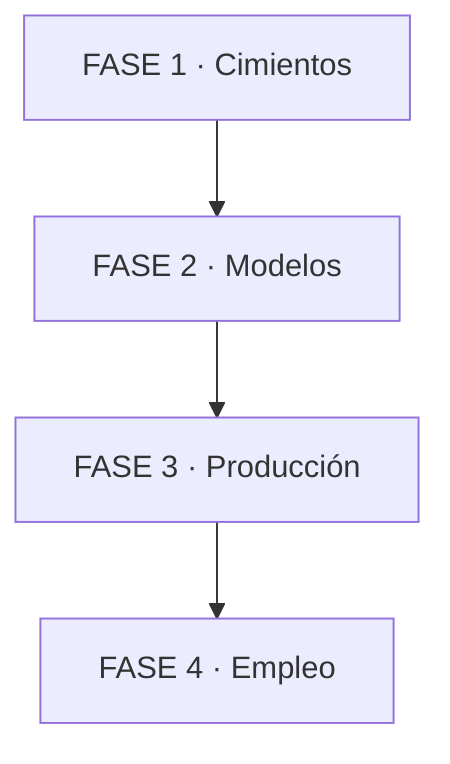

# MASTERCLASS: Tecnologías del Ingeniero de IA — Desarrollo de Cada Herramienta del Roadmap 🛠️🧠

## INTRODUCCIÓN: POR QUÉ ESTA GUÍA DESARROLLA CADA TECNOLOGÍA 🎯

La hoja de ruta original enumera las tecnologías que debe dominar un ingeniero de IA, pero no las detalla una por una. Esta guía cubre ese vacío: explica qué es cada tecnología, para qué sirve, cómo se usa en la práctica y qué errores evitar.

El método es aprender construyendo, sin caer en el "tutorial hell". Cada tecnología se presenta con una analogía previa, un ejemplo resuelto, un contra-ejemplo, una práctica con respuesta esperada y una pregunta de recall.

> **Objetivo de Aprendizaje** 🎯 — Al terminar, sabrás qué hace cada tecnología del roadmap, cuándo usarla, cómo evitar sus errores típicos y tienes un ejercicio práctico listo para ejecutar en cada una.

> **Advertencia educativa** ⚠️ — Esta guía es formativa y resume tecnologías del mercado. Las herramientas mencionadas (OpenAI, Anthropic, Hugging Face, AWS, GCP, Docker, DeepEval, MCP) son referencias de la industria, no patrocinios. No se inventan citas científicas.

## 🗺️ MAPA DE 4 FASES — Tecnologías 1 → 14



*Se lee de arriba hacia abajo. 4 fases: cimientos → modelos → producción → empleo.*

Las 14 tecnologías se recorren en orden:

1️⃣ Python · 2️⃣ SQL · 3️⃣ APIs · 4️⃣ Context Engineering · 5️⃣ AI APIs · 6️⃣ Modelos locales · 7️⃣ RAG + BD vectoriales · 8️⃣ Agentes · 9️⃣ MCP · 🔟 Despliegue · 1️⃣1️⃣ Evaluación + Gobernanza · 1️⃣2️⃣ Proyectos de impacto · 1️⃣3️⃣ Visibilidad · 1️⃣4️⃣ Networking

## 📖 Glosario de tecnologías (declarado)

| Tecnología | Qué hace en una línea |
|------------|----------------------|
| Python | Lenguaje principal para lógica de IA |
| SQL | Extraer, filtrar y combinar datos |
| API | Dejar que dos programas se comuniquen |
| Context Engineering | Diseñar system/master prompts |
| AI APIs | Llamar a modelos de OpenAI o Anthropic desde código |
| Modelos locales | Correr modelos descargados de Hugging Face |
| RAG | Dejar que la IA consulte datos privados |
| Bases de datos vectoriales | Guardar fragmentos para búsqueda rápida por IA |
| Agentes | Coordinar varias IA para tareas complejas |
| MCP | Protocolo que conecta agentes con herramientas y datos |
| Docker | Empaquetar el sistema para desplegarlo igual en cualquier lado |
| AWS / GCP | Nubes públicas para alojar sistemas en producción |
| DeepEval | Medir la calidad de las respuestas de IA |
| Model routing | Elegir el modelo más barato según la complejidad de la tarea |
| Portafolio | Proyecto público que demuestra lo que construiste |
| Networking | Buscar activamente referencias y conexiones laborales |

*(Glosario declarado: excepción de la regla de tablas de ≤4 filas.)*

Cada PARTE sigue la plantilla fija: pretest → por qué/logro → victoria rápida → concepto con analogía → ejemplo resuelto + diagrama ≤4 pasos → contra-ejemplo → práctica con respuesta esperada → recall → idea clave → auto-chequeo.

---

## 🧩 PARTE 1: Python (Nivel 1 / 14) 🐍

1. ❓ PRETEST — Antes de enseñar: ¿para qué sirve Python en el camino de ingeniero de IA?
   > Respuesta esperada: es el lenguaje principal para escribir la lógica que conecta datos, modelos y APIs de IA.
   > Si sabés la respuesta: camino rápido → punto 7.

2. 🎯 POR QUÉ + LOGRO — Importa porque casi toda la infraestructura de IA está escrita o se controla desde Python. Vas a lograr leer y escribir un script sencillo que procese datos.

3. ⚡ VICTORIA RÁPIDA (<5 min) — Abrí una terminal o un editor y escribí una sola línea que imprima un texto. Ver la salida en pantalla es éxito garantizado.
   📌 Tu primera línea ya es un programa.

4. 💡 CONCEPTO — Analogía: Python es el idioma que le hablas a la computadora para decirle qué hacer paso a paso. Definición: un lenguaje de programación legible, usado para automatizar tareas, manipular datos y llamar a modelos de IA. Una idea nueva: Python es el pegamento que une el roadmap.

5. 👀 EJEMPLO RESUELTO — Caso: necesitas calcular el precio total de una lista de productos. Pasos: (1) creás una lista con tres precios, (2) sumás los valores, (3) mostrá el resultado.
   ```mermaid
   flowchart LR
   A["1 Lista de precios"] --> B["2 Sumar valores"]
   B --> C["3 Mostrar total"]
   ```
   *Se lee de izquierda a derecha. 3 pasos de contenido.*

6. ⚠️ CONTRA-EJEMPLO / ERROR TÍPICO — Ver veinte horas de tutoriales de Python sin escribir una sola línea. Eso es "tutorial hell" y no produce habilidad. Corrección: por cada concepto que veas, escribí vos mismo el código correspondiente.

7. 🧪 PRÁCTICA — Escribí en Python una lista con tres productos y sus precios, y mostrá el producto más caro. (Contexto distinto al ejemplo: acá comparás, no sumás.)
   > Respuesta esperada / criterio: el programa imprime el nombre del producto con el precio más alto de los tres.

8. 🔁 RECALL — Sin mirar: ¿para qué sirve Python en este roadmap? (Nivel Bloom: recordar)
   > Respuesta esperada: escribir la lógica que conecta datos, modelos y APIs; es el lenguaje principal de la IA.

9. 📌 IDEA CLAVE — Python no se aprende viendo; se aprende escribiendo.

10. ✅ AUTO-CHEQUEO + SIGUIENTE — [ ] Escribí un script de Python. [ ] Manipulé una lista de datos. [ ] Mostré un resultado por pantalla. Siguiente: PARTE 2 (SQL).

---

## 🧩 PARTE 2: SQL (Nivel 2 / 14) 🗄️

1. ❓ PRETEST — ¿Qué tres comandos básicos de SQL debés dominar antes de trabajar con datos de IA?
   > Respuesta esperada: SELECT (extraer), WHERE (filtrar) y JOIN (combinar tablas).
   > Si sabés los tres: camino rápido → punto 7.

2. 🎯 POR QUÉ + LOGRO — Importa porque los modelos de IA necesitan datos, y esos datos viven en bases de datos que se consultan con SQL. Vas a lograr escribir una consulta que extraiga y filtre información.

3. ⚡ VICTORIA RÁPIDA (<5 min) — Abrí cualquier consola de SQL (incluso una online) y escribí: SELECT nombre FROM clientes WHERE ciudad = 'Buenos Aires'. Ver una fila devuelta es éxito.
   📌 Consultar datos es hacer una pregunta precisa a la base de datos.

4. 💡 CONCEPTO — Analogía: SQL es el lenguaje para preguntarle a una biblioteca dónde está cada libro y cuántos hay. Definición: un lenguaje para extraer datos (SELECT), filtrarlos (WHERE) y combinar varias tablas (JOIN). Una idea nueva: sin SQL no podés alimentar a un modelo de IA con la información correcta.

5. 👀 EJEMPLO RESUELTO — Caso: una tienda quiere saber cuántos productos vendió ayer. Pasos: (1) identificá la tabla de ventas, (2) filtrá por fecha de ayer con WHERE, (3) contá los registros con SELECT.
   ```mermaid
   flowchart LR
   A["1 Tabla de ventas"] --> B["2 WHERE filtra ayer"]
   B --> C["3 SELECT cuenta registros"]
   ```
   *Se lee de izquierda a derecha. 3 pasos de contenido.*

6. ⚠️ CONTRA-EJEMPLO / ERROR TÍPICO — Intentar traer toda la base de datos a Python y filtrar ahí en vez de dejar que SQL filtre. Eso es lento y consume memoria. Corrección: filtrá en la base de datos con WHERE antes de traer los datos.

7. 🧪 PRÁCTICA — Escribí una consulta SQL que extraiga los nombres de clientes que gastaron más de $100. (Contexto distinto: acá filtrás por monto, no por fecha.)
   > Respuesta esperada / criterio: la consulta usa SELECT, FROM y WHERE con el monto.

8. 🔁 RECALL — Sin mirar: ¿qué hace WHERE en SQL? (Nivel Bloom: recordar)
   > Respuesta esperada: filtra las filas según una condición.

9. 📌 IDEA CLAVE — SQL filtra y combina datos para que la IA reciba solo lo que necesita.

10. ✅ AUTO-CHEQUEO + SIGUIENTE — [ ] Escribí una consulta SELECT. [ ] Usé WHERE para filtrar. [ ] Entendí qué hace JOIN. Siguiente: PARTE 3 (Arquitectura de APIs).

---

## 🧩 PARTE 3: Arquitectura de APIs (Nivel 3 / 14) 🌐

1. ❓ PRETEST — ¿Qué es una API en una frase?
   > Respuesta esperada: una interfaz que permite que dos programas se comuniquen y se intercambien datos de forma segura.
   > Si lo sabés: camino rápido → punto 7.

2. 🎯 POR QUÉ + LOGRO — Importa porque los modelos de IA no viven en tu computadora; se acceden a ellos mediante APIs. Vas a lograr entender cómo una aplicación pide un servicio a otro sistema.

3. ⚡ VICTORIA RÁPIDA (<5 min) — Abrí un navegador y visitá una URL pública de API (por ejemplo, un endpoint de prueba que devuelve JSON). Ver los datos en pantalla es éxito.
   📌 Una API es como una ventana por donde un programa pide algo a otro.

4. 💡 CONCEPTO — Analogía: una API es el cajero automático que te deja pedir dinero al banco sin entrar a la oficina. Definición: un conjunto de reglas que define cómo dos sistemas se comunican, generalmente mediante HTTP y formatos como JSON. Una idea nueva: las APIs permiten que tu código use modelos de IA sin tener que instalarlos localmente.

5. 👀 EJEMPLO RESUELTO — Caso: una app de clima necesita mostrar la temperatura de una ciudad. Pasos: (1) la app envía el nombre de la ciudad a la API del servicio de clima, (2) la API procesa la petición, (3) devuelve la temperatura en JSON.
   ```mermaid
   flowchart LR
   A["1 App pide clima"] --> B["2 API procesa"]
   B --> C["3 Devuelve temperatura"]
   ```
   *Se lee de izquierda a derecha. 3 pasos de contenido.*

6. ⚠️ CONTRA-EJEMPLO / ERROR TÍPICO — Exponer claves de API directamente en el código subido a GitHub. Eso es un riesgo de seguridad grave. Corrección: guardá las claves en variables de entorno y nunca las subas al repositorio.

7. 🧪 PRÁCTICA — Describí con palabras el flujo de una aplicación que consulta una API de IA para resumir un texto. (Contexto distinto: acá es diseño de flujo, no código.)
   > Respuesta esperada / criterio: el flujo tiene petición, procesamiento por la API y devolución del resumen.

8. 🔁 RECALL — Sin mirar: ¿para qué sirve una API en el roadmap de IA? (Nivel Bloom: recordar)
   > Respuesta esperada: permite que tu aplicación se comunique con modelos de IA y otros sistemas de forma segura.

9. 📌 IDEA CLAVE — La API es el puente entre tu código y la inteligencia artificial.

10. ✅ AUTO-CHEQUEO + SIGUIENTE — [ ] Entendí qué es una API. [ ] Conocí el ejemplo cliente-servidor. [ ] Sé que las claves no se suben a GitHub. Siguiente: PARTE 4 (Context Engineering).

---

## 🧩 PARTE 4: Context Engineering / System y Master Prompts (Nivel 4 / 14) 🧠

1. ❓ PRETEST — ¿Cuál es la diferencia entre un prompt básico y un system prompt?
   > Respuesta esperada: el prompt básico es una pregunta suelta; el system prompt define quién es la IA y cómo debe comportarse en toda la conversación.
   > Si sabés la diferencia: camino rápido → punto 7.

2. 🎯 POR QUÉ + LOGRO — Importa porque el mismo modelo da respuestas distintas según el contexto que le des. Vas a lograr escribir un system prompt que haga que la IA responda exactamente como querés.

3. ⚡ VICTORIA RÁPIDA (<5 min) — Abrí un chat de IA y pegá este system prompt: "Sos un asistente que responde siempre en español y en una sola oración." Hacé una pregunta y verificá que obedece.
   📌 El contexto manda sobre el modelo.

4. 💡 CONCEPTO — Analogía: el system prompt es el manual de reglas que se le da a un empleado nuevo el primer día. Definición: el Context Engineering diseña system prompts y master prompts para que la IA entienda su rol, el tono, el formato y las expectativas. Una idea nueva: un buen contexto vale más que un modelo más caro.

5. 👀 EJEMPLO RESUELTO — Caso: necesitás que la IA redacte correos de venta en tono profesional. Pasos: (1) escribís un system prompt que defina el rol (redactor de ventas), el tono (profesional) y el formato (asunto + cuerpo); (2) desde código llamás a la API pasando ese system prompt y los datos del cliente; (3) probá el resultado y ajustá el prompt si es necesario.
   ```mermaid
   flowchart LR
   A["1 System prompt define el rol"] --> B["2 Se llama a la API"]
   B --> C["3 Se ajusta el prompt"]
   ```
   *Se lee de izquierda a derecha. 3 pasos de contenido.*

6. ⚠️ CONTRA-EJEMPLO / ERROR TÍPICO — Pedirle al modelo "escribí un correo de ventas" sin contexto. Resultado: texto genérico que no convence. Corrección: especificá rol, tono, audiencia y formato en el system prompt.

7. 🧪 PRÁCTICA — Escribí un system prompt que haga que la IA resuma noticias en máximo tres viñetas, y probalo con un titular cualquiera.
   > Respuesta esperada / criterio: el sistema devuelve exactamente tres viñetas cortas sobre la noticia.

8. 🔁 RECALL — Sin mirar: ¿qué hace el "C" de CAM? (Nivel Bloom: recordar)
   > Respuesta esperada: Context Engineering, diseñar system/master prompts para que la IA entienda el rol y la tarea.

9. 📌 IDEA CLAVE — Un buen contexto (system prompt) vale más que un modelo más caro.

10. ✅ AUTO-CHEQUEO + SIGUIENTE — [ ] Escribí un system prompt. [ ] Definí rol, tono y formato. [ ] Probé el resultado con un caso real. Siguiente: PARTE 5 (AI APIs).

---

## 🧩 PARTE 5: AI APIs — OpenAI y Anthropic (Nivel 5 / 14) 🔌

1. ❓ PRETEST — ¿Qué necesitás para llamar a un modelo de OpenAI o Anthropic desde Python?
   > Respuesta esperada: una clave de API, la librería del proveedor y el código que hace la petición pasando el prompt y el modelo.
   > Si sabés los tres elementos: camino rápido → punto 7.

2. 🎯 POR QUÉ + LOGRO — Importa porque integrar modelos potentes por código es lo que diferencia a un usuario de un ingeniero de IA. Vas a lograr escribir el esqueleto de una llamada a una API de modelo.

3. ⚡ VICTORIA RÁPIDA (<5 min) — Entrá a la documentación de OpenAI o Anthropic y buscá el ejemplo de "chat completion" en Python. Leer los primeros cinco líneas es éxito.
   📌 La documentación es el primer paso antes de escribir código.

4. 💡 CONCEPTO — Analogía: las AI APIs son el enchufe por donde tu programa se conecta a la inteligencia del modelo sin tener que entrenarlo. Definición: interfaces que permiten enviar prompts y recibir respuestas de modelos como GPT o Claude mediante llamadas HTTP desde código. Una idea nueva: tu valor está en saber qué modelo elegir y cómo estructurar la petición.

5. 👀 EJEMPLO RESUELTO — Caso: necesitás clasificar si un correo es spam o no. Pasos: (1) preparás la clave de API, (2) escribís el código que envía el texto del correo al modelo con la instrucción de clasificar, (3) recibís la respuesta y la usá en tu aplicación.
   ```mermaid
   flowchart LR
   A["1 Clave de API lista"] --> B["2 Código envía el texto"]
   B --> C["3 Modelo responde spam/no spam"]
   ```
   *Se lee de izquierda a derecha. 3 pasos de contenido.*

6. ⚠️ CONTRA-EJEMPLO / ERROR TÍPICO — Enviar datos sensibles o personales de clientes a una API pública sin anonimizarlos. Eso viola privacidad. Corrección: nunca envíes datos sensibles a modelos externos sin consentimiento y sin revisar los términos del proveedor.

7. 🧪 PRÁCTICA — Escribí en palabras el esqueleto de una llamada a una API de IA: qué necesitás (clave, librería, modelo, prompt) y qué recibís (respuesta).
   > Respuesta esperada / criterio: se identifican clave de API, librería, modelo, prompt de entrada y respuesta de salida.

8. 🔁 RECALL — Sin mirar: ¿qué se necesita para llamar a una AI API desde Python? (Nivel Bloom: recordar)
   > Respuesta esperada: clave de API, la librería del proveedor y el código que envía el prompt y recibe la respuesta.

9. 📌 IDEA CLAVE — Integrar modelos por API es lo que convierte un script en un sistema de IA.

10. ✅ AUTO-CHEQUEO + SIGUIENTE — [ ] Sé qué necesita una AI API. [ ] Entendí el ejemplo de clasificación. [ ] Conozco el error de datos sensibles. Siguiente: PARTE 6 (Modelos locales).

---

## 🧩 PARTE 6: Modelos Locales — Hugging Face (Nivel 6 / 14) 💾

1. ❓ PRETEST — ¿Qué ventajas tiene correr un modelo de IA en tu propia computadora en lugar de usar una API pública?
   > Respuesta esperada: privacidad de los datos, no depender de internet, no pagar por cada llamada y poder experimentar libremente.
   > Si sabés dos o más: camino rápido → punto 7.

2. 🎯 POR QUÉ + LOGRO — Importa porque correr modelos locales te da control total y te permite experimentar sin costos por uso. Vas a lograr entender cómo se descarga y ejecuta un modelo desde Hugging Face.

3. ⚡ VICTORIA RÁPIDA (<5 min) — Entrá a Hugging Face y buscá un modelo pequeño (por ejemplo, para análisis de sentimientos). Ver la tarjeta del modelo con su descripción es éxito.
   📌 Conocer el catálogo es el primer paso para usar modelos locales.

4. 💡 CONCEPTO — Analogía: un modelo local es una herramienta que comprás y tenés en tu propio taller, en lugar de alquilar un servicio cada vez que la usás. Definición: modelos de IA descargados desde repositorios como Hugging Face que se ejecutan en tu máquina o servidor sin depender de una API externa. Una idea nueva: los modelos locales son ideales para privacidad, experimentación y costos predecibles.

5. 👀 EJEMPLO RESUELTO — Caso: querés analizar el sentimiento de reseñas de productos sin enviar datos a un servicio externo. Pasos: (1) buscás un modelo de análisis de sentimientos en Hugging Face, (2) descargás los pesos del modelo, (3) cargás el modelo en tu código y pasás una reseña para obtener si es positiva o negativa.
   ```mermaid
   flowchart LR
   A["1 Buscás modelo en Hugging Face"] --> B["2 Descargás los pesos"]
   B --> C["3 Cargás y analizás la reseña"]
   ```
   *Se lee de izquierda a derecha. 3 pasos de contenido.*

6. ⚠️ CONTRA-EJEMPLO / ERROR TÍPICO — Intentar correr un modelo gigante de 70 mil millones de parámetros en una laptop común sin suficiente memoria RAM o GPU. Eso falla o va extremadamente lento. Corrección: elegí un modelo del tamaño adecuado para tu hardware (por ejemplo, modelos de 1 a 7 mil millones de parámetros para empezar).

7. 🧪 PRÁCTICA — Elegí en Hugging Face un modelo pequeño para una tarea concreta (por ejemplo, resumir texto o clasificar sentimientos) y escribí para qué lo usarías. (Contexto distinto: acá es selección y justificación, no ejecución.)
   > Respuesta esperada / criterio: se nombra el modelo, la tarea y la razón de la elección.

8. 🔁 RECALL — Sin mirar: ¿qué es Hugging Face en el contexto de modelos locales? (Nivel Bloom: recordar)
   > Respuesta esperada: un repositorio donde se descargan modelos de IA pre-entrenados para ejecutarlos localmente.

9. 📌 IDEA CLAVE — Los modelos locales dan privacidad, control y experimentación sin costos por llamada.

10. ✅ AUTO-CHEQUEO + SIGUIENTE — [ ] Sé qué es Hugging Face. [ ] Entendí la ventaja de privacidad. [ ] Conozco el error de hardware insuficiente. Siguiente: PARTE 7 (RAG y bases de datos vectoriales).

---

## 🧩 PARTE 7: RAG y Bases de Datos Vectoriales (Nivel 7 / 14) 🔍

1. ❓ PRETEST — ¿Qué significa RAG y para qué sirve en una frase?
   > Respuesta esperada: Retrieval-Augmented Generation, es dejar que la IA consulte datos externos privados antes de responder, para que use información real y no solo lo que memorizó en entrenamiento.
   > Si lo sabés: camino rápido → punto 7.

2. 🎯 POR QUÉ + LOGRO — Importa porque los modelos públicos no conocen los datos internos de tu empresa. Vas a lograr entender cómo conectar una base de datos vectorial a un modelo para que responda con información privada.

3. ⚡ VICTORIA RÁPIDA (<5 min) — Subí un PDF pequeño a una herramienta de chat con documentos y hacé una pregunta sobre su contenido. Si responde usando el archivo, ya hiciste RAG básico.
   📌 La IA + tus datos = RAG.

4. 💡 CONCEPTO — Analogía principal: RAG es un examen abierto donde el estudiante puede consultar el libro de texto antes de responder.
   - Base de datos vectorial: analogía, es el índice al final del libro que te dice en qué página está cada tema. Definición: guarda fragmentos de datos convertidos en vectores para que la IA los encuentre rápido por similitud.
   - Generación aumentada: analogía, es el estudiante que lee el índice, abre la página y responde con esa información. Definición: el modelo usa los fragmentos recuperados para generar una respuesta fundamentada.

5. 👀 EJEMPLO RESUELTO — Caso: un departamento de soporte quiere responder preguntas de su manual interno. Pasos: (1) partís el manual en fragmentos y los guardás en una base de datos vectorial; (2) cuando llega una pregunta, el sistema busca los fragmentos más parecidos; (3) se los pasás al modelo con un system prompt para que responda solo con esos datos.
   ```mermaid
   flowchart LR
   A["1 Fragmentos en BD vectorial"] --> B["2 Busca lo parecido"]
   B --> C["3 El modelo responde con esos datos"]
   ```
   *Se lee de izquierda a derecha. 3 pasos de contenido.*

6. ⚠️ CONTRA-EJEMPLO / ERROR TÍPICO — Subir toda la empresa al modelo como "entrenamiento" en lugar de consultarla por RAG. Eso es caro, inseguro y no funciona bien. Corrección: usá RAG para consultar datos privados sin reentrenar el modelo.

7. 🧪 PRÁCTICA — Diseñá en una hoja el flujo de un sistema RAG para responder preguntas de una política de recursos humanos. (Contexto distinto: acá es diseño de arquitectura, no código.)
   > Respuesta esperada / criterio: el flujo tiene carga de documentos, búsqueda de fragmentos y respuesta del modelo con esos fragmentos.

8. 🔁 RECALL — Sin mirar: ¿qué hace la base de datos vectorial en RAG? (Nivel Bloom: recordar)
   > Respuesta esperada: guarda fragmentos de datos para que la IA los encuentre rápido por similitud antes de responder.

9. 📌 IDEA CLAVE — RAG permite que la IA use datos privados sin reentrenarla.

10. ✅ AUTO-CHEQUEO + SIGUIENTE — [ ] Entendí RAG. [ ] Sé qué hace la base de datos vectorial. [ ] Diseñé un flujo de RAG. Siguiente: PARTE 8 (Agentes autónomos).

---

## 🧩 PARTE 8: Agentes Autónomos (Nivel 8 / 14) 🤖

1. ❓ PRETEST — ¿Qué es un agente de IA en una frase?
   > Respuesta esperada: un sistema que usa un modelo de lenguaje para razonar, planificar y ejecutar tareas de extremo a extremo usando herramientas, sin intervención humana en cada paso.
   > Si lo sabés: camino rápido → punto 7.

2. 🎯 POR QUÉ + LOGRO — Importa porque los agentes coordinan varias IA para hacer tareas complejas que un solo prompt no puede resolver. Vas a lograr entender cómo varios agentes se reparten el trabajo.

3. ⚡ VICTORIA RÁPIDA (<5 min) — Pensá en una tarea de varios pasos (por ejemplo: leer un correo, consultar una base de datos y responder). Escribí esos tres pasos en orden. Eso ya es el diseño mental de un agente.
   📌 Un agente es un empleado especializado que se reparten el trabajo.

4. 💡 CONCEPTO — Analogía: un agente es como un empleado autónomo que recibe un objetivo, decide qué herramientas usar y avisa cuando termina. Definición: un sistema que orquesta uno o más modelos de IA para planificar y ejecutar tareas complejas usando herramientas externas (bases de datos, APIs, búsqueda web). Una idea nueva: los agentes no solo responden; actúan.

5. 👀 EJEMPLO RESUELTO — Caso: un agente que procese facturas de proveedores. Pasos: (1) el agente recibe el correo con la factura adjunta, (2) extrae los datos clave (monto, proveedor, fecha), (3) consulta la base de datos para verificar si el proveedor existe, (4) genera el pago o alerta si hay un error.
   ```mermaid
   flowchart LR
   A["1 Recibe factura"] --> B["2 Extrae datos"]
   B --> C["3 Verifica proveedor"]
   C --> D["4 Genera pago o alerta"]
   ```
   *Se lee de izquierda a derecha. 4 pasos de contenido.*

6. ⚠️ CONTRA-EJEMPLO / ERROR TÍPICO — Crear un agente que tome decisiones críticas (por ejemplo, aprobar pagos) sin revisión humana. Eso es riesgoso. Corrección: dejá siempre un paso de aprobación humana para acciones sensibles.

7. 🧪 PRÁCTICA — Escribí los tres pasos de un agente que lea un correo de cliente, consulte el estado del pedido y responda. (Contexto distinto: acá es diseño de flujo, no implementación.)
   > Respuesta esperada / criterio: tres pasos ordenados: leer correo, consultar estado, responder al cliente.

8. 🔁 RECALL — Sin mirar: ¿qué diferencia a un agente de un chatbot simple? (Nivel Bloom: comprender)
   > Respuesta esperada: el agente planifica y ejecuta acciones con herramientas; el chatbot solo responde conversando.

9. 📌 IDEA CLAVE — Los agentes coordinan IA para ejecutar tareas de extremo a extremo, no solo conversar.

10. ✅ AUTO-CHEQUEO + SIGUIENTE — [ ] Entendí qué es un agente. [ ] Vi el ejemplo de facturas. [ ] Conozco el error de falta de revisión humana. Siguiente: PARTE 9 (MCP).

---

## 🧩 PARTE 9: MCP — Model Context Protocol (Nivel 9 / 14) 🔌🔗

1. ❓ PRETEST — ¿Qué problema resuelve MCP en una frase?
   > Respuesta esperada: estandariza cómo los agentes de IA se conectan a herramientas y datos, para que no tengas que construir un conector diferente para cada combinación.
   > Si lo sabés: camino rápido → punto 7.

2. 🎯 POR QUÉ + LOGRO — Importa porque sin MCP cada agente necesita integraciones a medida con cada base de datos o API. Vas a lograr entender que MCP es el "enchufe estándar" de la IA.

3. ⚡ VICTORIA RÁPIDA (<5 min) — Buscá en la web "Model Context Protocol" y leé la definición en una oración. Entender el concepto en una línea es éxito.
   📌 MCP es el enchufe estándar que deja conectar cualquier aparato.

4. 💡 CONCEPTO — Analogía: MCP es el enchufe estándar de pared que deja conectar cualquier aparato eléctrico sin necesidad de adaptadores especiales. Definición: un protocolo abierto que estandariza cómo los agentes de IA acceden a herramientas, datos y recursos externos. Una idea nueva: MCP evita que reinventes la rueda cada vez que conectás un agente a un nuevo sistema.

5. 👀 EJEMPLO RESUELTO — Caso: tenés un agente que necesita leer archivos de Google Drive, consultar una base de datos PostgreSQL y enviar mensajes por Slack. Sin MCP, construirías tres integraciones diferentes. Con MCP, usás servidores MCP estándar para cada uno y el agente se conecta por un protocolo común.
   ```mermaid
   flowchart LR
   A["1 Agente necesita herramientas"] --> B["2 Se conecta por MCP"]
   B --> C["3 Usa Drive, BD y Slack"]
   ```
   *Se lee de izquierda a derecha. 3 pasos de contenido.*

6. ⚠️ CONTRA-EJEMPLO / ERROR TÍPICO — Construir conectores personalizados para cada herramienta sin usar un estándar, lo que genera código difícil de mantener. Corrección: adoptá MCP o protocolos similares para estandarizar las conexiones.

7. 🧪 PRÁCTICA — Listá tres herramientas que quisieras conectar a un agente de IA y escribí por qué MCP facilitaría esa conexión. (Contexto distinto: acá es análisis, no código.)
   > Respuesta esperada / criterio: se nombran tres herramientas y se explica el beneficio de un protocolo estándar.

8. 🔁 RECALL — Sin mirar: ¿qué es MCP? (Nivel Bloom: recordar)
   > Respuesta esperada: un protocolo abierto que estandariza cómo los agentes de IA se conectan a herramientas y datos externos.

9. 📌 IDEA CLAVE — MCP evita construir integraciones a medida para cada herramienta.

10. ✅ AUTO-CHEQUEO + SIGUIENTE — [ ] Sé qué es MCP. [ ] Entendí el ejemplo de Drive, BD y Slack. [ ] Conozco el error de conectores personalizados. Siguiente: PARTE 10 (Despliegue).

---

## 🧩 PARTE 10: Despliegue — Docker, AWS y GCP (Nivel 10 / 14) ☁️

1. ❓ PRETEST — ¿Qué significa desplegar un sistema de IA en producción?
   > Respuesta esperada: poner el sistema a disposición de los usuarios en un servidor de la nube, para que esté disponible las 24 horas y no solo en tu computadora.
   > Si lo sabés: camino rápido → punto 7.

2. 🎯 POR QUÉ + LOGRO — Importa porque un modelo que funciona en tu laptop no sirve si los clientes no pueden usarlo. Vas a lograr entender cómo empaquetar y alojar un sistema de IA en la nube.

3. ⚡ VICTORIA RÁPIDA (<5 min) — Entrá a la página de inicio de Docker, AWS o GCP y leé qué ofrecen. Reconocer una de las tres plataformas es éxito.
   📌 Desplegar es mudarte de tu casa a un edificio donde todos pueden entrar.

4. 💡 CONCEPTO — Analogía: desplegar es como mudarte de tu casa (donde solo vos podés usar tu sistema) a un edificio público donde cualquiera con acceso puede usarlo.
   - Docker: analogía, es una caja estandarizada que lleva tu programa y todo lo que necesita para correr igual en cualquier computadora. Definición: empaqueta la aplicación y sus dependencias para que funcione igual en desarrollo y producción.
   - AWS / GCP: analogía, son edificios de oficinas en la nube donde alquilás espacio y potencia para tu sistema. Definición: proveedores de nube pública que ofrecen servidores, almacenamiento y servicios para alojar aplicaciones.

5. 👀 EJEMPLO RESUELTO — Caso: tenés un chatbot de IA que funciona en tu computadora y querés que los clientes lo usen. Pasos: (1) creás una imagen de Docker con tu código y dependencias, (2) subís esa imagen a un servidor de AWS o GCP, (3) configurás el acceso para que los clientes lleguen por internet.
   ```mermaid
   flowchart LR
   A["1 Imagen de Docker"] --> B["2 Subís a AWS/GCP"]
   B --> C["3 Clientes acceden por internet"]
   ```
   *Se lee de izquierda a derecha. 3 pasos de contenido.*

6. ⚠️ CONTRA-EJEMPLO / ERROR TÍPICO — Dejar el sistema corriendo solo en tu laptop y decir que "está en producción". Si apagás la computadora, el servicio muere. Corrección: siempre desplegá en un servidor remoto que esté encendido las 24 horas.

7. 🧪 PRÁCTICA — Escribí los tres pasos para llevar un sistema de IA de tu laptop a la nube. (Contexto distinto: acá es secuencia conceptual, no comandos.)
   > Respuesta esperada / criterio: empaquetar (Docker), subir a la nube (AWS/GCP) y habilitar acceso por internet.

8. 🔁 RECALL — Sin mirar: ¿qué hace Docker en el despliegue? (Nivel Bloom: recordar)
   > Respuesta esperada: empaqueta la aplicación y sus dependencias para que funcione igual en cualquier entorno.

9. 📌 IDEA CLAVE — Desplegar en la nube es lo que hace que un sistema de IA esté realmente disponible para los usuarios.

10. ✅ AUTO-CHEQUEO + SIGUIENTE — [ ] Entendí Docker. [ ] Conozco AWS y GCP. [ ] Sabía el error de dejarlo solo en la laptop. Siguiente: PARTE 11 (Evaluación y gobernanza).

---

## 🧩 PARTE 11: Evaluación — DeepEval y Gobernanza — Model Routing (Nivel 11 / 14) 📊

1. ❓ PRETEST — ¿Cuáles son las dos actividades de esta parte y qué hace cada una?
   > Respuesta esperada: evaluación mide la calidad de las respuestas (con herramientas como DeepEval); gobernanza controla costos eligiendo el modelo más barato para cada tarea (model routing).
   > Si sabés las dos: camino rápido → punto 7.

2. 🎯 POR QUÉ + LOGRO — Importa porque un sistema en producción necesita saber si funciona bien y cuánto cuesta. Vas a lograr entender cómo medir respuestas y controlar el gasto en modelos de IA.

3. ⚡ VICTORIA RÁPIDA (<5 min) — Pensá en una respuesta de IA que recibiste. Preguntate: ¿fue correcta, útil y segura? Si respondiste sí/no con un criterio, ya hiciste evaluación informal.
   📌 Evaluar es inspeccionar la calidad; gobernar es administrar el costo.

4. 💡 CONCEPTO — Analogía: la evaluación es el inspector de calidad que revisa cada producto antes de salir; la gobernanza es el empleado que elige la herramienta más barata para cada tarea sin perder calidad.
   - Evaluación (DeepEval): analogía, es el inspector de calidad. Definición: mide si las respuestas de la IA son correctas, útiles y seguras usando pruebas automáticas.
   - Gobernanza / Model routing: analogía, es el empleado que elige la herramienta más barata. Definición: selecciona el modelo más económico según la complejidad de la tarea (modelos simples para tareas simples, modelos potentes solo cuando sea necesario).

5. 👀 EJEMPLO RESUELTO — Caso: una empresa recibe miles de consultas diarias a su IA. Pasos: (1) usás DeepEval para medir si las respuestas son correctas; (2) clasificás las consultas por complejidad; (3) enviás las simples a un modelo barato y las complejas a uno más caro.
   ```mermaid
   flowchart LR
   A["1 Mide calidad con DeepEval"] --> B["2 Clasifica complejidad"]
   B --> C["3 Usa modelo barato o caro"]
   ```
   *Se lee de izquierda a derecha. 3 pasos de contenido.*

6. ⚠️ CONTRA-EJEMPLO / ERROR TÍPICO — Usar el modelo más caro y potente para todas las consultas, incluso las simples. Eso dispara los costos sin mejorar la calidad. Corrección: aplicá model routing para usar modelos baratos en tareas simples.

7. 🧪 PRÁCTICA — Escribí dos ejemplos de tareas: una que podrías resolver con un modelo barato y otra que necesita un modelo caro. (Contexto distinto: acá es clasificación, no código.)
   > Respuesta esperada / criterio: se nombran dos tareas con distinto nivel de complejidad y se justifica el modelo para cada una.

8. 🔁 RECALL — Sin mirar: ¿qué hace DeepEval y qué hace el model routing? (Nivel Bloom: comprender)
   > Respuesta esperada: DeepEval mide la calidad de las respuestas; el model routing elige el modelo más económico según la complejidad.

9. 📌 IDEA CLAVE — Evaluar mide calidad; gobernar controla costos con el modelo adecuado para cada tarea.

10. ✅ AUTO-CHEQUEO + SIGUIENTE — [ ] Entendí DeepEval. [ ] Entendí model routing. [ ] Clasifiqué tareas por complejidad. Siguiente: PARTE 12 (Proyectos de impacto).

---

## 🧩 PARTE 12: Proyectos de Impacto / Portafolio (Nivel 12 / 14) 🏆

1. ❓ PRETEST — ¿Qué diferencia un proyecto tutorial de un proyecto de portafolio?
   > Respuesta esperada: el tutorial lo copias paso a paso; el portafolio lo diseñás vos, resuelve un problema real y se puede demostrar públicamente.
   > Si la sabés: camino rápido → punto 7.

2. 🎯 POR QUÉ + LOGRO — Importa porque te contratan por lo que construiste, no por lo que cursaste. Vas a lograr definir un proyecto de portafolio que demuestre habilidad de ingeniero de IA.

3. ⚡ VICTORIA RÁPIDA (<5 min) — Abrí una hoja o un bloc de notas y escribí un problema real que puedas resolver con IA en dos semanas. Tener ese problema escrito es éxito.
   📌 Empezar es más importante que esperar a estar listo.

4. 💡 CONCEPTO — Analogía: el portafolio es tu currículum demostrable; el proyecto de impacto es la prueba de que sabés construir, no solo consumir. Definición: un proyecto terminado que use al menos dos niveles del roadmap (por ejemplo, fundamentos + modelos o RAG + despliegue), con código público, demo funcionando y una métrica de calidad. Una idea nueva: termina y publica; lo incompleto no cuenta.

5. 👀 EJEMPLO RESUELTO — Caso: Juan construyó un agente que resume contratos de alquiler y lo publicó con un demo. Pasos: (1) eligió un problema real (entender contratos), (2) construyó el sistema con RAG + agente, (3) subió el código a GitHub con README y demo, (4) compartió el avance en público.
   ```mermaid
   flowchart LR
   A["1 Problema real"] --> B["2 Construí el sistema"]
   B --> C["3 Código público en GitHub"]
   C --> D["4 Compartí en público"]
   ```
   *Se lee de izquierda a derecha. 4 pasos de contenido.*

6. ⚠️ CONTRA-EJEMPLO / ERROR TÍPICO — Hacer solo cursos y certificados sin mostrar nada construido. Los reclutadores ignoran certificados sin evidencia. Corrección: un proyecto funcionando vale más que diez certificados.

7. 🧪 PRÁCTICA — Escribí el título y una frase de qué problema resuelve tu primer proyecto de impacto. (Contexto distinto: acá es definición de alcance, no implementación.)
   > Respuesta esperada / criterio: un título claro y un problema real identificado.

8. 🔁 RECALL — Sin mirar: ¿cuáles son los tres componentes de un proyecto de portafolio? (Nivel Bloom: recordar)
   > Respuesta esperada: código público, demo funcionando y una métrica de calidad.

9. 📌 IDEA CLAVE — Un proyecto terminado y publicado vale más que un curso completo sin evidencia.

10. ✅ AUTO-CHEQUEO + SIGUIENTE — [ ] Definí mi proyecto de impacto. [ ] Sé que necesita código, demo y métrica. [ ] Conozco el error de solo tener certificados. Siguiente: PARTE 13 (Visibilidad).

---

## 🧩 PARTE 13: Visibilidad — Construir en Público y LinkedIn (Nivel 13 / 14) 📣

1. ❓ PRETEST — ¿Por qué compartir avances en público atrae oportunidades sin buscarlas activamente?
   > Respuesta esperada: porque los reclutadores y clientes pueden ver tu trabajo, tu constancia y tu capacidad de explicar lo que construís, lo que genera confianza antes de contactarte.
   > Si sabés la razón: camino rápido → punto 7.

2. 🎯 POR QUÉ + LOGRO — Importa porque la visibilidad convierte tu portafolio en imán de ofertas. Vas a lograr entender cómo publicar avances en LinkedIn para atraer contacto profesional.

3. ⚡ VICTORIA RÁPIDA (<5 min) — Abrí LinkedIn (o creá una cuenta) y seguí a tres personas que hablen de IA o ingeniería de software. Esa red inicial es éxito.
   📌 Construir en público significa mostrar el proceso, no solo el resultado final.

4. 💡 CONCEPTO — Analogía: LinkedIn es el altavoz que hace visible tu portafolio; construir en público es ensayar frente a una audiencia que puede convertirse en empleadores. Definición: compartir avances, aprendizajes y fragmentos de código en redes profesionales para demostrar expertise continuo. Una idea nueva: no esperes a estar listo; comparte lo que vas haciendo.

5. 👀 EJEMPLO RESUELTO — Caso: María publica cada jueves un avance de su agente de resumen de contratos: un fragmento de código, una captura del demo y una lección aprendida. Pasos: (1) elegí un día fijo para publicar, (2) mostré un avance concreto cada semana, (3) respondí comentarios y conecté con personas del área.
   ```mermaid
   flowchart LR
   A["1 Día fijo de publicación"] --> B["2 Avance concreto semanal"]
   B --> C["3 Responder y conectar"]
   ```
   *Se lee de izquierda a derecha. 3 pasos de contenido.*

6. ⚠️ CONTRA-EJEMPLO / ERROR TÍPICO — Publicar solo cuando tenés el proyecto terminado y perfecto. Eso pierde la oportunidad de generar confianza durante el proceso. Corrección: compartí avances imperfectos y reales; la constancia genera más credibilidad que un solo post final.

7. 🧪 PRÁCTICA — Escribí un avance concreto que puedas publicar esta semana sobre tu aprendizaje o proyecto de IA. (Contexto distinto: acá es redactar un post, no programar.)
   > Respuesta esperada / criterio: un texto corto con qué hiciste, qué aprendiste y qué sigue.

8. 🔁 RECALL — Sin mirar: ¿por qué construir en público ayuda a conseguir empleo? (Nivel Bloom: comprender)
   > Respuesta esperada: porque demuestra constancia, capacidad de explicar y trabajo real, atrayendo contactos sin buscar activamente.

9. 📌 IDEA CLAVE — La visibilidad en público convierte tu portafolio en imán de oportunidades.

10. ✅ AUTO-CHEQUEO + SIGUIENTE — [ ] Tengo cuenta en LinkedIn. [ ] Sé qué publicar y cuándo. [ ] Conozco el error de esperar a estar perfecto. Siguiente: PARTE 14 (Networking proactivo).

---

## 🧩 PARTE 14: Networking Proactivo (Nivel 14 / 14) 🤝

1. ❓ PRETEST — ¿Qué significa networking proactivo en el contexto de buscar empleo en IA?
   > Respuesta esperada: no esperar a que los reclutadores te contacten, sino buscar activamente referencias, conexiones y conversaciones con personas del área para destacar.
   > Si lo sabés: camino rápido → punto 7.

2. 🎯 POR QUÉ + LOGRO — Importa porque muchos empleos nunca se publican; se llenan por recomendación. Vas a lograr tener un plan para contactar a personas estratégicas.

3. ⚡ VICTORIA RÁPIDA (<5 min) — Identificá a una persona que trabaje en IA en una empresa que te interese y buscá su perfil en LinkedIn. Encontrarla es éxito.
   📌 El networking es tocar puertas directamente, no esperar a que te llamen.

4. 💡 CONCEPTO — Analogía: el networking proactivo es como pedirle a un conocido presente que te presente al dueño del local, en lugar de esperar afuera a que te atiendan. Definición: buscar activamente referencias, conexiones y conversaciones con profesionales del área para destacar en un mercado competitivo. Una idea nueva: las referencias acortan el proceso de selección.

5. 👀 EJEMPLO RESUELTO — Caso: Carlos quiere trabajar en una startup de IA. Pasos: (1) identificó a tres empleados de esa empresa en LinkedIn, (2) les envió un mensaje corto comentando su trabajo y pidiendo una charla de 15 minutos, (3) en la charla preguntó por sus desafíos y mencionó su proyecto de portafolio.
   ```mermaid
   flowchart LR
   A["1 Identificá tres empleados"] --> B["2 Enviá mensaje corto"]
   B --> C["3 Charla de 15 minutos"]
   ```
   *Se lee de izquierda a derecha. 3 pasos de contenido.*

6. ⚠️ CONTRA-EJEMPLO / ERROR TÍPICO — Enviar mensajes genéricos de "busco trabajo" a decenas de personas sin personalizar. Eso se ignora o se marca como spam. Corrección: personalizá cada mensaje mencionando algo específico de la persona o su empresa.

7. 🧪 PRÁCTICA — Escribí el borrador de un mensaje corto y personalizado para contactar a un profesional de IA que admires. (Contexto distinto: acá es redactar networking, no construir tecnología.)
   > Respuesta esperada / criterio: un mensaje que mencione algo específico de la persona y pida una breve conversación.

8. 🔁 RECALL — Sin mirar: ¿cuál es el error típico al hacer networking? (Nivel Bloom: recordar)
   > Respuesta esperada: enviar mensajes genéricos y no personalizados a muchas personas.

9. 📌 IDEA CLAVE — No esperes al reclutador; buscá activamente referencias y conexiones.

10. ✅ AUTO-CHEQUEO + SIGUIENTE — [ ] Identifiqué contactos potenciales. [ ] Sé escribir un mensaje personalizado. [ ] Conozco el error de mensajes genéricos. Siguiente: cierra el roadmap con el checklist final.

---

## ✅ CIERRE Y LISTA DE VERIFICACIÓN FINAL

Resumen de las 14 tecnologías desarrolladas:

1. Python · 2. SQL · 3. APIs · 4. Context Engineering · 5. AI APIs · 6. Modelos locales · 7. RAG + BD vectoriales · 8. Agentes · 9. MCP · 10. Despliegue (Docker, AWS, GCP) · 11. Evaluación (DeepEval) + Gobernanza (model routing) · 12. Proyectos de impacto · 13. Visibilidad (LinkedIn) · 14. Networking proactivo

> ✅ Checklist final — [ ] Escribí un script de Python. [ ] Consulté datos con SQL. [ ] Entendí una API. [ ] Escribí un system prompt. [ ] Llamé a una AI API. [ ] Conocí modelos locales. [ ] Diseñé un flujo RAG. [ ] Diseñé un agente. [ ] Entendí MCP. [ ] Entendí despliegue en la nube. [ ] Sé evaluar y gobernar costos. [ ] Definí mi proyecto de portafolio. [ ] Publicaré avances en LinkedIn. [ ] Haré networking proactivo.

Cuando completes las catorce casillas, habrás desarrollado cada tecnología del roadmap de ingeniero de IA y tendrás el perfil que el mercado valora. No necesitas permiso para empezar: elegí una tecnología y escribí tu primera línea hoy.
